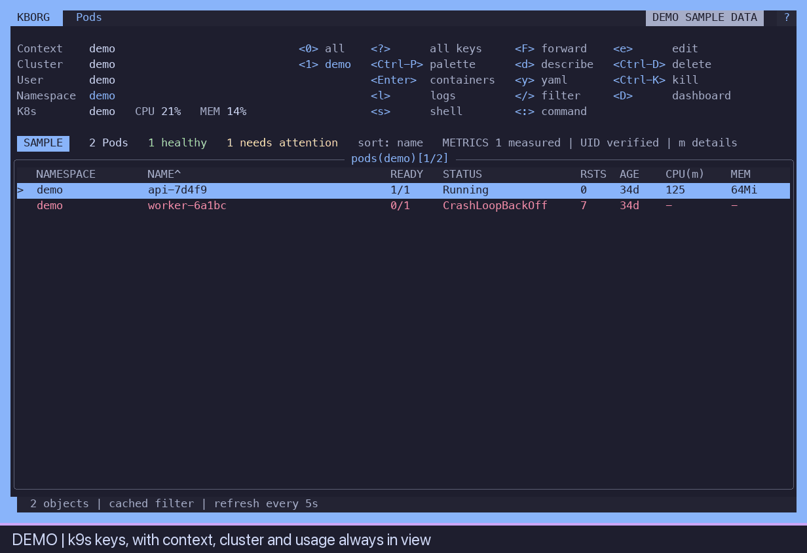
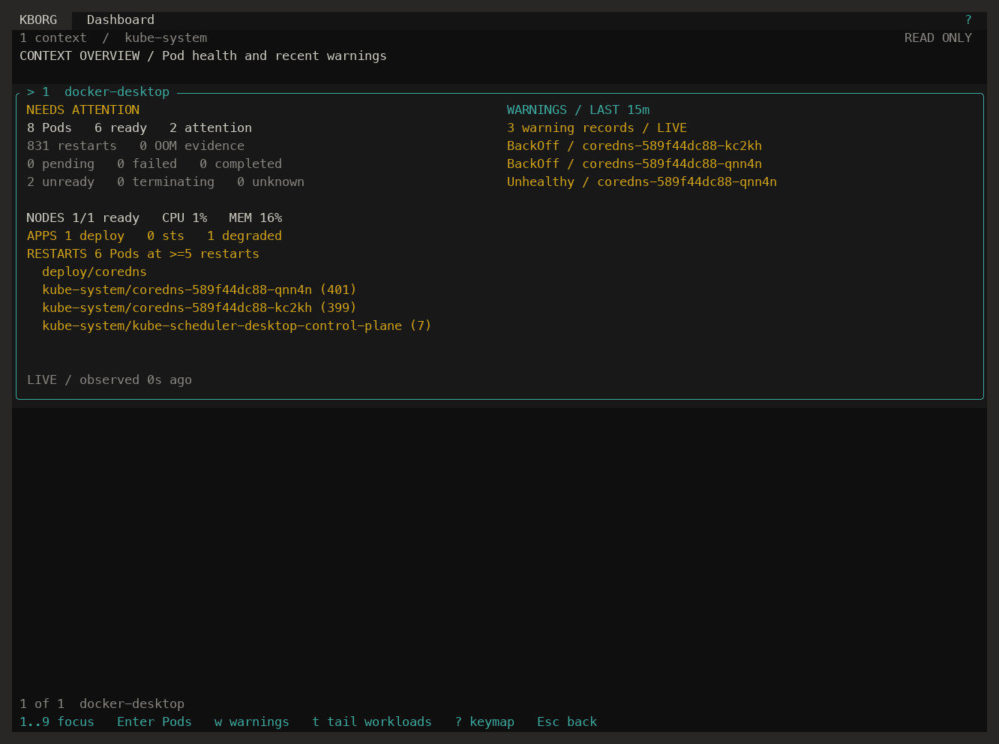
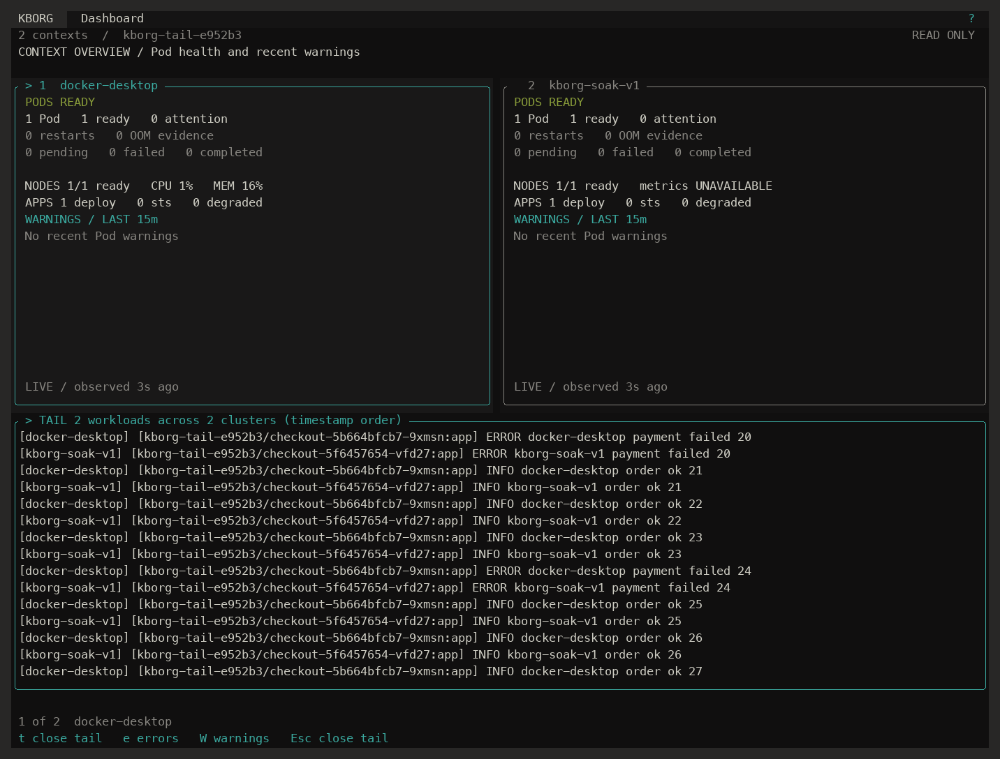
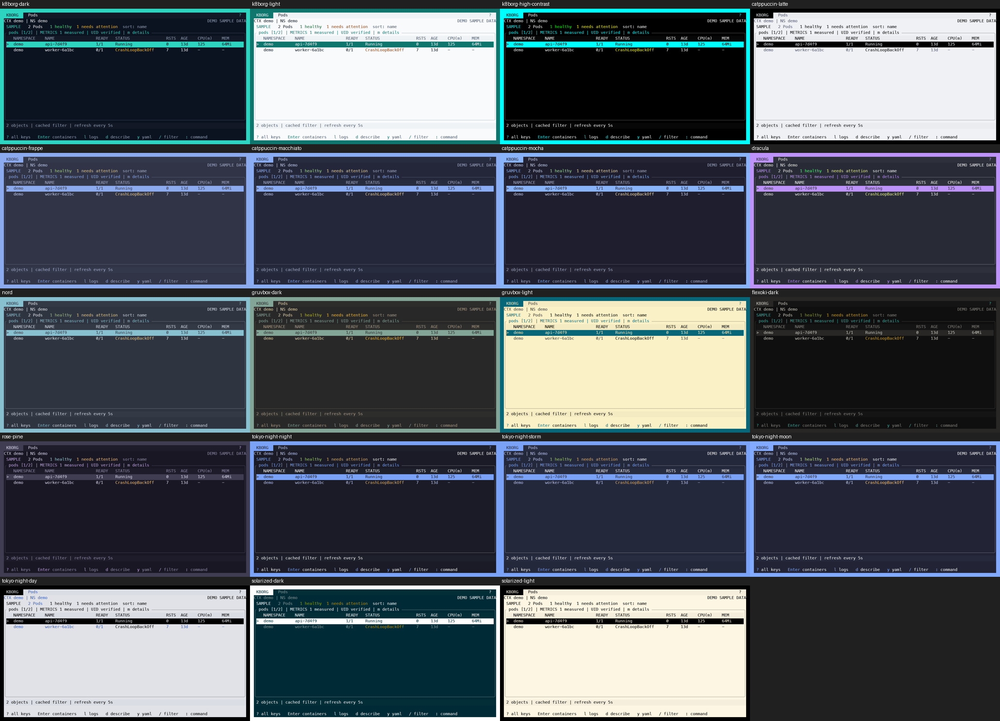

<div align="center">
  <picture>
    <source media="(prefers-color-scheme: dark)" srcset="assets/kborg-logo-dark.png">
    
  </picture>
  <h3>Every cluster at a glance. Every change reviewed.</h3>
  <p>A fast Kubernetes terminal UI with k9s keys, a multi-cluster dashboard and a review before every change.</p>
  <p>
    <a href="#install">Install</a> ·
    <a href="#quick-start">Quick start</a> ·
    <a href="#keys">Keys</a> ·
    <a href="#make-it-yours">Customize</a> ·
    <a href="#copilot-optional">Copilot</a> ·
    <a href="#documentation">Docs</a>
  </p>
  <p>
    
    
    
    
  </p>
</div>



<p align="center"><sub>Recorded from the real binary in <code>kborg demo</code>: sample data, no cluster needed. <a href="docs/FEATURE_TOUR.md">How it was made</a>.</sub></p>

## Why KBorg

- **You already know the keys.** `:pods`, `:deploy`, `/` to filter, `l` logs, `s` shell, `d` describe, Ctrl-D delete. k9s commands, aliases, `views.yaml`, `hotkeys.yaml` and plugins work the way you expect.
- **It is fast.** First data in 0.06 s where k9s takes 0.69 s, about a quarter of its memory on the same cluster, and an 18 MB binary. Moving through 20,000 Pods takes the same 8 ms per key as 5,000. [How this was measured](#performance).
- **Every cluster at once.** A dashboard of up to nine clusters side by side: Pod health, restarts, OOM kills, Node usage, degraded workloads and recent warnings. Tail one workload across all of them in a single pane.
- **Nothing changes without a review.** Scale, delete, edit, apply, drain: each shows exactly what it will do, checks it with a server dry run where Kubernetes supports one, and waits for `y`. `--read-only` turns changes off entirely.
- **Works out of the box.** No flags to learn. Your kubeconfig works as it does in kubectl, including `aws`, `gcloud` and `kubelogin` helpers. KBorg shows the context it is about to connect to and asks first.
- **Yours to shape.** 20 themes, every key remappable, columns per resource, per-cluster settings such as a red `PROD` badge, all in small YAML files that apply the moment you save.

## Install

**macOS and Linux (Homebrew)**

```sh
brew install c0dewars/tap/kborg
```

**Debian, Ubuntu, Fedora, RHEL** — download the package for your CPU from the [latest release](https://github.com/c0dewars/kborg/releases/latest):

```sh
sudo apt install ./kborg_0.5.0_amd64.deb      # Debian / Ubuntu
sudo dnf install ./kborg-0.5.0-1.x86_64.rpm   # Fedora / RHEL
```

**Windows** — download the ZIP for your CPU from the [latest release](https://github.com/c0dewars/kborg/releases/latest), extract it and run `kborg.exe` from Windows Terminal or PowerShell.

**Any platform, from source** (needs Rust):

```sh
cargo install --locked --git https://github.com/c0dewars/kborg --tag v0.5.0
```

Release archives exist for macOS, Linux and Windows on x86_64 and ARM64. Every file is signed; see [verify a download](#verify-a-download). Shell completions: `kborg completions zsh|bash|fish|powershell`.

## Quick start

Try it without a cluster:

```sh
kborg demo
```

Then open the cluster your kubeconfig already points at, or name a context:

```sh
kborg
kborg --context prod-eu
```

KBorg shows the context, cluster and namespace and asks before it connects. From there:

- `:` opens the command prompt (`:deploy`, `:nodes`, `:ns payments`), and `?` lists the keys for the view in front of you.
- `kborg --contexts prod-eu,prod-us,staging` opens the dashboard; `kborg dashboard` brings the last one back.
- `kborg --read-only` only looks. `kborg doctor` checks your terminal, kubeconfig and cluster access and says what to fix.



## What you can do

| Area | What you get |
|---|---|
| **Browse** | Every resource type, including CRDs. Context and namespace switching, regex, fuzzy and label filters, sort by any column, live updates. Failing rows are red and pending rows yellow in every theme. |
| **Inspect** | Describe, YAML and JSON with secrets masked and `/` search inside the text. k9s-style columns per resource (Nodes: role, version, taints, CPU and memory usage), or your own. |
| **Logs** | Container, workload and label-selector logs, merged streams, time ranges, filters, export, and one tail across several clusters. |
| **Operate** | Scale, restart, roll back, delete, edit YAML, apply manifests, port-forward, shell and attach as a full terminal, copy files, cordon and drain Nodes, node shell, debug containers, CronJob trigger. One reviewed batch for up to 50 marked rows. |
| **Dashboard** | One to nine clusters with health, restarts, OOM evidence, Node usage, degraded workloads, warnings and trend charts. |
| **Check** | `:lint` for misconfigurations, `:scan` for image vulnerabilities through your Trivy or Grype, an errors-only view, `:pulses` and `:xray`. |
| **Helm** | Browse releases and history; reviewed install, upgrade, rollback, uninstall and tests, with optional signature verification. |
| **Secrets** | Key names and masked YAML; reveal one value for 30 seconds. Values are never exported or copied. |
| **Metrics** | CPU and memory per Pod and Node, usage against requests and limits, live charts. Needs [metrics-server](https://github.com/kubernetes-sigs/metrics-server#installation); without it KBorg shows `-`, never zero. |
| **Errors** | Messages that say what failed, why and what to do next, down to the exact `kubectl auth can-i` check for a permission problem. |



## Keys

`?` always shows the keys for the view you are in, with your own bindings. The ones you will use most:

| Key or command | Does |
|---|---|
| `:pods` `:deploy` `:svc` `:nodes` … | Open a resource table (k9s aliases and CRDs work) |
| `:ctx`, `:ns`, `0`, `1`–`9` | Switch context or namespace; all namespaces; recent namespaces |
| `/` | Filter rows (`/!` inverse, `/-f` fuzzy, `/-l` label selector) |
| `Enter`, `d`, `y` | Drill down, describe, YAML; `/` then `n` / `N` searches inside |
| `l`, `p` | Logs, previous logs |
| `s`, `a`, `F` | Shell, attach, port-forward |
| `s`, `r` on workloads | Scale, restart |
| `e` | Edit the YAML spec |
| Ctrl-D, Ctrl-K | Delete, force kill |
| `Space` | Mark rows for one batch delete, restart or suspend |
| `c`, `u`, `r` on Nodes | Cordon, uncordon, drain |
| `N` `A` `S` `R` `C` `M`, `:sort COLUMN` | Sort by name, age, status, readiness, CPU, memory, or any column |
| Ctrl-Z, Ctrl-W | Only rows that need attention; wide columns |
| `D`, `kborg dashboard` | Dashboard |
| `:helm`, `:secrets`, `:lint`, `:scan`, `:metrics` | Releases, Secrets, checks, scans, metrics |
| Ctrl-P | Command palette: fuzzy search every action, command and recent object |
| Ctrl-G | Ask Copilot about the screen ([optional](#copilot-optional)) |

The [k9s compatibility map](docs/K9S_COMPATIBILITY.md) lists every command and the few deliberate differences.

## Performance

Speed is a design goal, and the numbers below are measured, not estimated.

| Measured on a local cluster | KBorg | k9s |
|---|---|---|
| Time to first data | **0.06 s** | 0.69 s |
| Memory, 1,000 objects | **28 MiB** | 118 MiB |
| Memory, 5,000 objects with churn | **71 MiB** | 174 MiB |
| CPU, 5,000 objects with churn | **2.8 %** | 6.8 % |
| Binary size | **18 MB** | 140 MB |

In KBorg's own scale test, a key press redraws in about 8 ms with 5,000 or with 20,000 Pods in the table, and filtering 20,000 Pods takes 0.4 s. These come from one Apple M2 Pro against local clusters; expect different absolute numbers on yours. [Method and full results](docs/PERFORMANCE_COMPARISON.md) · [the regression gate in CI](docs/PERFORMANCE.md).

## Make it yours

Everything lives in KBorg's configuration folder (macOS `~/Library/Application Support/KBorg`, Linux `~/.config/kborg`, or `KBORG_CONFIG_DIR`) as plain data files. Saving one applies it within a second; a mistake keeps the last good settings and tells you the line.

| File | Controls |
|---|---|
| Themes | 20 built in with live preview (`:themes`), each tested for readable contrast; `kborg theme new` for your own — [guide](docs/themes.md) |
| `ui.yaml` | Header style, borders, density, colors, charts, dashboard layout (`kborg ui init`) — [reference](docs/themes.md#uiyaml) |
| `keymap.yaml` | Any key on any screen — [format](docs/K9S_COMPATIBILITY.md#custom-keymap) |
| `views.yaml` | Columns and sort per resource, by predefined name (`ROLE`, `%CPU`, `QOS`) or any `TITLE:.json.path`. `kborg views init` writes the defaults to edit; `:columns` lists what is available — [format](docs/K9S_COMPATIBILITY.md#custom-views-columns-and-sort) |
| `hotkeys.yaml`, `aliases.yaml`, plugins | Your own keys, command names and k9s plugins |
| `contexts/NAME.yaml` | Per-cluster namespace, view, theme, header badge, read-only or typed confirmations (`:ctx-config`) — [reference](docs/themes.md#per-context-settings) |



## Copilot (optional)

KBorg can ask GitHub Copilot about what is on your screen. It needs the Copilot CLI and a Copilot plan, and it is entirely optional.

```sh
kborg copilot setup
```

Setup finds your installed `copilot` and `gh`, reuses the account `gh` is signed in with, and takes about a minute. Then Ctrl-G (or `:ask QUESTION`) asks about the view in front, `f` on an answer asks a follow-up, and `:copilot` sends a minimized diagnostic for the selected object.

Before anything is sent you see the exact text and approve it. Answers are advice only; KBorg never runs what Copilot suggests. Copilot itself runs in a sandbox that can reach only GitHub.

**Answers inside KBorg currently work on Apple Silicon Macs only.** On other platforms setup completes the GitHub sign-in and says so. [Setup, enterprise hosts and limits](docs/COPILOT_INTEGRATION.md).

## For teams

- **Policy in one file.** An operator `--config` can switch off any capability (`"allow_node_shell": false`), force read-only or require typed confirmations. It can only take capabilities away. [Operations](docs/OPERATIONS.md)
- **Per-cluster safety.** Mark production read-only or give it a red badge with `contexts/NAME.yaml`.
- **Audit trail.** Every change can be written to a hash-chained file or syslog for your SIEM, and `kborg audit verify` detects tampering. [Audit sink](docs/OPERATIONS.md#audit-sink-for-a-siem)
- **Signed releases.** Every release file carries a Sigstore signature and GitHub build provenance.

### Verify a download

```sh
gh attestation verify kborg-0.5.0-aarch64-apple-darwin.tar.gz --repo c0dewars/kborg
```

`cosign verify-blob` and the checksum file work too; see [Release process](docs/RELEASE_PROCESS.md#verify-a-release-asset).

## Security

- Every change shows a review first; supported changes are dry-run on the server and tied to the exact object version you reviewed.
- Known sensitive fields are masked, Secret values stay hidden until you reveal one, and nothing is exported or copied.
- Dashboard and log connections have every write capability removed.
- No telemetry.

KBorg has had internal security reviews but no independent audit. Details and limits: [SECURITY.md](SECURITY.md).

## Requirements

- Windows, macOS or Linux with a kubeconfig, and Kubernetes 1.34 or newer.
- Any modern terminal. Ghostty, kitty, WezTerm, Alacritty, iTerm2, VS Code and Windows Terminal get 24-bit color; Terminal.app, tmux and screen get 256 colors; plain consoles fall back to 16 colors and ASCII.
- The header's key hints and one-item-per-line layout need a 100x24 terminal; smaller ones get a compact header.

Good to know: the macOS release binaries are signed but not yet notarized, so macOS may ask you to confirm the first run of a downloaded binary. The Homebrew install builds from source and is not affected.

## Documentation

| Guide | Contents |
|---|---|
| [Release notes](docs/RELEASE_NOTES.md) | What is new |
| [k9s compatibility](docs/K9S_COMPATIBILITY.md) | Commands, keys, views, hotkeys, plugins and differences |
| [Themes and ui.yaml](docs/themes.md) | Themes, layout, per-cluster settings |
| [Dashboard](docs/DASHBOARD.md) · [Saved selections](docs/SAVED_SELECTIONS.md) | Health meanings, cross-cluster tail, saved groups |
| [Operations](docs/OPERATIONS.md) | Install, update, team configuration, audit sink, recovery |
| [YAML editing](docs/YAML_EDITING.md) · [Helm](docs/HELM_LIFECYCLE.md) | Reviewed edits and chart workflows |
| [Copilot](docs/COPILOT_INTEGRATION.md) | Setup, enterprise hosts, what is sent, containment |
| [Performance](docs/PERFORMANCE_COMPARISON.md) | Measurements against k9s and k10s |
| [CLI help](docs/CLI_HELP.txt) · [CLI output](docs/CLI_OUTPUT.md) | Scripting with `--json` |
| [Windows through WSL](docs/WSL.md) · [Docker Desktop metrics](docs/DESKTOP_METRICS.md) | Platform notes |
| [Roadmap](docs/ROADMAP.md) · [Feature status](docs/REMAINING_WORK.md) | What is planned and what is not done yet |

## Credits

Navigation follows [k9s](https://github.com/derailed/k9s); the dashboard is inspired by [k10s](https://github.com/mpiorowski/k10s); palettes draw on [Omarchy](https://omarchy.org/themes/) and the theme authors listed in [THIRD_PARTY_NOTICES.md](THIRD_PARTY_NOTICES.md).

Licensed under [Apache 2.0](LICENSE).
