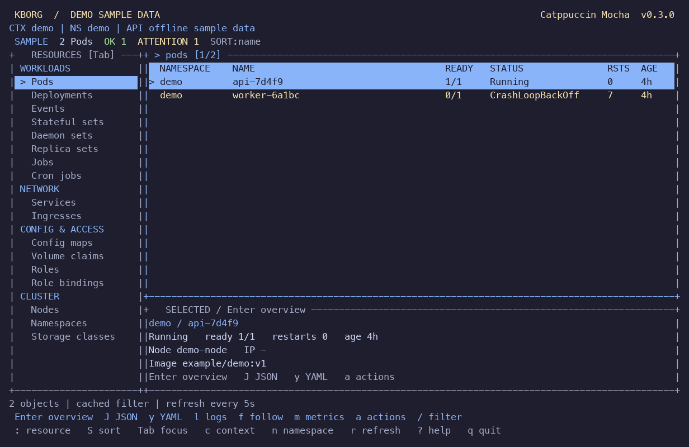

# KBorg

Kubernetes operations, under your control.


Current capabilities and open acceptance gates: [remaining work](docs/REMAINING_WORK.md), [0.3 release notes](docs/RELEASE_NOTES.md), [configuration and operations](docs/OPERATIONS.md).

Rust terminal UI and CLI, read-only by default. Local-testing release **0.3.0**. This is a working first iteration, not a production-certified implementation of every requirement in the development guide.

## Run

Native macOS/Linux:

```sh
cargo build --release --locked
./scripts/start-local.sh --demo
./scripts/start-local.sh --context docker-desktop --no-splash
```

The native launcher uses the release binary under `target/release`; the live
session defaults to read-only. `--demo` explores all 17 built-in resource types
without cluster credentials.

Requirements: Rust 1.99 (pinned), the platform linker (Visual Studio C++ tools on Windows), and a terminal. Docker Desktop with Kubernetes and kubectl are needed only for local integration tests. Cargo downloads the pinned dependencies on first build. Git is useful for development. No Node/Python runtime, AI account, Helm, or kubectl runtime backend is required.

```powershell
cd C:\Users\Garcia\Desktop\projects\k8borg
cargo build --release
.\target\release\kborg.exe demo
```

For a real cluster, use an explicitly selected trusted kubeconfig and a least-privilege identity:

```powershell
.\target\release\kborg.exe --kubeconfig <file> --context <context> -n <namespace>
.\target\release\kborg.exe --kubeconfig <file> list pods --json
.\target\release\kborg.exe --help
```

Existing Docker Desktop admin kubeconfig works, but the fixture reader is preferable for local testing. No kubeconfig changes are made. Certificate/token authentication is supported. Unix ExecCredential helpers require a reviewed absolute native executable, a context/endpoint/CA-bound trust policy and explicit `--allow-auth-helper --auth-helper-policy FILE`. Legacy auth providers remain rejected. All real clusters are labeled PRODUCTION.

## Docker Desktop acceptance and local fixtures

Run checks, inspect the local endpoint, then explicitly approve that endpoint for the test harness:

```powershell
.\scripts\Check.ps1
kubectl --context docker-desktop config view --minify -o 'jsonpath={.clusters[0].cluster.server}'
.\scripts\Test-DockerDesktop.ps1 -ExpectedServer 'https://127.0.0.1:64170' -KeepFixtures
.\scripts\Start-Local.ps1
.\scripts\Start-Local.ps1 -Theme catppuccin-mocha
.\scripts\Start-Local.ps1 -Write
```

The example port is this machine's verified endpoint at authoring; Docker Desktop can choose a different port. Supply the endpoint you inspected. The harness rejects nonlocal hosts, non-HTTPS, missing CA data, or a mismatch. It creates only a unique owned namespace with digest-pinned synthetic workloads and restricted service accounts. It never resets Docker Desktop or switches the current context. Test credentials expire after one hour; rerun the harness to get fresh credentials. Old retained runs should be cleaned up using their run IDs.

Live tests cover resource reads, real RBAC-denied access, logs, ConfigMap redaction, Secret rejection, scale/restart/delete and stale-version conflict. They use the API through Rust, not kubectl for application operations. The operator fixture has workload patch rights for local tests; it is not a recommended production role, because server-side policy must independently constrain patch fields.

```powershell
.\scripts\Cleanup-Local.ps1 -RunId <12-character-run-id>
```

Omit `-KeepFixtures` for automatic cleanup. Failed runs clean up even when retention was requested. `test-results/` has sanitized reports; `.local/` holds credential files with restricted Windows directory ACLs and is ignored by Git. Deleting the namespace invalidates its service-account identities. Never commit these credentials or use real production data in fixtures.

## Interface



Tab changes focus between resources and objects. Responsive bordered panels show readiness, restarts and age when space permits. Type `:pods`, `:deploy`, `:svc` or `:nodes` for quick navigation, `:ns NAME` for namespace, `:all` for all namespaces, and `:sort name|namespace|status|restarts|age` to sort. `S` cycles sorting; PageUp/PageDown/Home/End navigate tables. Up/down or j/k navigate, Enter opens a readable object overview, `J` opens redacted JSON, `/` filters cached names, `r` refreshes, `c` selects context, `n` changes namespace (`*` means all namespaces), `R` discovers resources/CRDs, `m` opens pod/node metrics with bounded CPU/memory history and five-second refresh, `w` switches live watch/polling, `y` opens YAML, `l` selects bounded pod logs, `L` previous logs, `f` follows a selected container, `o` opens continuous independent context watches, `e` reviews an image edit, `V` reviews deployment CPU/memory requests and limits, `E` reviews an interactive pod shell, `a` opens actions, `t` opens themes, `?` shows help, Esc closes and `q` exits. Click resource/object rows or scroll using the mouse. ASCII rendering is conservative: non-ASCII display characters become `?`; raw JSON retains safely escaped Unicode.

Live clusters use bounded LIST/WATCH with bookmarks, reconnect/backoff and expired-version relisting. Use `--poll` or `w` for explicit five-second polling; offline demo uses polling. Failed requests mark data STALE. Reads are limited to 1,000 objects/8 MiB retained data, with 200-object pages and 8 MiB response bodies. Narrow namespace scope when TRUNCATED appears. Log snapshots require `--allow-logs` and are capped at 200 lines/256 KiB. Follow defaults to one hour, with `--log-seconds 1..86400`; the TUI retains the newest 2,000 lines/256 KiB and marks evictions/truncation. Quiet streams remain open. A stream stops at 64 MiB received, its configured deadline, transport failure, or 1 MiB/5,000-line per-second flood limits. Logs can still contain sensitive data.

Mutations require `--write`, a server dry-run and exact `namespace/name` confirmation within 60 seconds. `s` scales deployments (0..20), `x` restarts, `V` sets four reviewed container CPU/memory request/limit fields, and Delete deletes an allowed individual object. UID/resourceVersion preconditions reject stale targets; no automatic mutation retries. System namespaces and cluster-scoped mutations are blocked. Generic edits, force deletion and finalizer manipulation are absent. Confirm the complete displayed target before typing; on small terminals enlarge the window to inspect long targets. Noninteractive writes are rejected.

## Themes

18 bundled choices: KBorg Dark/Light/High Contrast; all four Catppuccin flavors; Dracula; Nord; Gruvbox Dark/Light; Tokyo Night Night/Storm/Moon/Day; Solarized Dark/Light; host Terminal mode. Safety-critical low-contrast upstream colors are adapted to meet the project's fixed-palette targets. Theme families are credited in `THIRD_PARTY_NOTICES.md`; this is an unofficial adaptation.

```powershell
.\target\release\kborg.exe theme list
.\target\release\kborg.exe theme use catppuccin-mocha
.\target\release\kborg.exe theme new my-theme --base catppuccin-mocha
.\target\release\kborg.exe theme validate <file.json>
.\target\release\kborg.exe theme preview <file.json>
.\target\release\kborg.exe theme install <file.json>
.\target\release\kborg.exe theme export catppuccin-mocha --output .\custom.json
```

See `docs/themes.md`. Themes never execute code or access the network. Install refuses overwrites. Use `theme replace FILE` for a validated replacement with an original `.json.bak` retained; it refuses to overwrite an existing backup. `theme clone-current ID` creates a new theme from the current resolved colors. Built-in IDs cannot be replaced. The TUI previews with arrows, saves on Enter and restores on Esc. Press `N` in the theme picker to create and activate a named custom theme from the actual preview palette; existing files are never overwritten. Selection under `--theme` is session-only. `NO_COLOR` and `--color=never` disable colors. JSON output contains no theme styling.

## Security and scope

TLS validation is required. Secrets are excluded from built-in and discovered kinds. Common secret-bearing fields (data, annotations, literal environment values, tokens/credentials and managed fields) are masked for display/export. Redaction is not a complete classifier of business data. Terminal controls are removed from text and diagnostic content. No telemetry or object persistence is enabled.

Writes use a local durable intent/outcome audit spool; this is supplementary and mutable by the operator, not centralized protected audit. Windows config directories outside the test harness inherit their existing user ACLs; verify them before using writes on sensitive clusters. Same-user path replacement races are not eliminated by symlink checks. Authentication revocation, malicious local software and cluster admission remain outside the client trust boundary.

The current development iteration adds reviewed native stdin/TTY sessions, longer rolling logs, continuous context watches, resource-budget edits and optional metrics comparisons to the 0.3 baseline. Each privileged operation requires separate opt-in and target review. Automatic AI diagnosis, generic YAML apply, remote full-screen applications, interactive external pagers/editors, signed distribution and protected centralized audit remain incomplete or gated. This prerelease is suitable for isolated local testing; see `docs/REMAINING_WORK.md` for the current acceptance register.

## Startup and first use

Interactive startup shows a two-second ASCII KBorg animation. Any key skips it. Use `--no-splash`, set `KBORG_NO_SPLASH`, or run `kborg startup off` to disable it persistently (`startup on` restores it). Animation never runs in CLI/JSON commands. The first interactive launch opens the theme picker with Catppuccin Mocha selected; Enter chooses a theme and Esc keeps Mocha. Explicit `--theme` overrides onboarding for that session.

## Optional GitHub Copilot preparation

KBorg supports only GitHub Copilot as the planned AI provider. Current commands prepare a small local diagnostic JSON file and hand login to an explicitly selected trusted official Copilot CLI. KBorg sends no model request and never gives AI write authority. Copilot CLI is optional and is not installed or downloaded by KBorg.

```powershell
kborg --kubeconfig <file> -n <namespace> copilot context pods <name> --output <new-file.json>
kborg copilot login --cli <absolute-trusted-copilot-executable> --host github.com
kborg copilot login --cli <absolute-trusted-copilot-executable> --host acme.ghe.com
```

Context export omits object names, cluster identity, workload specs, logs, labels and arbitrary status messages. Bounded type/reason strings can still contain confidential text or prompt injection: inspect before manually sharing. Copilot manages login credentials and may have its own telemetry/storage. Do not assume GitHub Enterprise Server login provides a Copilot service; supported login hosts are GitHub.com and GitHub Enterprise Cloud data-residency `*.ghe.com`. See [official Copilot authentication](https://docs.github.com/en/enterprise-cloud%40latest/copilot/how-tos/copilot-cli/set-up-copilot-cli/authenticate-copilot-cli).

Automatic AI diagnosis remains a production gate requiring isolation, tested tool denial, explicit per-request payload review and policy evidence. Other AI providers are excluded. The current UI refinement has native PTY captures and a retained short CPU/memory sample; longer soak and accessibility acceptance remain open.

## Platform, security and performance evidence

See `docs/SECURITY_REVIEW.md`, `docs/USER_ACCEPTANCE.md`, `docs/RELEASE_PROCESS.md`, and the WSL/performance reports. Build automation targets Windows, Linux and macOS on x64/ARM64. Platform artifacts count as built only when the corresponding native job succeeds; packaging is unsigned. Multiple kubeconfig aliases to one cluster test context handling, not independent cluster capacity.

## Kubernetes and GitHub support targets

The minimum Kubernetes target is 1.34. API bindings use the 1.34 schema to avoid accidentally depending on newer typed fields; discovery and dynamic objects adapt to available server resources. Supported-version claims are limited to the live compatibility evidence in docs/KUBERNETES_COMPATIBILITY.md. Newer Kubernetes releases require continuing compatibility tests. GitHub integration targets GitHub.com and Enterprise Cloud *.ghe.com; Enterprise Server is outside the configured Copilot login scope.


## Live watches and metrics (0.2)

```powershell
kborg --kubeconfig <file> -n <namespace> watch pods --json
kborg --kubeconfig <file> -n <namespace> metrics pods --json
kborg --kubeconfig <file> metrics nodes
kborg --kubeconfig <file> --poll
kborg --demo metrics pods
```

`watch --json` emits bounded snapshot JSONL, not raw events. Each view owns one cancellable watch and one coalesced update slot. Old scope events are discarded; row selection follows namespace/name/UID, and scale input captures its original name/UID. Bookmarks retain resume versions; HTTP 410 relists. Authorization denial clears the cache and stops requests until explicit reconnect. Authorization changes apply on new requests: an existing watch can continue until its bounded eight-second server lifetime ends. Unsupported or missing watch endpoints stop with polling/catalog guidance. No automatic permission fallback occurs.

A watch cannot represent a complete view above its 1,000-object/8 MiB cache budget: it clears data, displays STALE/TRUNCATED and stops. Narrow the namespace or explicitly select polling for bounded partial results. Individual response streams are also capped at 8 MiB. Input remains responsive during background reads; obsolete watches are aborted at scope changes.

Pod/container and node usage come from `metrics.k8s.io/v1beta1`; this requires an installed and correctly secured Metrics Server or compatible provider. The app never installs one. CPU is normalized using checked integer nanocores and exact decimal millicores; memory uses checked bytes. Raw quantities, measurement timestamp/window and any upward rounding remain explicit. Missing, forbidden or malformed metrics produce errors and do not invalidate resource browsing or fabricate zero usage. Success and error dialogs wrap for narrow terminals. Press `M` or use `--metrics-resources` for an explicit extra pod/node read and usage comparisons with current requests/limits or allocatable/capacity. Percentages use checked integer arithmetic and are omitted for missing/zero/invalid bases. Missing Metrics API UID receives a qualified name-based label; known UID changes or resources created after measurement suppress comparisons. No percentages are inferred without a known positive denominator. The metrics modal retains up to 64 identities with 60 samples each for ten minutes, shows exact latest/min/max values and ASCII charts, marks missing/error measurements as gaps, and resets history on context/scope/namespace or known UID changes. Repeated API timestamps do not create new samples.

See `docs/WATCH_METRICS_REVIEW.md` and `docs/WATCH_METRICS_UX.md` for actual and controlled-test distinctions. Remaining production gates and broader roadmap features still apply.

### Rename compatibility

The product and executable are now **KBorg** and `kborg`. Use `KBORG_CONFIG_DIR` and `KBORG_NO_SPLASH`; the previous `K8BORG_CONFIG_DIR` and `K8BORG_NO_SPLASH` remain accepted. The new configuration override takes precedence. Default settings live under `KBorg` on Windows/macOS and `kborg` on Linux; an existing legacy directory is reused when the new directory does not exist. No credentials or settings are moved automatically.

The three built-in theme identifiers `k8borg-dark`, `k8borg-light`, and `k8borg-high-contrast` remain stable for existing preferences and custom theme inheritance; their displayed names use KBorg. Existing local fixture launch and cleanup scripts also accept the recorded legacy fixture identity. Historical release reports, test evidence, and the original logo concept retain the original name to preserve their provenance.
## Reviewed external views (Unix)

```sh
kborg --context docker-desktop --allow-tools view pods POD --tool /bin/cat
kborg --demo --allow-tools view pods api-7d4f9 --yaml --tool /usr/bin/head --tool-arg -n --tool-arg 20
```

An interactive review displays the exact argv and complete redacted input; type
`RUN TOOL` to execute the absolute trusted native binary. KBorg uses no shell,
clears the supplied environment, and captures/sanitizes at most 256 KiB of output
within 15 seconds. The trusted tool keeps your OS-user filesystem/network
permissions. This feature is a bounded read-only filter, and never applies tool
output to Kubernetes. Interactive editors/pagers and Windows tool supervision
remain unsupported. See [tool view limits](docs/OPERATIONS.md#reviewed-external-views).

For native local acceptance, inspect the Docker Desktop endpoint and run
`scripts/test-local.py --expected-server https://127.0.0.1:PORT`. It provisions
uniquely owned restricted fixtures, runs operation/watch/subresource tests, and
removes its namespaces and temporary ten-minute credentials.

## Interactive sessions and native inspection

```sh
kborg --context docker-desktop -n YOUR_NAMESPACE --write --allow-exec --interactive --session-seconds 900 exec POD CONTAINER -- sh
kborg --context docker-desktop -n YOUR_NAMESPACE --write --allow-attach --interactive attach POD CONTAINER
kborg --context docker-desktop -n YOUR_NAMESPACE --interactive view pods POD
kborg --context docker-desktop --follow --json overview CONTEXT_A CONTEXT_B
kborg --context docker-desktop --write set-resources DEPLOYMENT CONTAINER 100m 64Mi 500m 128Mi
```

Sessions support stdin, remote TTY resize, local `Ctrl-]` disconnect and terminal
restoration. Output allows printable UTF-8, line editing controls and selected
SGR; clipboard/OSC, hyperlinks, queries, cursor/private controls and bidi are
removed. Remote full-screen applications remain unsupported. Sessions last at
most 1..3600 seconds and stop at 16 MiB output/1 MiB input; disconnect does not
prove remote termination. All ordinary-container sessions retain separate
capabilities, exact target review and UID/resourceVersion rechecks.

The built-in `view --interactive` pager launches no external tool. It supports
search, page/home/end navigation, horizontal pan, resize and JSON/YAML toggling.
Native tool filters remain separately reviewed and time/output bounded.

`extensions register NAME --tool ABS [--tool-arg ARG]` creates a private data-only
registration after `REGISTER EXTENSION`; every invocation still requires
`--allow-extensions --allow-tools extensions run NAME RESOURCE OBJECT` and a fresh
complete `RUN TOOL` input review. Executable updates invalidate registrations;
arguments remain literal. No output is applied to Kubernetes and no in-process
plugin is loaded. Trusted native programs retain OS-user permissions.

`copilot preflight --cli ABS_NATIVE --host github.com` fingerprints a selected
SDK and checks fresh fake-file sandbox canaries without reading real tokens or
making a model request. `copilot preview RESOURCE NAME --host HOST` shows a local
minimized bundle. Automated diagnosis remains disabled until independent
hostname-bound egress, dedicated credential authority and publisher provenance
are validated.

Current local acceptance and screenshots: [priority session](docs/PRIORITIES_ACCEPTANCE.md).
