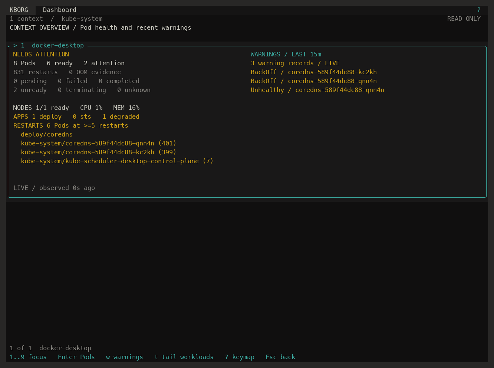
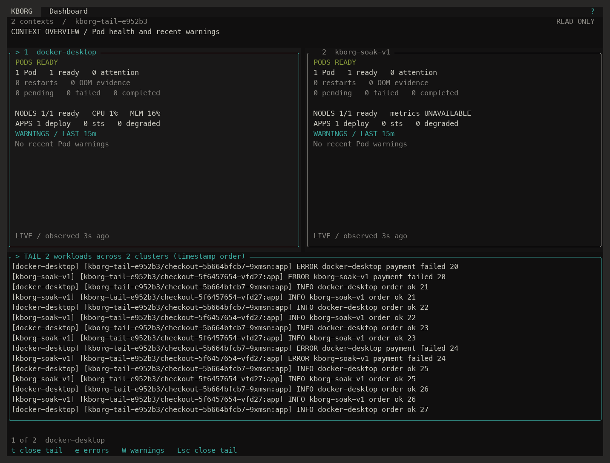
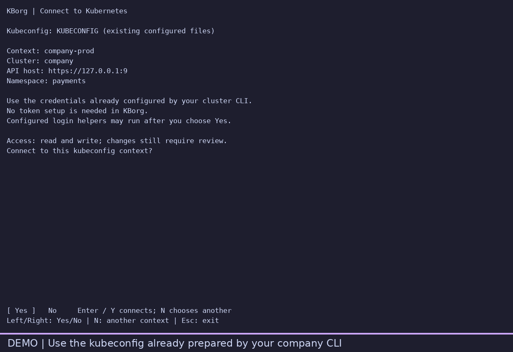
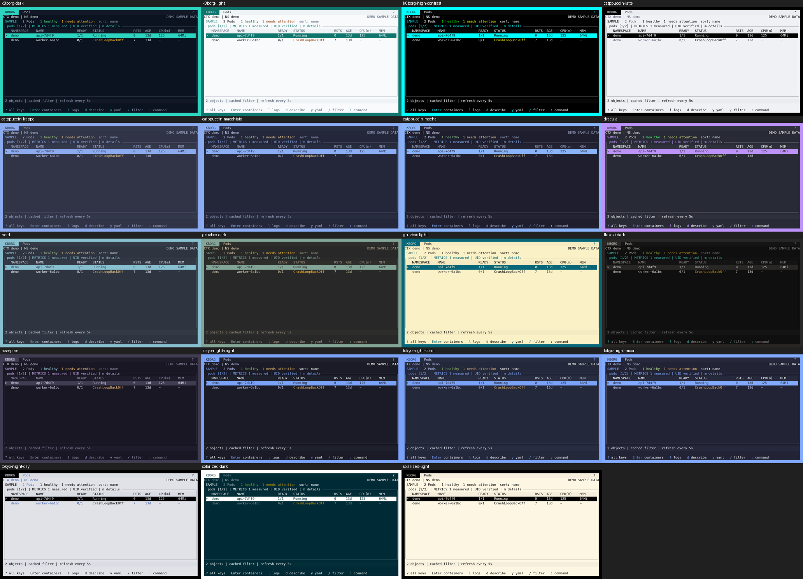

<div align="center">
  <picture>
    <source media="(prefers-color-scheme: dark)" srcset="assets/kborg-logo-dark.png">
    
  </picture>
  <h3>Every cluster at a glance. Every change reviewed.</h3>
  <p>A fast Kubernetes terminal workspace with k9s muscle memory, a k10s-style multi-cluster dashboard, and reviewed operational workflows.</p>
  <p>
    <a href="#install">Install</a> ·
    <a href="#run">Run</a> ·
    <a href="#keys-for-k9s-users">Keys</a> ·
    <a href="#copilot-advice-optional">Copilot setup</a> ·
    <a href="docs/ROADMAP.md">Roadmap</a> ·
    <a href="docs/REMAINING_WORK.md">Feature status</a>
  </p>
  <p>
    
    
    
    
    
  </p>
</div>


<p align="center"><sub>Catppuccin Mocha feature tour recorded in <code>kborg demo</code>: synthetic data, no cluster or credentials. Operational screens are previews, not real changes. <a href="docs/FEATURE_TOUR.md">Coverage and reproduction</a>; regenerate with <code>scripts/make-demo-gif.py --tour --binary PATH</code>.</sub></p>



## Why KBorg

- **You already know the keys.** `:pods`, `:deploy`, `/filter`, `l` logs, `s` shell, Ctrl-D delete — k9s navigation, commands, aliases and `hotkeys.yaml` work the way you expect.
- **See all your clusters at once.** Up to nine clusters side by side: Pod health, restarts, OOM kills, Node readiness and CPU/memory, degraded Deployments and StatefulSets, and recent warnings, each updating independently.
- **Follow one workload across every cluster.** Pick Deployments from any cluster and tail them together in one pane, merged in timestamp order and tagged by cluster.
- **Works out of the box, like k9s.** No flags to learn: shell, logs, edits, apply, port forwards, node shell, Helm, Secrets and scans are all on. Your kubeconfig works as it does in kubectl, including aws/gcloud/kubelogin exec helpers, impersonation and proxies.
- **Review changes before applying them.** Operations show their target and effect; supported Kubernetes mutations also use server dry-run. `y` or Enter confirms, `n` or Esc cancels. Shells, forwards and other connection subresources have no server dry-run. Use `--read-only` when you only want to look, and company profiles for stricter controls.
- **Discover Copilot from inside the app.** `:ask` opens a question or a visible setup/status screen; `:copilot setup` explains the next step. Contained inference currently works on **macOS ARM64** with the supported runtime and an entitled GitHub account. Windows/Linux browsing works independently; contained AI is not yet available there. [Setup and platform limits](docs/COPILOT_INTEGRATION.md).
- **Measured speed and resource use.** Recorded side-by-side tests cover first data, 5,000 live objects, CPU, memory and network traffic ([methods and results](docs/PERFORMANCE_COMPARISON.md)). These are source/environment-specific measurements, not a guarantee for every cluster. The manual CI performance gate checks new builds.
- **Designed for modern terminals.** 20 hand-tuned themes that meet WCAG AA contrast everywhere they're drawn (plus your terminal's own palette), 24-bit color with graceful fallback, and a quiet layout with contextual key hints.
- **Make it yours.** Like an Omarchy desktop, everything is data you control: remap any key (`keymap.yaml`), restyle the UI (`ui.yaml`: borders, header, density, colors, chart style), choose columns per resource (`views.yaml`), add hotkeys and aliases. `?` always shows the keys for the screen you're on, with your bindings.
- **See trends, not just snapshots.** Live CPU and memory charts per Pod or Node, and trend charts for every cluster on the dashboard.

## Features

| Area | What you get |
|---|---|
| **Browse** | 35 built-in resource types, CRDs via discovery, context/namespace switching, regex/fuzzy/label filters, sorting, redacted describe/YAML/JSON, live watches |
| **Dashboard** | 1–9 clusters, full-screen focus, Pod health, restart hotspots, OOM evidence, Node readiness + CPU/memory, degraded workloads, Pod and non-Pod warning events, warning → exact Pod Events drilldown |
| **Logs** | Container, workload and selector logs; merged multi-container streams; live rollout following (`:logs-live`); cross-cluster workload tail; time ranges, search, error/warning filters, export |
| **Operate** | Scale, restart, rollback, delete, force kill, reviewed batches on marked rows (up to 50), CronJob trigger and suspend/resume, YAML spec editing (in-app or `$EDITOR`), server-side apply of local manifests, image/resource forms, cordon/uncordon/drain, node shell, ephemeral debug containers, port forwards, shell/attach as a full terminal (vim, top, less; Ctrl-] returns), file and directory copy — each reviewed first, confirmed with one key |
| **Errors** | Actionable guidance for common Kubernetes, network and kubeconfig errors: RBAC, TLS, DNS, timeout, conflict, admission and quota; RBAC guidance includes a scoped `kubectl auth can-i` command |
| **Check** | `:lint` misconfiguration report, `:scan` image vulnerability scan through your Trivy or Grype, Ctrl-Z errors-only view, `:pulses` health, `:xray` relationships, busiest Nodes on dashboard cards, port-forward benchmark |
| **Helm** | Release browsing and history; reviewed install, upgrade, rollback, uninstall and tests for packaged and OCI charts with optional OpenPGP/Sigstore verification |
| **Secrets** | Key listing and masked YAML/describe (`y`/`d`: values shown as sizes, TLS subject/expiry, registry hostnames); reveal one value for 30 seconds; never exported or copied |
| **Metrics & charts** | Pod/Node CPU and memory tables with exact values and request/limit comparisons; live charts (`g` in `:metrics`) with units and % of request, limit or allocatable; dashboard trend charts (`G`) and 15-minute sparklines; braille, block or ASCII rendering |
| **Copilot** | Minimized diagnostic preview, `:ask` about the current screen, exact account approval, contained native runtime (macOS ARM64) |
| **Workspace** | Saved context groups and scopes, remembered dashboard (`kborg dashboard`), k9s-format `views.yaml` columns, sort by any column, recent namespaces on `1`–`9`, custom aliases and k9s-format hotkeys, every key remappable on every screen (`keymap.yaml`, `?` help per screen, `:keymap`), Ctrl-P command palette, UI styling (`ui.yaml`), reviewed extensions and k9s plugins with `$VARIABLES` and shortcuts (`:ext`, `kborg extensions import-k9s`), 20 themes plus custom palettes, shell completions |



## Install

**Requirements:** Windows, macOS or Linux, an existing kubeconfig, and an interactive terminal. Truecolor is preferred; 256/16-color and monochrome output are supported. Some external-tool and AI integrations remain Unix/macOS-specific; see [feature status](docs/IMPLEMENTATION_STATUS.md). Building from source needs Rust (the pinned toolchain installs automatically through `rustup`) and on macOS the command-line developer tools (`xcode-select --install`).

### Windows

Extract the Windows ZIP matching your CPU, open Windows Terminal or PowerShell in that directory, and run `./kborg.exe`. Keep the CLI/login environment that configured your kubeconfig; no separate KBorg token setup is required. Add the extracted directory to PATH if you want to run `kborg` from any folder. Native Windows packages and their build evidence are available in the manually dispatched [Actions builds](https://github.com/c0dewars/kborg/actions/workflows/ci.yml); download the artifact for your exact source/architecture.

### With Homebrew (macOS and Linux)

```sh
brew install c0dewars/tap/kborg
```

The formula builds KBorg from the tagged source with Homebrew's Rust and installs bash, zsh and fish completions. Upgrade with `brew upgrade kborg`.

### Try the 0.5.0 preview

```sh
cargo install --locked --git https://github.com/c0dewars/kborg --tag v0.5.0-rc.5
```

The tag is the published RC snapshot, the same version Homebrew installs. To test changes made since, use `--branch release/next` instead of `--tag v0.5.0-rc.5`. The [testing guide](docs/TESTING.md) has a 15-minute tour and what to report.

### From source

```sh
git clone https://github.com/c0dewars/kborg.git
cd kborg
cargo build --release --locked
```

Put the binary on your `PATH`:

```sh
mkdir -p ~/.local/bin
cp target/release/kborg ~/.local/bin/
kborg --version
```

Add shell completions (zsh shown; `bash`, `fish` and `powershell` also work):

```sh
kborg completions zsh > ~/.zfunc/_kborg
```

### From a release archive

Download the archive for your OS and CPU (for example `kborg-0.4.0-aarch64-apple-darwin.tar.gz`), get its SHA-256 through a trusted channel, and compare before extracting:

```sh
shasum -a 256 kborg-0.4.0-aarch64-apple-darwin.tar.gz
tar -xzf kborg-0.4.0-aarch64-apple-darwin.tar.gz
```

Releases built by the signed release workflow carry a Sigstore bundle (`FILE.sigstore.json`) and GitHub build provenance for every asset. Verify before installing:

```sh
gh attestation verify kborg-0.6.0-aarch64-apple-darwin.tar.gz --repo c0dewars/kborg
cosign verify-blob kborg-0.6.0-aarch64-apple-darwin.tar.gz \
  --bundle kborg-0.6.0-aarch64-apple-darwin.tar.gz.sigstore.json \
  --certificate-identity-regexp '^https://github\.com/c0dewars/kborg/\.github/workflows/release\.yml@refs/tags/v' \
  --certificate-oidc-issuer https://token.actions.githubusercontent.com
```

Releases up to 0.5.0-rc.3 are unsigned. See [Release process](docs/RELEASE_PROCESS.md#verify-a-release-asset) for details and [Operations](docs/OPERATIONS.md) for updates and rollback.

### Debian/Ubuntu (.deb) and Fedora/RHEL (.rpm)

```sh
sudo apt install ./kborg_0.5.0.rc.5_amd64.deb      # Debian / Ubuntu
sudo dnf install ./kborg-0.5.0.rc.5-1.x86_64.rpm   # Fedora / RHEL-compatible
```

Both install `/usr/bin/kborg` and bash, zsh and fish completions, and need glibc 2.39 or newer. CI builds the .deb; the .rpm is built from `packaging/rpm/kborg.spec`. See [Operations](docs/OPERATIONS.md#install-from-a-deb-or-rpm).

## Run

These instructions describe 0.5.0-rc.5, the version Homebrew and the `v0.5.0-rc.5` tag install.

Try it without a cluster:

```sh
kborg demo
```

Use the cluster you already configured with your company CLI (for example `orbit-use`), kubectl or a cloud login tool. Run both commands in the same terminal when that tool sets `KUBECONFIG`:

```sh
# Run your usual company login/context command first, then:
kborg
# Or select an existing context explicitly:
kborg --context prod-eu
```

KBorg shows the **context name, cluster and namespace** from the existing kubeconfig before connecting. Press **Enter/Y for Yes**, **N for No** to choose another existing context, or **Esc** to exit. Type to filter the context list; Enter reviews the selection. No API request or credential helper runs before Yes. KBorg does not rewrite the context saved by your company CLI and does not ask you to copy tokens.



If your session has expired, run your usual login tool again and reopen KBorg. A configured credential helper is reused automatically after consent; VPN, cluster permissions and provider login still need to be valid.

The operator default enables available workflows; platform/tool prerequisites still apply: `l` logs, `s` shell, `e` edit, `s` scale, Ctrl-D delete, `F` port forward, `:apply FILE`, `:cp-from`, `s` on a Node for a node shell, `:debug`, `:helm`, `:secrets` and `:scan` (with Trivy or Grype on your PATH). Every change shows a review; `y`/Enter applies, `n`/Esc cancels.

Open the multi-cluster dashboard. KBorg remembers it, so next time `kborg dashboard` brings it straight back:

```sh
kborg --contexts prod-eu,prod-us,staging
kborg dashboard
```

Just looking? `kborg --read-only` turns every change off. Something not working? `kborg doctor` checks your terminal, tools, kubeconfig authentication and cluster access, and says what to fix.

**For companies:** an operator `--config` file can switch any capability off (`"allow_node_shell": false`), force read-only (`"profile": "read-only"`) or require typed confirmations (`"strict_confirmations": true`). See [Operations](docs/OPERATIONS.md).

KBorg reuses your kubeconfig and its configured authentication: the current context unless you pass `--context`, every file in `$KUBECONFIG` merged (first definition wins), exec helpers such as `aws eks get-token`, `gke-gcloud-auth-plugin` and `kubelogin`, impersonation, `proxy-url` and `insecure-skip-tls-verify`. kubectl, Helm, Python and an AI account are not needed for browsing. Server-side RBAC and admission always have the final say.

## Keys for k9s users

| Key / command | Action |
|---|---|
| `:pods` `:deploy` `:svc` `:nodes` … | Open a resource table (k9s aliases, CRDs and `:apps/v1/deployments` work) |
| `:ctx` `:ns`, `:pods @CTX`, `:pods NS` | Switch context or namespace |
| `/` `/!` `/-f` `/-l` | Regex, inverse, fuzzy, label-selector filter |
| `Enter` `d` `y` | Drill down, describe, YAML |
| `l` `p` | Logs, previous logs |
| `s` `a` `F` `f` | Shell, attach, new port forward, forward list |
| `s` `r` on workloads | Scale, restart |
| `e` | Edit YAML spec (Ctrl-E opens `$EDITOR`) |
| Ctrl-D, Ctrl-K | Reviewed delete, reviewed force kill |
| `Space` then Ctrl-D / `r` / `s` | Mark rows, then one reviewed batch delete, restart or CronJob suspend/resume (max 50; type e.g. `delete 7 objects`) |
| `c` `u` `r` on Nodes | Cordon, uncordon, drain |
| `:secrets`, `x`, `y` | Secret keys, reveal one value, masked YAML |
| `:helm`, `:pulses`, `:xray`, `:lint` | Releases, health, relationships, misconfigurations |
| `s` on Nodes, `:apply FILE`, `:dir` then `a` | Node shell, reviewed apply of a manifest |
| `:cp-from` `:cp-to` (`-r`) | Copy files or directories to and from the selected Pod |
| `:pf` then `b`, `:bench` | Benchmark a port forward |
| `:ext NAME`, `hotkeys.yaml` | Run a registered extension; bind keys like k9s |
| `t` `s` on CronJobs, `:rollback [REV]` | Trigger now, suspend/resume; roll back a workload |
| `:debug [CONTAINER]` | Ephemeral debug container in the selected Pod |
| Ctrl-Z, Ctrl-W, `1`–`9` | Errors only, wide columns, recent namespaces |
| `N` `A` `S` `R` (again to reverse), `:sort COL` | Sort by any column; `views.yaml` sets columns |
| `:subjects` `:users` `:groups`, `:can` | RBAC subjects with their roles; one subject's bindings and rules |
| `:ask QUESTION`, `:explain`, `:copilot setup`, `:copilot status` | Ask about the current screen (`f` on an answer follows up), explain the status-line error, connect/sign in or inspect AI availability |
| `D` / `kborg dashboard` | Dashboard |
| Dashboard `1`–`9`, `w`, `L`, `t`, `G` | Focus (again = full screen), select warning, Pod logs, cross-cluster tail, trend charts |
| `:metrics` then `g` | Live CPU and memory chart for the selected Pod or Node |
| `?`, `:keymap` | Keys for the screen you're on (Tab: every screen); every action and its key |
| Ctrl-P | Command palette (KBorg extension): fuzzy search the current screen's actions with their keys, `:` commands, resource kinds, recent contexts, namespaces and objects; Enter runs it like the key, with the same reviews |

The bottom row always shows the keys that work for what's selected and the flags you started with. The [k9s compatibility map](docs/K9S_COMPATIBILITY.md) documents every command and the few deliberate differences.

## Metrics (CPU and memory)

CPU/memory columns, `:metrics` and the dashboard's Node usage need the Kubernetes Metrics API (metrics-server). Check a cluster:

```sh
kubectl --context docker-desktop top nodes
kborg --context docker-desktop metrics nodes
```

If `kubectl top` fails, install a provider:

- **Docker Desktop:** the pinned, TLS-verified helper in [Docker Desktop metrics](docs/DESKTOP_METRICS.md).
- **minikube:** `minikube addons enable metrics-server`, then wait a minute for samples. The addon uses `--kubelet-insecure-tls`, fine for a disposable local cluster only.
- **Other clusters:** upstream [metrics-server](https://github.com/kubernetes-sigs/metrics-server#installation).

Without a provider KBorg keeps working and shows `-` or `metrics UNAVAILABLE`, never zeros.

## Themes



KBorg greets you with a short animated logo that decrypts out of glyph noise, catches a light beam and fades into your workspace. Any key skips it; `kborg startup preview` replays it, and `kborg startup off`, `--no-splash` or `KBORG_NO_SPLASH=1` turn it off.

Pick a theme with `:themes` (live preview) or `--theme catppuccin-mocha` (used throughout the feature-tour GIF). Every fixed built-in theme is tested for 4.5:1 contrast on each surface the UI paints, including dashboard cards and selected rows. Create your own with `kborg theme new my-theme --base rose-pine`; see the [theme guide](docs/themes.md). `NO_COLOR` and `--color=never` turn styling off.

To style and lay out the UI to your taste, run `kborg ui init` and edit the generated `ui.yaml`: borders (rounded, square, ASCII or none), a compact header, hidden key hints, zebra rows, column separators, long ages, local log timestamps, dashboard card columns and per-role color overrides on top of any theme. It is data only and validated; `:ui reload` applies changes live. Every option is listed in the [ui.yaml reference](docs/themes.md#uiyaml).

## Make it yours

Everything below lives in KBorg's configuration directory (macOS `~/Library/Application Support/KBorg`, Linux `~/.config/kborg`, or `KBORG_CONFIG_DIR`). All files are data only, strictly validated and bounded; a broken file shows a notice and KBorg falls back to its defaults.

Saved changes apply live, within about a second, without `:ui reload`: `ui.yaml`, the theme choice and your custom theme file, `keymap.yaml`, `hotkeys.yaml`, `aliases.yaml`, `views.yaml`, plugin registrations and the current context's `contexts/NAME.yaml`. A file that fails validation or the trust checks (symlink, size, writable by other users) is refused: the last good settings stay and the status line names the file, the line or field and the next step. Key changes wait until an open dialog, such as a typed approval, closes. Turn it off with `reload: false` in `ui.yaml` or `KBORG_CONFIG_RELOAD=off`.

| File | Controls |
|---|---|
| `ui.yaml` | Borders, header and hint rows, compact mode, table density, zebra rows, separators, markers, age format, color overrides, chart style, dashboard layout (`kborg ui init`, `:ui reload`) — [reference](docs/themes.md#uiyaml) |
| `keymap.yaml` | Any key on any screen; Enter, Esc and review confirmations stay fixed — [format](docs/K9S_COMPATIBILITY.md#custom-keymap) |
| `views.yaml` | Columns and default sort per resource, including `TITLE:.json.path` columns (k9s format) — [format](docs/K9S_COMPATIBILITY.md#custom-views-columns-and-sort) |
| `hotkeys.yaml`, `aliases.yaml` | Keys and names that run commands (k9s format) |
| `contexts/NAME.yaml` | Per-context namespace, view, theme, header badge (e.g. a red PROD), read-only and strict confirmations; `:ctx-config` edits it — [reference](docs/themes.md#per-context-settings) |
| Themes | 20 built-ins, live preview in `:themes`, `kborg theme new` for your own |

## Terminals

KBorg detects color support from the environment and works without terminfo.

| Terminal | Color |
|---|---|
| Ghostty, kitty, WezTerm, Alacritty, iTerm2, VS Code, Windows Terminal | 24-bit |
| macOS Terminal.app, tmux, screen | 256 colors (24-bit when `COLORTERM=truecolor` is passed through) |
| Linux console, plain `xterm` | 16 colors with ASCII fallback |

**Unicode:** in a UTF-8 locale, object names, logs, YAML and describe text show real glyphs: Japanese and other wide characters and emoji (including ZWJ families and flags) take two cells, combining accents none, and columns stay aligned. Truncation never cuts a character in half. Control, bidi and invisible format characters are still removed. Without a UTF-8 locale, or with `text: ascii` in `ui.yaml`, non-ASCII characters are drawn as `?`. Approval screens always show non-ASCII as `\u{...}` escapes so look-alike characters can be told apart.

**Ghostty:** run `kborg` from any Ghostty window, or open a dedicated one:

```sh
open -na Ghostty.app --args -e "$HOME/.local/bin/kborg" --context docker-desktop
```

Ghostty's shortcuts use Cmd on macOS, so Ctrl-D/K/S/R reach KBorg, and `c` copies names through OSC 52. Over SSH KBorg still recognizes `TERM=xterm-ghostty` as 24-bit. Match your Ghostty theme with the same KBorg theme (for example `--theme catppuccin-mocha`), or use `--theme terminal` for Ghostty's own palette.

## Copilot advice (optional)

Start with **`:ask`** in the app. If Copilot is not ready, KBorg shows setup/status instead of silently waiting. **`:copilot setup`** opens the same guidance; press **S** to run interactive setup and return to KBorg. Choose GitHub.com or your company `TENANT.ghe.com` domain, then use GitHub's one-time code and browser link if login is needed. The CLI equivalents are `kborg copilot setup` and `kborg copilot status`.

Setup discovers the supported Copilot runtime and GitHub CLI, asks which host/account to use, and can open GitHub's browser login. It saves the reviewed policy for future sessions. You do not copy a token or hand-write a policy for the ordinary setup flow. A Copilot entitlement is still required; setup does not purchase one or send cluster data.

**Contained inference is currently macOS ARM64 only.** Windows/Linux/Intel macOS can complete GitHub account login but explicitly show that it does not enable unsupported in-app answers. On supported Apple Silicon, setup also validates the runtime and saves the policy. Earlier GitHub.com inference has historical acceptance evidence; the new device-login wizard still needs live account acceptance. GHE.com and GHES 3.22+ are implemented but still need real tenant validation. See [Copilot setup and limits](docs/COPILOT_INTEGRATION.md).

`:copilot` previews a minimized status bundle for the selected resource. `:ask QUESTION` instead uses the visible screen, which can contain names, events or log lines. Both show the exact transfer and account before sending. Each screen capture is used once; revealed Secret values are hidden before capture. Answers are advisory and are never executed automatically.

## Security model

- Everything is on by default, as in k9s; `--read-only` turns changes off, and an operator `--config` can switch off any capability (exec, attach, port forward, file copy, apply, node shell, debug containers, scanning, node maintenance, YAML edit, force kill, Secret reveal, Helm writes, external editor, extensions, Copilot screen questions) or require typed confirmations.
- Supported object mutations use server dry-run and identity/version checks. Every operation family has its documented review and audit boundary; connect subresources cannot provide the same dry-run or UID-precondition guarantees.
- Known sensitive fields are masked; Secret values stay hidden until you reveal one key for 30 seconds. No telemetry.
- Dashboard and log-pane connections strip all write and interactive capabilities.
- The manually dispatched CI runs `cargo-deny` for dependency advisories, licenses and sources. Read source-specific results rather than treating an old scan as a permanent guarantee.

Details: [SECURITY.md](SECURITY.md), the [release-next review](docs/RELEASE_NEXT_REVIEW.md), and [remaining production gates](docs/REMAINING_WORK.md).

## Documentation

| Guide | Contents |
|---|---|
| [Testing guide](docs/TESTING.md) | For colleagues trying a release candidate: install, tour, what to report |
| [Dashboard](docs/DASHBOARD.md) | Health meanings, freshness, cross-cluster tail, card controls |
| [k9s compatibility](docs/K9S_COMPATIBILITY.md) | Commands, keys and differences |
| [Operations](docs/OPERATIONS.md) | Configuration, install, update, rollback, recovery |
| [YAML editing](docs/YAML_EDITING.md) · [v1 operations](docs/MAC_V1_OPERATIONS.md) | Reviewed edits, node maintenance |
| [Helm lifecycle](docs/HELM_LIFECYCLE.md) | Supported chart workflows |
| [Copilot](docs/COPILOT_INTEGRATION.md) | Account setup, enterprise deployments, containment |
| [Roadmap](docs/ROADMAP.md) | Planned performance, security, feature, UI and UX work with measurable targets |
| [CLI help](docs/CLI_HELP.txt) · [CLI output](docs/CLI_OUTPUT.md) | Scripting with `--json` |
| [Hardening acceptance](docs/MAC_V1_HARDENING_ACCEPTANCE.md) | Soak, terminal and security evidence |
| [Performance comparison](docs/PERFORMANCE_COMPARISON.md) | Memory, CPU and API traffic vs k9s and k10s |
| [Remaining work](docs/REMAINING_WORK.md) | What's done, partial and planned |

**0.5.0-rc.5** in testing (Homebrew and signed release assets): see the [release notes](docs/RELEASE_NOTES.md) for per-context settings, an audit sink for SIEMs, Copilot follow-ups, apply, node shell, debug containers, file and directory copy, bulk actions, image scanning, `:lint`, live charts, masked Secret YAML and full keymap and UI customization. CI builds and tests Linux, macOS and Windows (x86_64 and ARM). Packages up to 0.5.0-rc.3 are unsigned; 0.5.0-rc.4 is the first signed, attested release. An organizational pilot is the open release gate.

## Credits

Navigation follows [k9s](https://github.com/derailed/k9s); the dashboard is inspired by [k10s](https://github.com/mpiorowski/k10s); palettes draw on [Omarchy](https://omarchy.org/themes/) and the upstream theme authors in [THIRD_PARTY_NOTICES.md](THIRD_PARTY_NOTICES.md).

Licensed under [Apache 2.0](LICENSE).
