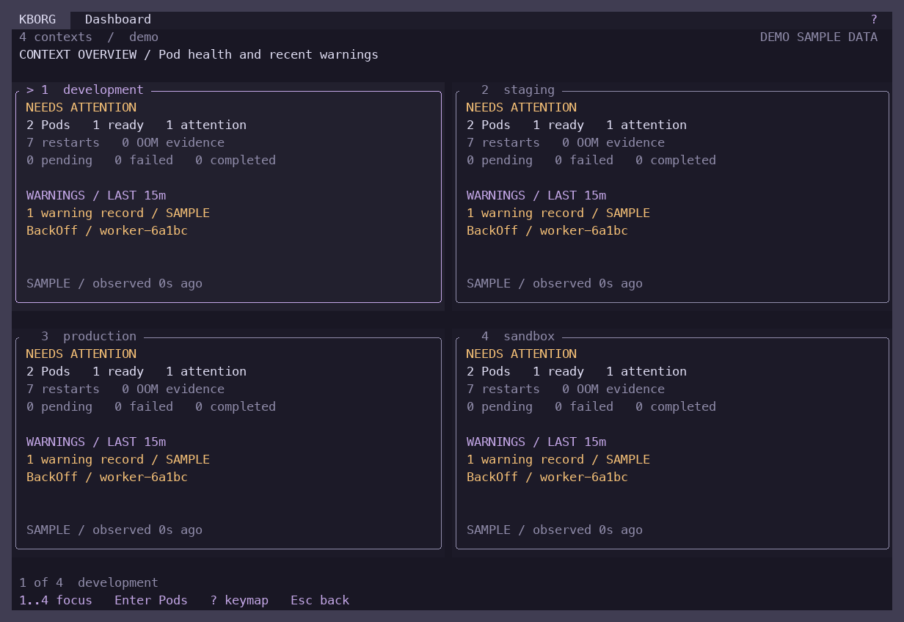

<div align="center">
  
  <h1>KBorg</h1>
  <p>A Kubernetes terminal workspace for exploring clusters and making reviewed changes.</p>
  <p><a href="#quick-start">Get started</a> · <a href="#navigation">Navigation</a> · <a href="docs/MAC_V1_PLAN.md">v1 roadmap</a> · <a href="docs/REMAINING_WORK.md">Feature status</a></p>
</div>



Familiar `:pods`, `:nodes`, `:deploy` navigation. A full-width table, a quiet header with `?` help, continuous borders, and 20 themes. Built in Rust, with a native Kubernetes client and a CLI alongside the terminal UI.

**Development release 0.3.0, targeting Mac + Docker Desktop v1.** See the [current acceptance report](docs/MAC_V1_HARDENING_ACCEPTANCE.md) for what was tested and the [remaining-work register](docs/REMAINING_WORK.md) for open release gates. Packages are currently unsigned.

## Features

- **Browse your cluster.** Built-in resource types, API discovery, CRDs, context and namespace switching, filters, sorting, resource inspection, and live watches.
- **See workload health.** Responsive cards for up to four contexts, readiness and restart summaries, UID-linked recent warnings, Pod/Node CPU and memory, bounded metrics history and ownership trees.
- **Work with logs.** Container, workload and selector logs; merged source labels; search, timestamps, wrapping, error/warning text filters, and explicit local export.
- **Save your workspace.** Explicitly save context groups, namespace/resource scopes and selected workload identities; revalidate them when reopening.
- **Edit with a review.** An in-memory YAML spec editor, readable diffs, server dry-run, identity checks, and exact target confirmation. Hidden fields are preserved. Focused image, resource-budget, scale and restart forms remain available.
- **Maintain nodes.** Reviewed cordon, uncordon and bounded drain using Kubernetes eviction requests. Disruption budgets are respected; retained and blocked workloads are reported.
- **Keep several connections open.** Up to eight independently managed loopback port forwards, with per-session review, status and stop controls.
- **Manage Helm releases.** Reviewed install, upgrade, rollback, uninstall and tests for supported packaged charts, including OCI tags/digests, optional OpenPGP/Sigstore verification and scoped CRD workflows.
- **Make it yours.** Rosé Pine, Flexoki, Catppuccin, Tokyo Night, Nord, Dracula, Gruvbox, Solarized and accessible KBorg palettes, plus custom themes.
- **Optional Copilot advice.** Explicit GitHub account selection and a minimized diagnostic preview before an approved advisory request on supported macOS ARM64 setups.

## Quick start

Build from source with the pinned Rust toolchain and macOS command-line developer tools:

```sh
git clone https://github.com/c0dewars/kborg.git
cd kborg
cargo build --release --locked
```

Explore without a cluster:

```sh
./scripts/start-local.sh --demo --theme rose-pine --no-splash
```

Connect to Docker Desktop Kubernetes:

```sh
./scripts/start-local.sh --context docker-desktop --allow-logs --no-splash
```

Browsing is read-only by default. It uses your kubeconfig directly; Helm, kubectl, Python, Node.js and an AI account are not needed for ordinary browsing. Metrics require a working Metrics API; see [Docker Desktop metrics](docs/DESKTOP_METRICS.md).

Enable the v1 operator workflows explicitly:

```sh
./scripts/start-local.sh --context docker-desktop --allow-logs \
  --write --allow-yaml-edit --allow-node-maintenance --allow-forward --no-splash
```

These flags make actions available. Each mutation still requires its own review and confirmation; server-side RBAC and admission remain authoritative.

## Navigation

| Command or key | Action |
|---|---|
| `:pods`, `:po`, `:deploy`, `:svc`, `:nodes` | Open a resource table |
| `:ctx`, `:ns` | Choose context or namespace |
| `:pods NAMESPACE`, `:pods @CONTEXT` | Navigate directly |
| `/`, `:pods app=api` | Filter visible rows or use a server-side label selector |
| `Enter`, `d`, `y` | Drill down, describe, inspect YAML |
| `e`, `Ctrl-S` in the editor | Edit YAML spec, then prepare a reviewed diff |
| `:edit-container` | Open the focused container editor |
| Node `c`, `u`, `r` | Review cordon, uncordon, drain |
| Pod `F`, `:pf` | Add a port forward, open the session list |
| `l`, `p` | Follow logs or read previous logs |
| Log `e`, `W`, `w` | Toggle error matches, warning matches, wrapping |
| Log/Helm `Ctrl-S` | Review and save a local export |
| `:export`, resource `Ctrl-S` | Export selected redacted YAML, save visible resource snapshot |
| `:helm`, `:pulses`, `:xray po`, `:overview` | Releases, health, relationships, multiple contexts |
| `D`, `b`, `B` | Dashboard, save current selection, reopen saved selections |
| Dashboard `1..4`, `Enter`, `c`, `s` | Focus card, open Pods, choose contexts, save dashboard |
| Dashboard `w`, then `Enter` | Select a recent warning, open that exact Pod's Events |
| `:logs-live [SELECTOR]` | Follow workload logs with announced Pod joins and departures |
| `:themes`, `?`, `:q` | Themes, help, quit |

The header keeps only `?` for the keymap; it also supports mouse clicks. Familiar `:` commands remain available when you type them. The [compatibility map](docs/K9S_COMPATIBILITY.md) records exact behavior and remaining k9s differences.

## Reviewed changes

YAML editing applies to the `spec` of existing namespaced non-Secret resources. It does not create resources or expose hidden fields for editing. Metadata, status, ConfigMap data, RBAC objects and cluster-scoped YAML edits are excluded. See [YAML editing](docs/YAML_EDITING.md).

Drain first reviews the complete bounded Pod inventory. System, mirror and DaemonSet Pods are retained; unmanaged workloads and potentially lossy local storage block the operation. Failed drains leave the node cordoned and report remaining work. Node shell and forced eviction are excluded. See [v1 operations](docs/MAC_V1_OPERATIONS.md).

Helm lifecycle requires `--write --allow-helm --allow-helm-write`, a trusted native Helm executable and a supported chart. See [Helm lifecycle](docs/HELM_LIFECYCLE.md), [extensions](docs/HELM_EXTENSIONS.md), and [trust and CRD migrations](docs/HELM_TRUST_AND_MIGRATION.md).

## Themes

Choose `:themes` to preview and save a palette, or use `--theme rose-pine` for one session. Saved preferences survive updates. `NO_COLOR` and `--color=never` disable styling.

```sh
./target/release/kborg theme list
./target/release/kborg theme new my-theme --base rose-pine
```

See the [theme guide](docs/themes.md) for custom palettes and contrast validation.

## CLI

```sh
./target/release/kborg --context docker-desktop -n default list pods --json
./target/release/kborg --context docker-desktop -n default metrics pods --json
./target/release/kborg --context docker-desktop -n default yaml-template deployments web > web.yaml
./target/release/kborg --context docker-desktop -n default --write --allow-yaml-edit \
  yaml-edit deployments web web.yaml
```

The edit command requires an interactive terminal for confirmation. [CLI help](docs/CLI_HELP.txt) and [output contracts](docs/CLI_OUTPUT.md) cover scripting and bounded reads.

## Documentation

| Guide | Contents |
|---|---|
| [v1 plan](docs/MAC_V1_PLAN.md) | Milestones and features inspired by k10s |
| [Mac v1 hardening](docs/MAC_V1_HARDENING_ACCEPTANCE.md) | Soak, terminal compatibility, security and current screenshots |
| [Dashboard acceptance](docs/DASHBOARD_ACCEPTANCE.md) | Dashboard and saved-selection implementation evidence |
| [Dashboard guide](docs/DASHBOARD.md) | Health meanings, freshness and card controls |
| [Saved selections](docs/SAVED_SELECTIONS.md) | Explicit persistence and revalidation |
| [Operator acceptance](docs/MAC_V1_ACCEPTANCE.md) | YAML, node, export and forwarding evidence |
| [Operations](docs/OPERATIONS.md) | Configuration, installation, update, rollback and recovery |
| [Copilot](docs/COPILOT_INTEGRATION.md) | Optional account setup, privacy and platform limits |
| [Security review](docs/MAC_V1_SECURITY_REVIEW.md) | Current findings, fixes and outstanding assessment work |
| [Remaining work](docs/REMAINING_WORK.md) | Implemented, partial and unsupported capabilities |

No telemetry is enabled. Known sensitive API fields are masked, but logs and custom resource fields can contain confidential data. Exports are explicit private files. Local audit records support reconciliation and are not a tamper-proof external audit service.

## Design and credits

Navigation follows [k9s](https://github.com/derailed/k9s). The dashboard layout takes inspiration from [k10s](https://github.com/mpiorowski/k10s); the palette direction also draws from [Omarchy](https://omarchy.org/themes/). Theme attribution and dependency notices are in [THIRD_PARTY_NOTICES.md](THIRD_PARTY_NOTICES.md).

Licensed under [Apache 2.0](LICENSE).
