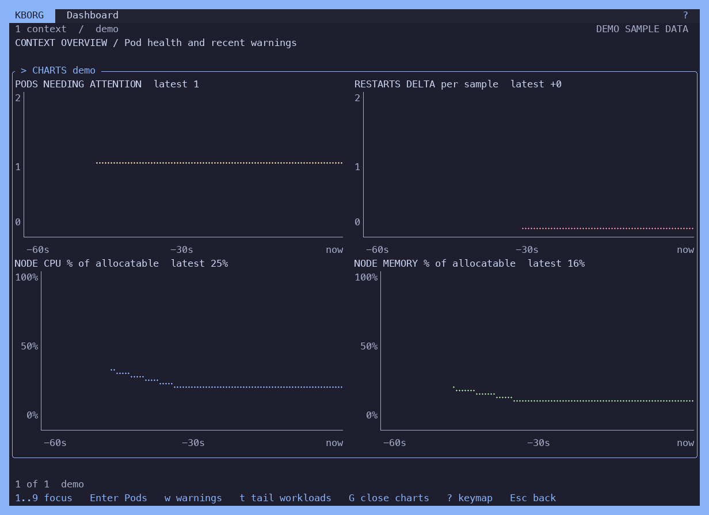
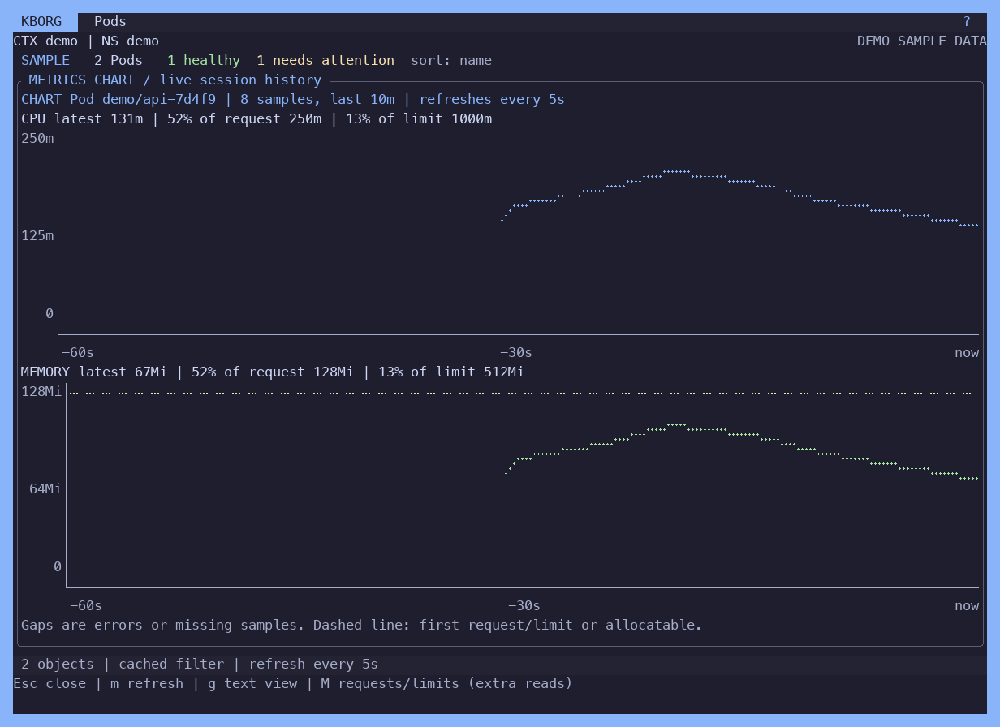

# Dashboard and saved workspace

Press `D` from a resource table to open the current context and namespace. The header shows a plain view title and `?`; familiar typed commands such as `:pods`, `:nodes` and `:overview` remain available without a persistent command menu.

## Controls

| Key | Action |
|---|---|
| `1`..`9`, arrows, Tab | Focus a context card; pressing the focused card's number again toggles full-screen focus |
| Enter | Open current Pods in the focused context and displayed namespace |
| `w` | Select the next recent warning in the focused card; cycling past the last clears it |
| Enter on a warning | Open Events for that exact Pod name and UID in its namespace |
| `t` | Tail workloads across clusters: list Deployments and StatefulSets from every card's cluster, Space selects up to six, Enter starts; `t` or Esc closes the tail |
| `e` / `W` in a pane | Show only error / warning lines in the open log pane |
| `L` on a warning | Follow that exact Pod's logs (all ordinary containers) in a pane under the cards; `L` again closes it |
| Esc on a warning | Close an open log pane first, then clear the warning selection without closing the dashboard |
| `c` | Choose one to nine explicit context names, comma separated; Ctrl-U clears the input |
| `s` | Name and save the dashboard's context group and namespace |
| `B` | Open saved selections |
| `G` | Charts for the focused card (see below); `G` or Esc closes them |
| `?` | Show the dashboard keymap and evidence legend; watches keep running |
| Esc | Close help, or close the dashboard and cancel its watches |

The log pane opens its own read-only connection to the focused card's context, so it works for any card, not only the connected one. It requires `--allow-logs`, follows the warning's Pod name and UID with the normal follow budget and shared byte/rate limits, and stops when it is closed, when Enter opens Pods or Events, or when the dashboard closes. Only one log session runs at a time, so opening the pane ends any other log view.

Expanded cards also show `NODES ready/total` (with cordoned Nodes and cluster CPU/memory as a percentage of summed allocatable when the Metrics API answers) followed by up to three named Nodes — NotReady and cordoned first, then the highest CPU or memory share of that Node's own allocatable, with `+N more` (a cluster with one healthy Node shows none) — and `APPS` with Deployment/StatefulSet counts and up to four named degraded workloads. A workload is degraded when it wants replicas that are not available or ready, or its rollout reports `ProgressDeadlineExceeded`; scaled-to-zero workloads are not. These come from a separate 15-second read-only poll per card, so a slow or denied read never delays the Pod and Event watches. Nodes are cluster-scoped and often denied to namespace-scoped identities; the card then shows `NODES DENIED` rather than zero.

`kborg --contexts a,b` opens the TUI directly in this dashboard for one to nine contexts. Wide terminals (150+ columns) use three columns once five or more clusters are shown.

Cards also raise two alerts. `RESTARTS` counts Pods whose busiest container has restarted 5 or more times and names the top three. `EVENTS` counts Warning events from the last 15 minutes about objects other than Pods (Nodes, ReplicaSets, Deployments, PersistentVolumeClaims…), read from the dashboard namespace plus `default`, where Node events are recorded; the newest three are named.

### Trend charts

`G` replaces the cards with four live charts for the focused card's cluster over the trend window (one sample every 15 seconds, at most 60 samples, so 15 minutes): Pods needing attention, the restart delta per sample (increase of the summed container restart counters since the previous sample; a counter that drops because Pods were replaced counts as 0), and Node CPU and memory as a percentage of summed allocatable. Each chart has a value axis with units and a time axis ending at `now`. A sample whose evidence is unknown or denied is a gap, never zero; the first restart sample has no delta. Charts need two samples; until then the panel says it is collecting. Wide terminals (100+ columns) show a 2x2 grid, narrower ones stack the charts. The history is the same bounded, session-local trend the cards' sparklines use; nothing is persisted. Style and colors come from `ui.yaml` `charts:` ([themes.md](themes.md#uiyaml)).

### Metrics chart mode

In `:metrics` (opened from `:pods` or `:nodes`), `g` switches between the text history and a full-width chart of the selected Pod (all containers summed) or Node: CPU in millicores and memory in Ki/Mi/Gi over the session history (at most 60 samples within 10 minutes, refreshed every 5 seconds while the view is open). The headers show the latest value and, when known, its percentage of the Pod's request and limit (every container must state them) or the Node's allocatable; a dashed line marks the request or allocatable when it does not flatten the series. An error, a missing row or a sample missing one of the Pod's containers is a gap, never a partial sum or zero. Chart mode draws only what the Metrics API returned in this session.

### Remembered dashboard

Opening a dashboard records its context names and namespace, and starting a tail records the chosen workload names, in `last-dashboard.json` in the private KBorg configuration directory. Nothing else is stored: no credentials, UIDs or cluster data. A normal launch never reads it. `kborg dashboard` (or `--dashboard`) reopens the last dashboard, or asks for contexts on first use; the tail picker pre-selects the remembered workloads, whose identities come from the fresh listing.

### Cross-cluster workload tail

`t` lists Deployments and StatefulSets (up to 200 per cluster) from every card's context in the dashboard namespace. Select up to six with Space, or press Enter on one. Each selected workload is followed over its own read-only connection with dynamic membership, so rollouts announce Pod joins and departures as in `:logs-live`. Lines from every cluster are merged in source timestamp order through a one-second reorder window and tagged with their context, after the timestamp so the log view's timestamp toggle still applies. The combined membership is capped at 24 Pods; a selection over the cap is refused rather than truncated. A source that cannot be opened is reported in the pane while the others continue. `e` and `W` filter to error or warning lines. Requires `--allow-logs`; only one log session runs at a time.

All cards use the selected namespace. Change namespace in the normal resource view before opening the dashboard, or reopen an explicitly saved dashboard scope. Wide terminals show a grid; narrow terminals retain the focused card and numbered navigation. A wide single-context view places health and warnings side by side.

Warning drilldown sends a server-side field selector binding `involvedObject.kind=Pod`, the Pod name and its UID, so a same-name replacement never inherits the old Pod's Events. The selection follows the same record across refreshes and clears if the record disappears or another card is focused. Esc in the Events view returns to the previous view.

Each card has independent Pod health and recent Warning Event evidence. Counts describe bounded observations, not an overall cluster health guarantee. Permission failures, incomplete lists and stale data remain explicit; an unknown count is `--`, never a healthy zero. Restarts are current counters, and OOM is current/previous container termination evidence. Warnings cover recent Event records linked to current Pod UIDs. See [exact health semantics and limits](DASHBOARD_HEALTH.md).

## Saved selections

Press `b` in a current resource table to save its context, namespace, resource type and server label selector. A selected supported workload also retains its namespace/name/UID for focus after reopening. Cached text filters, relationship filters, credentials and approvals are not saved. Dashboard `s` saves only its context group and namespace.

`B` opens the picker; Enter revalidates against the active kubeconfig and destination discovery. A replaced workload is reported instead of inheriting the old object's focus. `d` asks for the exact saved name before deleting a preference. Nothing is restored automatically at startup. Corrupt or nonprivate storage produces an in-app notice and is preserved.

See [saved-selection format and privacy](SAVED_SELECTIONS.md), [current acceptance](DASHBOARD_ACCEPTANCE.md), and [remaining v1 work](MAC_V1_PLAN.md).
