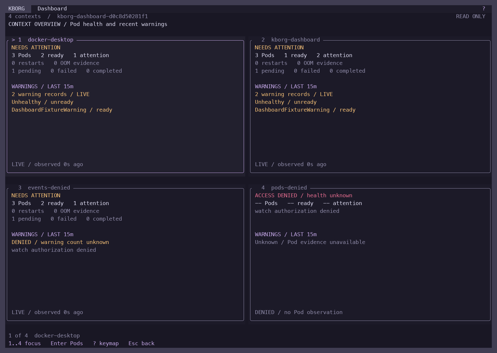
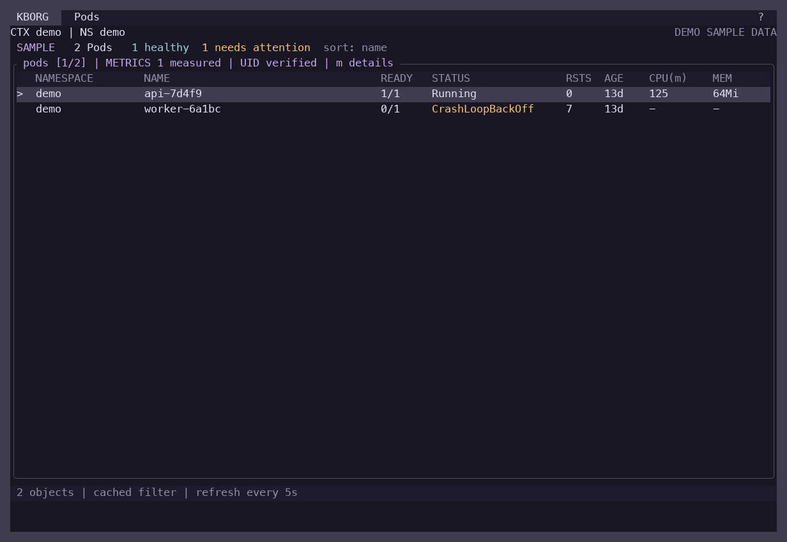
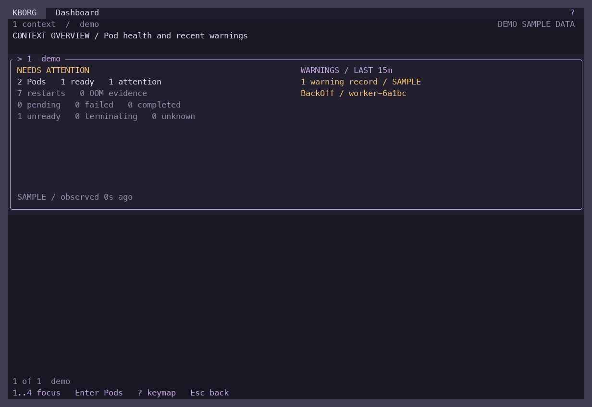
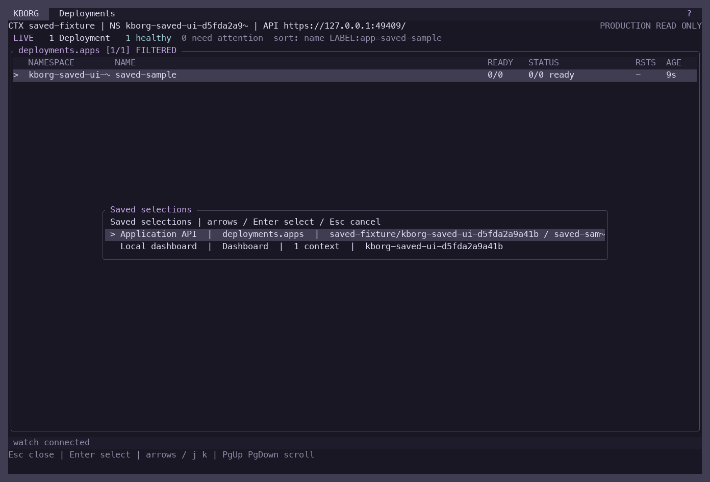

# Dashboard and saved-selection acceptance

Validated on 2026-10-23 on macOS ARM64. This batch adds dashboard cards, scoped health summaries and explicit saved selections, with a quiet header that retains only `?` as a help control. Familiar typed navigation remains available.

The final release binary SHA-256 is `803777f8e773ab741e6535a438246f7f7dbe5ae1554516d3595741b5500530dc`. All final PTY and live reports below identify that binary. The [source manifest](evidence/dashboard-build-source.json) covers Rust sources, tests, locked dependencies, toolchain and embedded CLI help. Historical screenshots and reports containing `iteration1` describe the earlier build, not final acceptance.

## Results

| Check | Result | Evidence |
|---|---|---|
| Native release build | Passed, locked and offline | [Build log](evidence/dashboard-release-macos.txt) |
| Rust formatting and strict all-target Clippy | Passed | [Formatting](evidence/dashboard-fmt-macos.txt), [Clippy](evidence/dashboard-clippy-macos.txt) |
| Full serial Rust suite | 404 passed, 0 failed, 18 ignored | [Test log](evidence/dashboard-tests-macos.txt) |
| Completed-frame capture parser | 3 passed | [Parser tests](evidence/dashboard-screen-tests.txt) |
| Terminal regression | 63 states; terminal restored; zero idle output over two seconds | [PTY report](evidence/dashboard-terminal-macos.json) |
| Dashboard interaction | 7 checks and 10 captures; narrow layouts, focus, help, save and drilldown | [Demo report](evidence/ui-dashboard-final/demo/report.json) |
| Live health | 7 checks across Docker Desktop, minikube and two restricted identities | [Live report](evidence/dashboard-health-live-final.json) |
| Saved selections on Docker Desktop | 12 checks, 6 captures; fixture cleanup passed | [Desktop report](evidence/ui-dashboard-final/selections-desktop/report.json) |
| Saved selections on minikube | 12 checks, 6 captures; fixture cleanup passed | [Minikube report](evidence/ui-dashboard-final/selections-minikube/report.json) |
| Owned test-cluster cleanup | Disposable profile removed; Desktop context and metrics retained | [Cleanup report](evidence/dashboard-cleanup.json) |

The 18 ignored Rust tests require explicit external fixtures or live services; the separately invoked live harnesses above supply this batch's cluster evidence. These results do not imply every ignored suite was executed. Clippy ran against the same Rust source before the final embedded CLI-help wording update. The release build, full Rust suite and final PTY/live checks include that update.

## Live coverage and boundaries

Docker Desktop ran Kubernetes 1.36.1. The disposable single-node Docker-driver minikube profile `kborg-dashboard` ran Kubernetes 1.35.9, with separate repo-local profile storage and kubeconfig. All test resources lived in uniquely labeled namespaces and cleanup checked their identity before deletion. No ordinary workloads or node scheduling settings were changed. The user's current context stayed `docker-desktop`; its existing Metrics Server remained available with verified APIService TLS.

Health fixtures exercised Ready=True, unready and pending Pods, recent Warning Events linked to exact Pod UIDs, old and unrelated event exclusion, independent Pod/Event authorization failures, watch recovery and watch cancellation. A readiness recovery on Desktop updated its card while the minikube and denied peers retained independent state. OOM classification, completed-only health and malformed/incomplete evidence are covered by focused Rust tests; live OOM failures were not induced.

Saved-selection acceptance exercised explicit private saves, duplicate refusal, process restart, current discovery and context validation, exact workload UID restoration, replaced-workload refusal, missing-context refusal, confirmed deletion, corrupt/nonprivate storage preservation, and return to the underlying resource view or dashboard. Store contents include preferences only, without credentials or restored operation approvals.

Three agents implemented and cross-reviewed health, dashboard presentation and saved-selection storage. Integration review covered scope changes, pending discovery, watch cancellation, unknown health states, private persistence and terminal rendering. Final screenshot review found no blocking UI issues. A minor remaining polish item is keeping the saved-picker delete hint visible when background watch status changes; `d` is documented in the guide. This is an internal code/UI review, not an independent security assessment.

## Final screenshots

These are PNG renders of actual captured PTY cell contents. They validate application layout and interactions, not native Terminal/iTerm font rendering or the full real-terminal matrix.

### Live health across both clusters and restricted identities



### Quiet resource header



### Compact single-context view



### Saved selections on Docker Desktop



The [demo gallery report](evidence/ui-dashboard-final/demo/report.json) also links 80×24 and 48×16 layouts, contextual help, numbered focus, save confirmation and Pod drilldown. The two live selection reports include restoration, UID replacement and invalid-storage notices.

## Remaining work

This batch completes the requested dashboard and saved-selection scope. Dynamic log membership, direct warning-to-event drilldown and dashboard log panes remain planned features. Publisher signing/notarization, sustained real-cluster soak, a broader terminal/accessibility matrix and independent security review remain Mac v1 release gates. See the [v1 plan](MAC_V1_PLAN.md) and [remaining-work register](REMAINING_WORK.md).

YAML editing, node maintenance, exports, forwards, Helm and Copilot retain their prior source-specific acceptance reports; this batch did not repeat all of their live mutation suites. The 63-state offline regression covers their existing terminal workflows without claiming new live lifecycle validation.

## Reproduction

Build and run the offline checks with the pinned toolchain:

```sh
cargo fmt --all -- --check
cargo clippy --locked --offline --all-targets -- -D warnings
cargo test --locked --offline -- --test-threads=1
cargo build --release --locked --offline
python3 scripts/test-screen.py
python3 scripts/test-terminal.py --binary target/release/kborg --output /tmp/kborg-terminal.json
```

Capture harnesses require Pillow. The live scripts expose `--help` for explicit kubeconfig/context, binary and evidence paths: `scripts/test-dashboard-health-live.py` and `scripts/test-saved-selections-ui.py`. They create and clean their own isolated fixtures; use only a deliberately selected local test cluster. The machine-readable [validation summary](evidence/dashboard-validation-summary.json) indexes final evidence.
