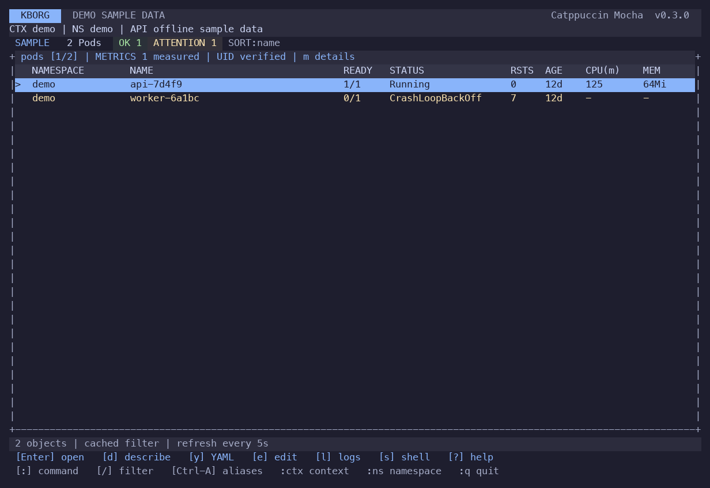
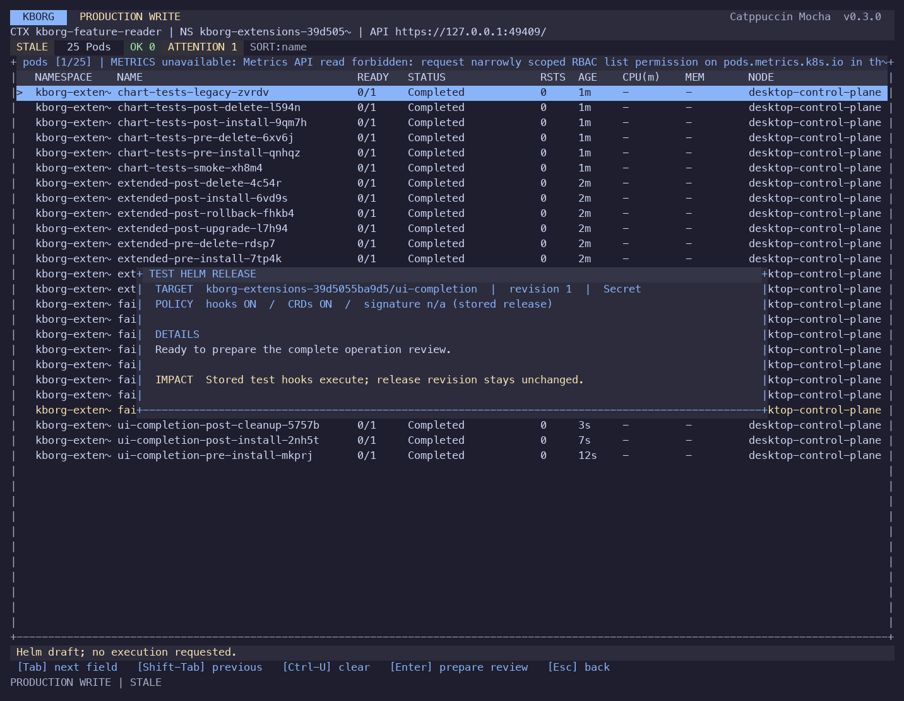
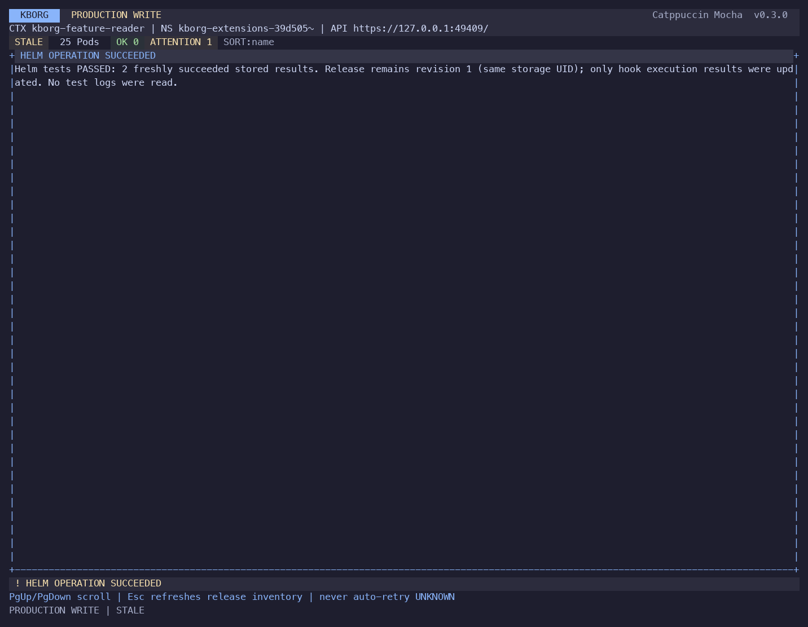

# Helm completion and terminal UI acceptance

Date: 2026-10-22. Continuation of `ba836a8` on `codex/helm-completion-ui`.
This report covers explicit OCI tags, required OpenPGP provenance, stored Helm
tests, native CRD upgrade/deletion and four terminal UI iterations. It is local
acceptance, not production certification or full Helm/k9s parity.

## Delivered behavior

- Explicit OCI tags resolve once before review. The requested reference and
  resolved manifest digest are displayed; the downloaded chart is sealed and
  execution cannot silently follow a moved tag. A fresh review resolves again.
- `--helm-keyring /absolute/public.gpg` requires standard Helm `.prov` signatures
  for local archives or the OCI provenance layer. The exact trusted Helm 4.3.1
  verifies before review and execution. Review includes the verified signer
  fingerprint and input hashes; missing, wrong-key, corrupt or changed inputs
  fail closed. Personal keyrings and keyservers are never consulted.
- `helm test RELEASE`, `t` in the release table and `:helm-test` run the exact
  stored test/legacy test-success hooks. Replacement/deletion policies are
  reviewed, fresh stored results are checked, no new revision is created and
  failed tests do not imply a failed deployment. Automatic log dumping is absent.
- `helm crds-upgrade RELEASE CHART` reviews compatible schema expansion or
  validation relaxation with a complete bounded cluster-wide instance inventory.
  Native API dry-run/update retains schema UID and metadata; defaults, API/storage
  versions, pruning changes and unsupported migrations are refused.
- `helm crds-delete RELEASE CHART` reviews schemas and every affected instance.
  Nonempty deletion requires exact Helm ownership; foreign/GitOps objects,
  owner references and finalizers block it. Instances and schemas use UID/RV
  delete preconditions. Approval is `DELETE CRDS namespace/release`. Normal
  release uninstall continues to retain schemas.
- The command-driven UI keeps the full-width table and no persistent sidebar.
  Palette-derived surfaces, clearer table selection/status colors, centered
  grouped forms, a typed operation overview and immediate painted-review progress
  improve hierarchy and feedback. New schema commands have separate forms and
  explicit destructive impact. Narrow forms retain all fields and keyboard hints.

See [workflow details](HELM_EXTENSIONS.md), [lifecycle controls](HELM_LIFECYCLE.md)
and the exact [k9s command mapping](K9S_COMPATIBILITY.md).

## Verification

Final results are recorded in [the validation summary](evidence/completion-validation-summary.json).
The summary checks product/source hashes and final executable identity across
native builds, live CLI/UI acceptance and terminal captures. All final behavioral checks use the final source and executable; development
runs are excluded from the validation summary.

| Check | Result | Evidence |
|---|---|---|
| macOS ARM64 | 318 automated tests; format, strict Clippy and release build passed | [Build](evidence/completion-build-macos.json) |
| Linux ARM64 | 318 automated tests; format, strict Clippy and release build passed | [Build](evidence/completion-linux-arm64.json) |
| Native terminal UI | 57 states per platform; terminal restoration passed | [macOS](evidence/completion-terminal-macos.json), [Linux](evidence/completion-terminal-linux-arm64.json) |
| Docker Desktop 1.36.1 and minikube 1.35.9 | Original OCI/auth/hook/CRD cases plus tag/signature/test/schema operations passed; fixtures and credentials removed | [Live acceptance](evidence/completion-local.json) |
| Base Helm lifecycle, both clusters | Install/upgrade/rollback/uninstall, Secret/ConfigMap storage, wrong confirmation and stale resource/history/chart rejection | [Regression](evidence/completion-lifecycle-regression.json) |
| Desktop integration | Six authentication/helper, watch, metrics-denial and native-operation tests passed; all three suites cleaned up | [Regression](evidence/completion-regression-local-macos.json) |
| Existing Desktop metrics | Available provider/APIService; final binary returns untruncated Pod and Node samples | [Metrics](evidence/completion-desktop-metrics.json) |
| Locked dependency audit | Zero known vulnerabilities or warnings; no ignored advisories | [Audit](evidence/completion-cargo-audit.json) |

Two early full regression attempts stopped at an extension install and a
changed-chart review. Both cleaned their fixtures. No specific code defect was
established; subsequent fresh-fixture runs passed. The final frozen-source runs
are the retained acceptance evidence, and prolonged reliability remains an open
soak gate.

The automated totals exclude twelve ignored entries: six subprocess fixture
entry points exercised by their parent tests and six cluster-gated entries
exercised by the separate Desktop harness. Rust 1.99.0 tests run serially to avoid
legacy subprocess snapshot-lock contention; concurrency within tests is retained.

The Linux build mounts staged source/tests/assets, help, manifests and validation
scripts plus a read-only public package cache. It receives no kubeconfig,
credential home or Docker socket. Its unique labeled container and volume are
[removed after validation](evidence/completion-linux-cleanup.json).
The isolated minikube profile is [removed](evidence/completion-minikube-cleanup.json)
after fixture cleanup. The selected Desktop context and existing verified-TLS
Metrics Server are preserved.

## Live coverage and UI captures

The cluster harness uses unique restricted namespaces, an exact trusted Helm
binary, digest-pinned BusyBox jobs, a verified loopback TLS OCI registry,
short-lived service-account credentials and UID-checked cleanup. Its registry
is a protocol fixture, not certification of a public/cloud provider.

Temporary OpenPGP fixture keys are generated in an isolated labeled container.
Only signed archives, provenance and exported public keyrings survive; the
private signing material and container are removed. Positive verification and
wrong-key rejection are [recorded](evidence/completion-signature-fixtures.json).
No personal signing key is used. Tests additionally cover corrupt/missing
provenance, changed chart content and keyring replacement during review.

A signed OCI tag moves between review and execution: installation still uses
the reviewed version, while a fresh upgrade resolves the new version. Test Jobs
are absent during install, run only on explicit test, and acquire new UIDs on
repeat. Failed tests have stored Failed results while ordinary resources remain.
Stale hook approval is refused. CRD upgrades preserve identity and instances;
incompatible schemas, foreign instances in another namespace, weak confirmation
and stale instance approval are refused before deletion.

The actual Desktop UI, with 22 captured panels, installs a fixture, runs its stored tests, uninstalls,
upgrades its schema and deletes the empty schema. The parent checks stored test
results before uninstall and checks final schema absence. Every approval follows
complete painted review coverage. Capture canaries and terminal restoration are
checked. These live UI actions use a local chart; signed OCI flows are exercised
through the live CLI. The fixture identity is intentionally denied metrics;
the separate native metrics check uses the existing provider.

All four UI iterations were captured from the running terminal application,
inspected and attached during the session. Demo images explicitly identify
sample data; the live captures show only generated test resources.

- [Iteration 1](evidence/ui-helm-completion-iteration1/report.json): surface hierarchy,
  grouped forms and operation overview.
- [Iteration 2](evidence/ui-helm-completion-iteration2/report.json): consistent review
  gutters, immediate displayed-line feedback and destructive styling.
- [Iteration 3](evidence/ui-helm-completion-iteration3/report.json): final explicit
  owned-instance/schema deletion impact.
- [Iteration 4](evidence/ui-helm-completion-iteration4/report.json): explicit provenance
  scope for stored-release actions.
- [Final 57-state terminal run](evidence/completion-terminal-macos.json): navigation,
  logs, metrics, forms, test/schema commands, narrow layouts, resize and approval.

## Product and code review

Three subagents and the integrating agent reviewed OCI/provenance, stored hook
execution, schema planning/API mutations, native release projection, CLI/config/
audit, UI, acceptance harnesses and documentation. Corrections included:

- Reject secret-key/subkey packets before passing an explicit public keyring to
  Helm; only a successful verifier's strictly parsed fingerprint is displayed.
- Preserve exact live schema metadata and validate admitted schema/metadata;
  reject new recursive defaults and unknown-field changes that could prune or
  reinterpret existing data.
- Record schema update/delete and instance UID/RV targets correctly in audit
  intent instead of labeling all existing schemas as retained.
- Require fresh completed stored test results rather than accepting an older
  successful run or changing release deployment status after a failed test.
- Mark review lines displayed only after successful terminal write/flush, then
  repaint feedback immediately. Demo overviews explicitly say simulated plan.
- Describe destructive instance impact in the form and preserve the stronger
  backend confirmation phrase through narrow review layouts.
- Bound terminal failure cleanup through PTY closure and final child reaping;
  isolated forced-timeout probes passed. Signing-fixture cleanup verifies the
  exact container name/ownership and absence before reporting success.

## Remaining boundaries

Signatures mean standard Helm OpenPGP provenance, not Sigstore/Cosign or
transparency-log attestations. There is no implicit latest tag, version range,
chart repository resolution, automatic dependency fetching or cloud registry
credential helper. The trusted Helm tool retains OS-user permissions.

CRD support remains structural Namespaced schemas with bounded complete instance
inventories (1,000 objects/8 MiB). API/storage-version migrations, conversion
webhooks, cluster-scoped custom resources and arbitrary schema changes remain
unsupported. Final inventory checks cannot eliminate a concurrent create between
an empty re-list and schema deletion; server RBAC/admission must quiesce writers
when required. Partial effects require inspection, with no automatic retries.

General Helm writes still have a post-check UID replacement race. SQL storage,
Windows lifecycle, arbitrary charts, broad terminal/accessibility certification,
long soak and independent production/security acceptance remain open in the
[remaining-work register](REMAINING_WORK.md).
