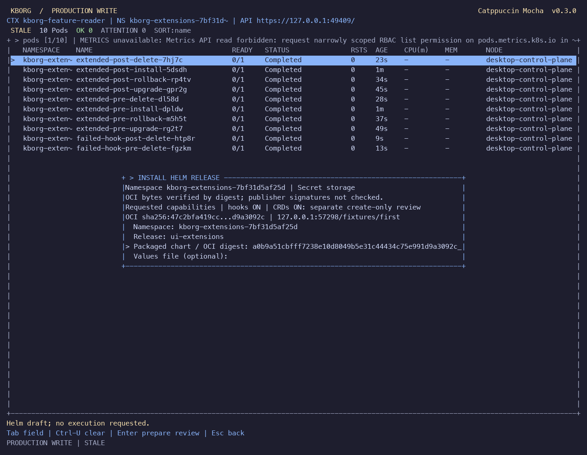
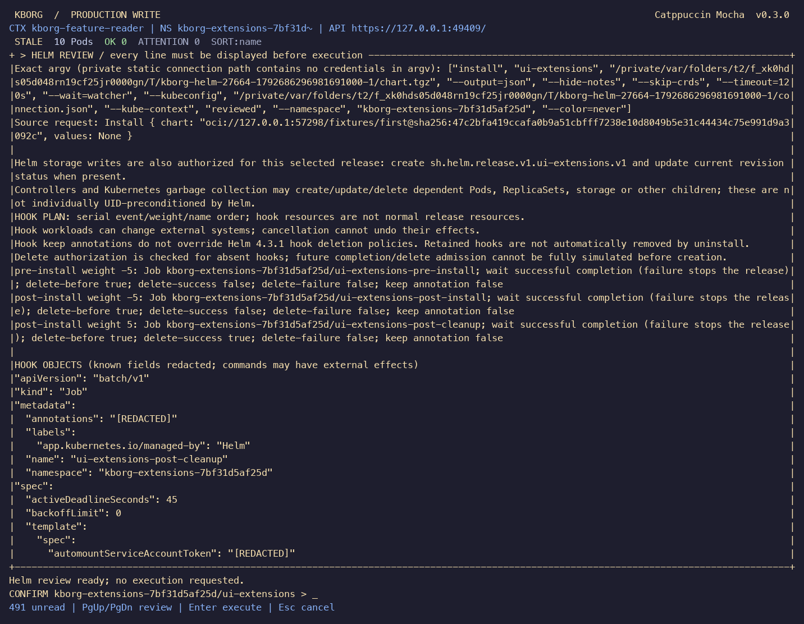

# OCI charts, Helm hooks and CRD acceptance

Date: 2026-10-22. Continuation of `df62183` on
`codex/helm-oci-hooks-crds`. Exact source, executable and test evidence hashes are
recorded in [validation evidence](evidence/extensions-validation-summary.json).
This is a local implementation and acceptance session; no release or push was
requested.

## Delivered behavior

- Install and upgrade accept immutable
  `oci://REGISTRY/REPOSITORY@sha256:DIGEST` sources. Native acquisition verifies
  HTTPS, media types, sizes and all content digests before producing a private
  chart snapshot. The review displays source and digest information; execution
  uses the sealed snapshot. Explicit private registry credentials and a private
  registry CA are supported separately from Kubernetes authentication.
- With `--allow-helm-hooks`, all eight pre/post install, upgrade, rollback and
  delete events have reviewed event ordering, resource identity, manifests,
  readiness and deletion policies. Jobs/Pods must complete. Existing hook
  replacement requires matching stored ownership/template and fresh UID/RV.
  Stored event/weight/deletion fields are checked independently of annotations.
- With `--allow-helm-crds`, `helm crds RELEASE CHART` creates missing supported
  schemas and waits for Established in a separate reviewed operation. Existing
  schemas must match the complete specification, allowing only narrow Kubernetes
  defaults. A fresh install/upgrade review can then use the registered namespaced
  custom resources. CRDs are retained through rollback and uninstall.
- The full-width command UI adds `:helm-crds` and `c` in the Helm table. OCI forms
  show the registry/digest, enabled hook/CRD capabilities and verification scope.
  The schema form identifies cluster-wide creation. Every wrapped review line
  must be displayed before exact confirmation; the existing `i`, `u`, history
  `r`, Ctrl-D and `:helm` workflow remains available.

[HELM_EXTENSIONS.md](HELM_EXTENSIONS.md) contains commands, credential formats,
permissions and constraints. Existing lifecycle requirements remain in
[HELM_LIFECYCLE.md](HELM_LIFECYCLE.md).

## Verification

Final validation passed. The summary verifies all final source hashes, both
release binaries, and the final live CLI/UI executable identity; no source-delta
bridge is needed for these runs.

| Check | Result | Evidence |
|---|---|---|
| macOS ARM64 | 299 automated checks; formatting, strict Clippy and release build passed | [Build](evidence/extensions-build-macos.json) |
| Linux ARM64 | 299 automated checks; formatting, strict Clippy and release build passed | [Build](evidence/extensions-linux-arm64.json) |
| Native terminal UI | 47 states on each platform passed, including default-disabled and explicitly enabled OCI/hooks/CRDs, CRD form, narrow/resize and existing log/navigation states | [macOS PTY](evidence/extensions-terminal-macos.json), [Linux PTY](evidence/extensions-terminal-linux-arm64.json) |
| Docker Desktop 1.36.1 and minikube 1.35.9 | OCI/authentication, all eight hooks, success/failure cleanup, repeated hook replacement, CRD bootstrap and custom-resource lifecycle passed; owned fixtures/credentials removed | [Extensions](evidence/extensions-local.json) |
| Existing Helm lifecycle on both clusters | Install, upgrade, rollback, uninstall; Secret and ConfigMap storage; stale resource/history/chart and wrong-confirmation rejection | [Lifecycle regression](evidence/extensions-lifecycle-regression.json) |
| Existing Desktop integration | Six live authentication/helper, watch, metrics-denial and native-operation tests passed; three suites cleaned up | [Regression](evidence/extensions-regression-local-macos.json) |
| Live Desktop metrics | Existing verified-TLS provider supplies Pod and Node samples through the final binary | [Metrics](evidence/extensions-desktop-metrics.json) |
| Locked dependency audit | Zero known vulnerabilities/warnings, with no ignored advisory | [Audit](evidence/extensions-cargo-audit.json) |

The automated totals exclude 12 ignored entries: six subprocess fixture entry
points run through their parent tests, and six cluster-gated entries run through
the Desktop integration harness. Tests use Rust 1.99.0 and serialized test cases
to avoid inherited snapshot-lock contention from concurrent subprocess fixtures;
asynchronous concurrency inside individual tests remains exercised.

The Linux build uses the pinned Rust image recorded in its evidence, two build
jobs and a 5 GiB limit. Only staged source/tests/assets, CLI help, build manifests
and validation scripts are mounted, plus a read-only public package cache. No
kubeconfig, credential home or Docker socket is mounted. Its uniquely labeled
container and scratch volume were [removed](evidence/extensions-linux-cleanup.json).
The isolated minikube profile was [deleted](evidence/extensions-minikube-cleanup.json)
after the owned namespace/CRD/RBAC checks passed. The selected `docker-desktop`
context and existing metrics provider were preserved.

The extension harness uses a verified loopback TLS OCI registry with an ephemeral
CA and signed leaf certificate, an exact trusted Helm 4.3.1 executable, digest-
pinned BusyBox Jobs, unique restricted namespaces and short-lived credentials.
It checks anonymous, Basic, anonymous Bearer and private Bearer access, rejects
token redirects without contacting the capture endpoint, rejects untrusted TLS
and tampered chart digests, and checks review redaction with a Secret canary.
This is OCI protocol acceptance against a controlled fixture, not certification
of a specific public/cloud registry or its credential service.

Hook checks cover all eight event Jobs, repeated same-name replacement with a new
UID, stale-hook review rejection, success/failure cleanup and failure stopping
ordinary resources. Cleanup assertions require the privately decoded stored
hook's completed phase; failed execution also requires the exact Job's
`BackoffLimitExceeded` event. No stored payload or hook output is retained.
CRD checks cover disabled capability, unsupported cluster scope, wrong
confirmation, creation/Established, custom-resource install/upgrade/rollback/
uninstall, stale schema review rejection and retained schema identity.

The actual Desktop UI, with 16 captured panels, reviews an existing matching schema, installs the pinned
OCI chart with hooks, and uninstalls it. The parent harness checks completed
hook Jobs, removed custom resources and the retained schema UID. Captures contain
only this run's generated fixtures. Its namespace-scoped fixture identity is
intentionally denied Metrics API access; the separate final metrics check above
uses the existing provider. Every approval follows complete painted
review coverage, and terminal settings/alternate screen are restored.

## Product and code review

Three subagents and the integrating agent reviewed transport, lifecycle,
schema/hook planning, native release projection, CLI/config/audit, UI, acceptance
harnesses and documentation. Findings corrected during the iteration include:

- Stored Helm hook metadata can differ from annotations. Review now reads the
  exact bounded native release storage record and seals the actual event, weight,
  deletion and output-log fields; malformed/case-alias fields are rejected.
- Equal weight/name hooks require stable stored order. The full hook array and
  its order are sealed, with a regression for canonical-order sensitivity.
- Desired-subset CRD comparison could accept an extra schema rule/property.
  Comparison now checks the complete spec after narrow known defaults, with
  regressions rejecting added properties, CEL rules and other schema changes.
- Custom-resource reviews needed common credential-field redaction in addition
  to Kubernetes Secret handling. Shared redaction covers API keys, passphrases,
  private-key fields and PEM material; arbitrary business data is still not
  comprehensively classified.
- Schema bootstrap audit intent now names the cluster-scoped CRDs and distinguishes
  create from retain, rather than suggesting ordinary namespaced release writes.
- The OCI notice was clipped and the schema form suggested a namespaced action.
  Iteration two shortened the notice, retained useful registry/digest context
  while editing, and labels the schema operation cluster-wide.
- The local registry fixture originally used a CA as the server leaf, rejected
  by Rustls. It now uses a separate CA and signed CA:false leaf. Product TLS
  verification was preserved.
- Cleanup evidence originally established absence only. The harness now verifies
  completed hook execution as well as deletion, and independently attempts
  cleanup of every owned namespace, schema and RBAC target on failure.

Both UI iterations retain actual terminal captures in
[iteration one](evidence/ui-helm-extensions/helm-oci-explicit-policy.png) and
[iteration two](evidence/ui-helm-extensions-iteration2/helm-crds-form.png).
The actual live screenshots above and the 47-state PTY captures use the final
macOS executable. No claim of cloud/production, arbitrary chart or full k9s
compatibility is made.

## Remaining limits

OCI tags, chart repository resolution, publisher signature verification,
automatic dependency fetching and credential-store/cloud login helpers remain
unsupported. Exact digests establish content integrity, not publisher trust.
Token-service cross-origin private credentials are refused; a registry-scoped
token is the supported alternative. The redirect guard is not DNS-based network
containment.

Hooks require explicit supported namespaced kinds and Helm ownership markers.
Cluster-scoped/custom-resource hooks, `helm test` and automatic hook-log output
remain unsupported. Conservative existing-hook update dry-runs may require a new
name for immutable-field changes. Hook side effects and retained hooks can
survive release removal.

CRD support is create-only for structural Namespaced v1 definitions; schema
upgrade/deletion, conversion webhooks and cluster-scoped custom resources require
a separate operator workflow. Bootstrap is cluster scoped; RBAC cannot constrain
CRD `create` by `resourceNames`. No CRD update/delete permission is needed by this
implementation.

The trusted native Helm 4.3.1 process retains OS-user permissions. Its API writes
do not carry the review's UID preconditions, so final-check races and partial
effects remain possible. Uncertain outcomes require inspection, with no automatic
retry/rollback. Windows lifecycle, SQL storage, broader platform and
terminal matrices, independent security review, long soak and signed releases
remain open gates in [REMAINING_WORK.md](REMAINING_WORK.md).
