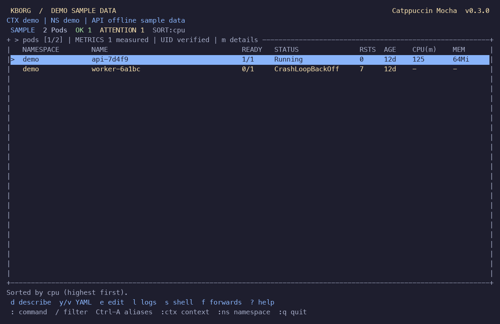

# Helm, merged logs and Desktop metrics acceptance

Historical report for the earlier Helm browsing/Pod-log/metrics source. Its
counts, binaries, screenshots and limitations are retained as recorded. The later
[Helm lifecycle and workload-log report](HELM_LIFECYCLE_ACCEPTANCE.md) supplies
current source-specific evidence; the [remaining-work register](REMAINING_WORK.md)
defines current scope.

Date: 2026-10-22. KBorg 0.3 development iteration, branch
`codex/helm-logs-metrics`. This report supersedes the missing Helm/merged-log/
Desktop-provider statements in the earlier [navigation report](K9S_ACCEPTANCE.md).
The [remaining-work register](REMAINING_WORK.md) and
[command compatibility map](K9S_COMPATIBILITY.md) distinguish useful implemented
workflows from incomplete parity and external release gates.

## Delivered behavior

- `:helm` lists native Helm v3/v4 Kubernetes storage, with namespace and driver
  identity. Enter/r opens revisions; revision Enter/v shows redacted stored
  overrides. Metadata, resource identities and safe YAML have separate keys.
  `:history RELEASE`, CLI `helm list|history|detail|resources|values`, JSON output
  and `--helm-storage secret|configmap` use the same bounded backend.
- `--allow-helm` is separate from general browsing and logs. Raw storage, chart
  files, notes and rendered bodies never become output. Selected reads bind to
  the storage UID. Incomplete/denied drivers remain explicit; an explicit driver
  does not require permission for the unused driver. Known-key/private-key
  redaction cannot identify every confidential custom value.
- Pod logs select a valid default-container annotation, one ordinary container,
  or a merged view for multiple ordinary containers. The picker offers All;
  log `a` toggles merged mode. CLI uses `logs POD --all-containers`. Source labels,
  previous-log failures, cancellation and Pod identity are retained. Head/tail
  selection is shared across containers; live delivery is arrival-ordered.
- Pod/Node tables show CPU and memory with `C`/`M` numeric sorting and compact
  display units. Exact values remain in metrics/details and drive sorting.
  Missing, partial, replaced or expired measurements are unknown, not zero.
  Absent Metrics API UIDs are marked `~` after checking the whole sample window
  against the current object's creation. Table refresh is bounded to one read
  per 15 seconds after completion; the cache expires after 45 seconds.
- Docker Desktop now has one explicitly authorized Metrics Server release.
  Both TLS hops remain verified. Positive usage, resource comparisons, session
  history, provider upgrade and paired serving-certificate renewal were tested.



[Real Desktop node table](evidence/ui-helm-logs-metrics/live-nodes.png),
[real session history](evidence/ui-helm-logs-metrics/live-node-metrics-history.png),
[Helm revisions](evidence/ui-helm-logs-metrics/live-helm-history.png), and
[merged log controls](evidence/ui-helm-logs-metrics/merged-logs.png) are actual
native terminal captures. DEMO captures are labeled as sample data.

## Validation

Final macOS ARM64 and Linux ARM64 builds each passed 239 automated checks,
format validation, strict all-target Clippy and all 27 demo terminal states.
The final macOS binary also passed all eight real Desktop UI screens.
[Validation summary](evidence/helm-validation-summary.json) binds the source
hashes to these checks and records the backend comparison.

Final release binary SHA-256 values:

- macOS ARM64: `1540c74d251c6dedbd361d7ca06cb7e518004ce9c2a18f43ffe6cc99755a02b2`
- Linux ARM64: `f27832a0a90f53440f92a1ef6c38e1df5459a6c2da249a0a141f93e6167d4bd1`

The retained live backend run used binary SHA-256
`3ca7375263e2c427aad2401b9679c410d1b61ddebf73612299c40a7d21f90936`.
Only table-display formatting was refined afterward; final validation records
compare all source hashes and explicitly identify that UI-only delta. Backend
code and live harnesses were not changed after their successful cluster runs.

| Check | Evidence |
|---|---|
| Native macOS ARM64 | Full tests, format, strict all-target Clippy and release build; [build record](evidence/helm-build-macos.json), [test log](evidence/helm-tests-macos.txt) |
| Native Linux ARM64 | Full tests, format, strict Clippy, release and terminal checks; [build record](evidence/helm-linux-arm64.json). Disposable pinned Rust container receives only staged source/public package cache, with no `.local`, `.git`, kubeconfig or Docker socket mount |
| Docker Desktop 1.36.1 | Both native Helm storage drivers with two real release revisions, selected values/metadata/resources, hidden-payload canaries, two-container snapshots/follow/previous failures and actual Metrics API comparisons; [feature evidence](evidence/helm-logs-metrics-local.json) |
| Minikube 1.35.9 | Same Helm/log checks in an isolated Docker-driver profile; metrics-provider installation deliberately scoped to Desktop. Feature evidence above; [profile cleanup](evidence/helm-minikube-cleanup.json) |
| Existing Desktop regressions | Six gated tests passed: reads/denials/logs, watch revocation, native operations/conflicts and reviewed credential helper. [Regression evidence](evidence/helm-regression-local-macos.json) |
| Terminal | 27 demo states on each native platform, narrow resize, zero two-second idle output, raw/alternate-screen restoration. [macOS](evidence/helm-terminal-macos.json), [Linux](evidence/helm-terminal-linux-arm64.json) |
| Live UI | Eight read-only Desktop screens, including normal `:nodes` after Metrics API discovery, measured table values, two distinct provider timestamps in history, Helm history/resources/values and terminal restoration. [Evidence](evidence/helm-live-ui-macos.json) |
| Provider | Idempotent upgrade and paired serving-certificate renewal pass; both TLS hops verified and a real node sample received. [Provider evidence](evidence/helm-metrics-provider.json) |
| Dependencies | 203 locked packages; zero known vulnerabilities/warnings against 1,349 RustSec advisories, no ignores. [Audit](evidence/helm-dependency-audit.json), [dependency review](DEPENDENCY_AUDIT.md) |

The live fixtures use unique namespaces, scoped ten-minute reader credentials,
digest-pinned images and ownership checks. Both feature namespaces and all three
regression namespaces were deleted; private temporary credential directories
were removed. The isolated minikube profile was deleted after its tests. The
user's current context and preexisting workloads were preserved. Desktop's owned
metrics release remains installed for actual use.

## Product and code review

Three collaborating agents implemented and cross-reviewed the Helm, log and UI
areas. The parent reviewed integration, the installer, actual screenshots and
live operation. Review-driven corrections include:

- Metrics API discovery no longer makes core `pods`/`nodes` commands ambiguous.
  Exact resource keys win, while genuinely ambiguous aliases require qualification.
- Metrics cache refresh, expiry and errors preserve selection by UID; slow failed
  providers receive a quiet retry interval instead of continuous Busy states.
- Paused log source changes replace the old cache; nested log navigation cannot
  restore a disconnected Follow view with a missing target. Late generations and
  cross-scope replies cannot reopen closed log or Helm views.
- Merged streams share consumer/rate limits and cancel all sources on identity
  replacement. One unavailable previous-container stream remains an attributed
  notice while the other valid source continues.
- Helm Secret/ConfigMap ambiguity is explicit. Custom resources ending in `List`
  are not silently mistaken for list envelopes. API-key, TLS-key and PEM private
  key values are included in known sensitive-field redaction.
- Provider preflight distinguishes configured TLS from live verified TLS. Public
  kubelet certificate chains are bounded; renewal changes the serving Secret and
  aggregation trust together. Helm endpoint/token/TLS environment overrides
  cannot redirect fixture or provider operations beyond preflight targets.
- Live table review prompted compact numeric units so truncation cannot hide a
  memory unit or be mistaken for the missing-UID marker.

No blocking finding remained in these reviewed scopes. These agent reviews are
not an independent security audit; short PTY sessions are not a prolonged soak,
latency-percentile measurement or full terminal/accessibility certification.

## Reproduction and remaining gaps

```sh
./scripts/start-local.sh --context docker-desktop --allow-helm --allow-logs --no-splash
```

Use `:pods`, `:nodes`, `:helm kborg-system`, `:metrics`, and `?`. CLI examples:

```sh
./target/release/kborg --context docker-desktop -n kborg-system --allow-helm helm list
./target/release/kborg --context docker-desktop metrics nodes --json
./target/release/kborg --context docker-desktop -n NAMESPACE --allow-logs logs POD --all-containers --follow --log-seconds 60
```

The native toolchain runs `cargo fmt --all -- --check`,
`cargo test --locked --all-targets`, `cargo clippy --locked --all-targets -- -D warnings`
and `cargo build --release --locked`. The feature harness is
`scripts/test-helm-logs-metrics.py`; it requires explicit expected Desktop and
minikube endpoints. Existing regression coverage uses `scripts/test-local.py`.
Demo and live terminal harnesses are `scripts/test-terminal.py` and
`scripts/test-live-metrics-ui.py`; PNG capture additionally needs Pillow.

Helm install/upgrade/rollback/uninstall and SQL storage remain unsupported in the
application. The existing reviewed tool filter has neither Kubernetes context/
credential binding nor lifecycle supervision. A proper mutation workflow needs
its own capability, sealed release/resource review, controlled static kubeconfig,
hook/plugin policy and uncertain-outcome handling; passing the original kubeconfig
to an external Helm process would bypass the native authentication controls.

Multi-Pod workload log merging, scanners/benchmarks, full RBAC pseudo-resource
views, context-specific hotkeys/plugins, generic Secret browsing/arbitrary apply,
node administration and automated Copilot remain incomplete or excluded.
Windows/other architecture refreshes, long soaks, broader terminal/accessibility
coverage, protected external audit, signing/notarization and organizational
acceptance remain separate gates. No release was published.

Desktop's pinned public kubelet trust and node IP require refresh on replacement;
serving TLS has a finite lifetime. See [maintenance instructions](DESKTOP_METRICS.md).
