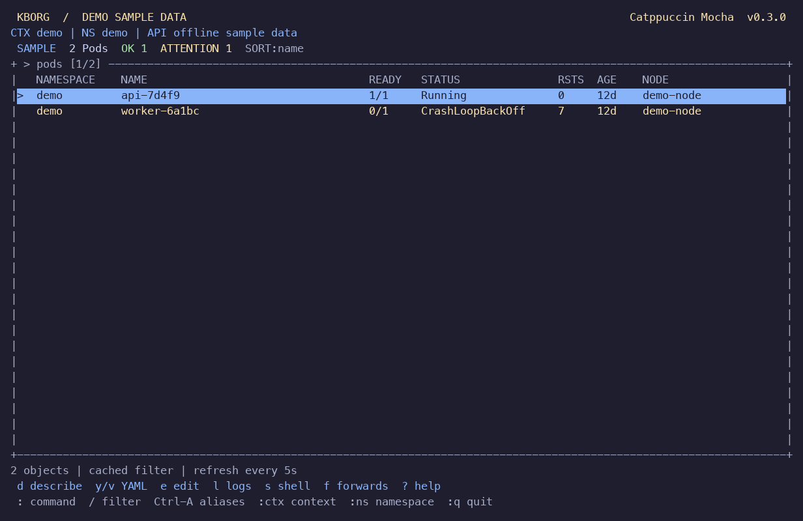

# k9s navigation iteration: implementation and acceptance

Historical navigation iteration. The later same-day [Helm/log/metrics report](HELM_LOGS_METRICS_ACCEPTANCE.md) supersedes its remaining-work statements and metrics-provider status. Binary hashes and counts below remain evidence only for this earlier source.

Recorded 2026-10-22 for KBorg 0.3.0 on branch `codex/k9s-navigation`. This iteration replaces the persistent sidebar with full-width command navigation and expands native workflows. Exact compatibility and the remaining differences are in [K9S_COMPATIBILITY.md](K9S_COMPATIBILITY.md); release and external acceptance gates remain in [REMAINING_WORK.md](REMAINING_WORK.md). This is a locally tested development build, with no claim of complete k9s parity or independent production certification.

## Delivered behavior

The resource browser supports familiar singular/plural/short-name commands, 35 built-in kinds, bounded discovery and qualified GVR names. Contexts, namespaces, aliases, command completion/history, view history, regex/inverse/fuzzy filters and actual server-side label selectors are integrated. Destination-only custom resources resolve after switching contexts. Enter drills into containers or related Pods using label/field selectors; custom resources with colliding Kind names do not inherit built-in behavior. Selection restoration includes UID and namespace.

Native `:pulses`, `:xray`, `:workloads`, `:can`, `:dir`, saved snapshots, log range/filter/display controls, and forwarding status/cancellation are available. The log view supports head/tail/lookback, previous logs, wrap, timestamps, autoscroll and bounded UID-checked transport reconnects. The prefilled editor covers Deployment, StatefulSet, DaemonSet and CronJob containers; scale/restart support has expanded with explicit workload semantics. Writes retain separate capabilities, exact target review, dry-run, UID/resourceVersion preconditions and no automatic retry.



[Command prompt](evidence/ui-k9s/command-completion.png), [containers](evidence/ui-k9s/containers.png), [log controls](evidence/ui-k9s/log-controls.png), [narrow layout](evidence/ui-k9s/narrow.png), and [actual Docker Desktop nodes](evidence/ui-k9s/live-nodes.png) are retained captures of the release binary.

## Final validation

| Check | Result and exact evidence |
|---|---|
| Native macOS ARM64 | 210 automated tests passed: 208 library tests and two standalone contracts; zero failures. Format, strict all-target Clippy and release build passed. [Build record](evidence/k9s-build-macos.json), [test log](evidence/k9s-tests-macos.txt) |
| Native Linux ARM64 | Same 210 tests passed, format/strict Clippy/release passed. Read-only source/cache mounts in a disposable official Rust container; no kubeconfig or Docker socket. All source hashes rechecked after build. [Build record](evidence/k9s-linux-arm64.json) |
| Docker Desktop Kubernetes 1.36.1 | Six gated tests passed across desktop, watch/metrics and native-operation suites, including real reviewed ExecCredential helper acceptance. All three uniquely owned namespaces and temporary ten-minute credentials removed. Final source hashes match. [Live record](evidence/k9s-local-macos.json) |
| macOS terminal | 22 actual release PTY states passed, including 120×32 and 48×12, explicit color override, zero output during a two-second idle interval, and terminal restoration. Peak RSS 11,419,648 bytes; short-session CPU 0.058528 seconds. [PTY record](evidence/k9s-terminal-macos.json) |
| Linux terminal | Same 22 states passed and terminal restored; zero idle output. Peak RSS 10,723,328 bytes; short-session CPU 0.060236 seconds. [PTY record](evidence/k9s-terminal-linux-arm64.json) |
| Live macOS UI | Read-only Docker Desktop keyboard checks passed: Pods, `:nodes`, Node→Pods field drilldown, `:ns`, alias/regex, server label selector, clearing selection scope, missing Metrics API guidance and terminal restoration. [Live UI record](evidence/k9s-live-ui-macos.json) |
| CLI | Help matches the checked-in document; 35 demo kinds, selected Pods, allocation JSON and five human-only navigation reads verified. Real-process closed-downstream regression now covers 21 output paths. |
| Dependencies | Three compatible TLS package updates resolve six advisories in the prior lockfile. Final cargo-audit 0.22.2 reports zero vulnerabilities/warnings against 1,349 advisories, with no ignores. [Audit](evidence/k9s-dependency-audit.json), [dependency review](DEPENDENCY_AUDIT.md) |

Eight tests are normally ignored by the all-target test run: six require live owned fixtures and ran through the separate Desktop harness; two are self-spawn supervision fixtures exercised by their parent contracts. The short PTY measurements are observation windows, not long-soak or latency-percentile claims.

Final executable SHA-256 values:

- macOS ARM64: `4868ed8134564e98099501d643c67b769662b7a5509a0fa370579e2d6cd4d145`
- Linux ARM64: `623a01488efc981d35d675cad5fd5db796024602f76ed08bf0e354acc717177a`

## Product and code review

Three collaborating agents implemented and reviewed separate UI, logs/metrics and operation areas; the parent reviewed integration and actual terminal captures. Review-driven fixes were validated before the final stable-source run:

- Empty/malformed HTTP watch errors cannot appear to be healthy empty streams; actual HTTP status controls authorization stop, expiry relist and retry behavior.
- Queued forwarding approvals cannot restart a canceled session after a context/scope change; installation is bound to both generation and epoch.
- Log range/read results are generation-bound, preserve view preferences and cannot overwrite newer selections.
- Cross-context history resolves against the destination catalog, preserves explicit scope/UID, retains unavailable entries and recovers after failed connections.
- Built-in drilldown and relationship views require the expected API identity, protecting against colliding CRD kind/plural names.
- Health snapshots account for omitted zero rollout counters, observed generation, Node pressure, pending Jobs and partitioned StatefulSet rollouts.
- Snapshot saves serialize the retention-cap check and file creation with a native private file lock; existing snapshots remain browsable at the cap.
- Manifest previews reject arbitrary credential JSON, bound YAML decoding, and omit Secret documents/List items.
- Live acceptance exposed Kubernetes' DaemonSet template-generation annotation increment. Only its exact native counter transition is permitted; unrelated metadata/spec changes remain rejected. [Controlled edit details](CONTROLLED_EDIT.md)

No blocking correctness/security finding remained in the reviewed scopes. Agent reviews are not an external security audit.

## Reproduction and limits

From the repository, the ready native binary can be launched with:

```sh
./scripts/start-local.sh --demo --no-splash
./scripts/start-local.sh --context docker-desktop --no-splash
```

The pinned Rust toolchain runs `cargo fmt --all -- --check`, `cargo test --locked --all-targets`, `cargo clippy --locked --all-targets -- -D warnings`, and `cargo build --release --locked`. The optional local toolchain cache is in `.local/tools`; it is not part of the product. The Python acceptance harness is `scripts/test-local.py --expected-server VERIFIED_LOCAL_HTTPS_ENDPOINT`, and terminal checks use `scripts/test-terminal.py --binary target/release/kborg`. PNG capture additionally needs Pillow. The Linux recipe remains in [PRIORITIES_ACCEPTANCE.md](PRIORITIES_ACCEPTANCE.md#linux-arm64-in-a-disposable-docker-container), using the same pinned image and `/source`, `/cache`, `/output` mounts; this run allocated a 4 GiB build tmpfs.

Docker Desktop is the only live provider in this session. Its Metrics API returns HTTP 404, so live usage/history needs a separately installed provider; no provider or cluster component was installed. Helm/history, scanners/Popeye, benchmarks, subject-list/reference pseudo-views, all-container merged logs, full hotkey/plugin import, Secret reads, arbitrary manifest apply/edit, node administration and remote full-screen sessions remain outside implemented parity. Automated Copilot diagnosis remains disabled. Windows/other architecture refreshes, broader terminal/accessibility coverage, long soaks, signing/notarization and protected external audit remain open. No release was published.
