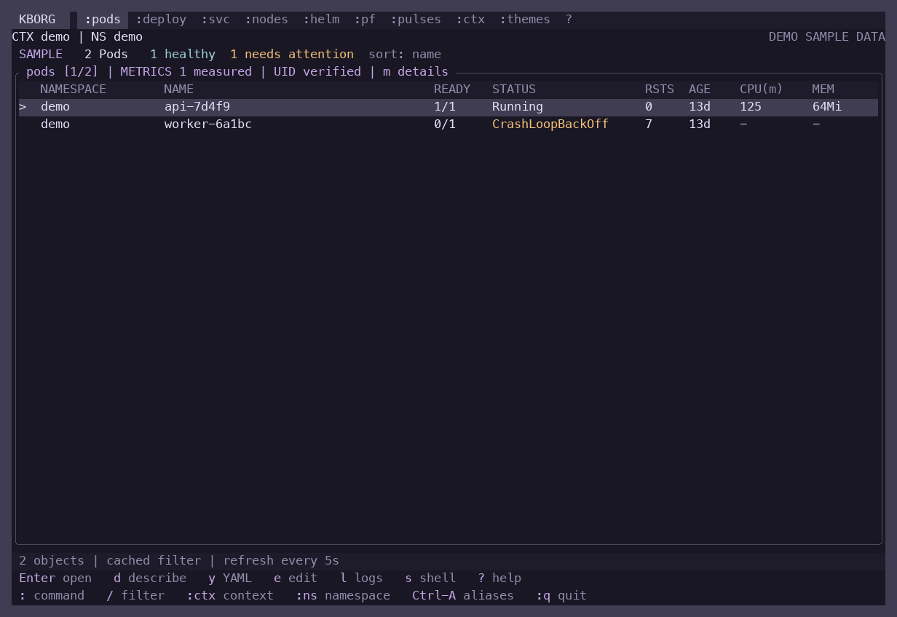
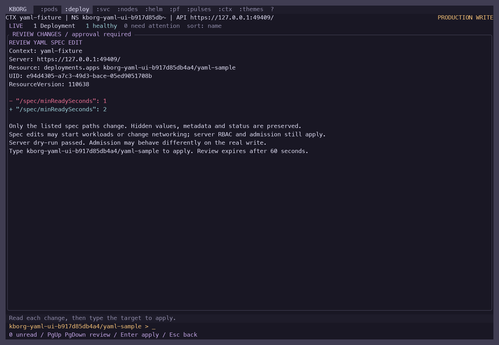
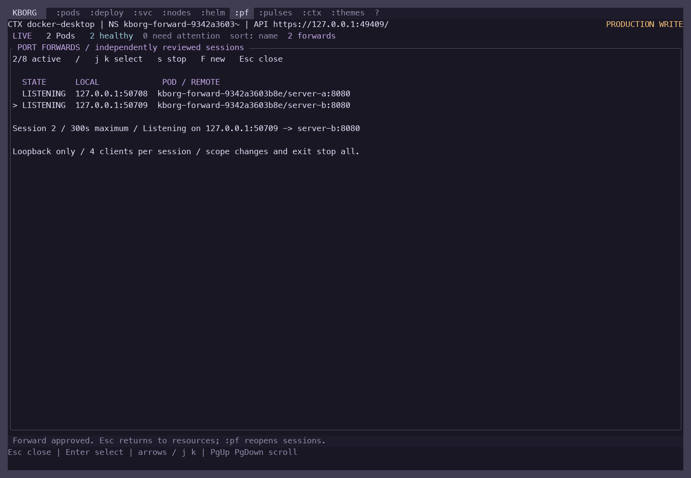
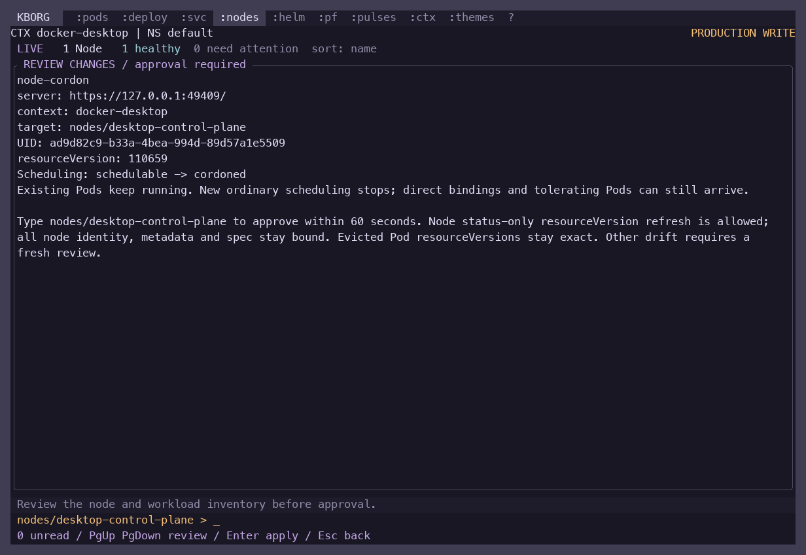
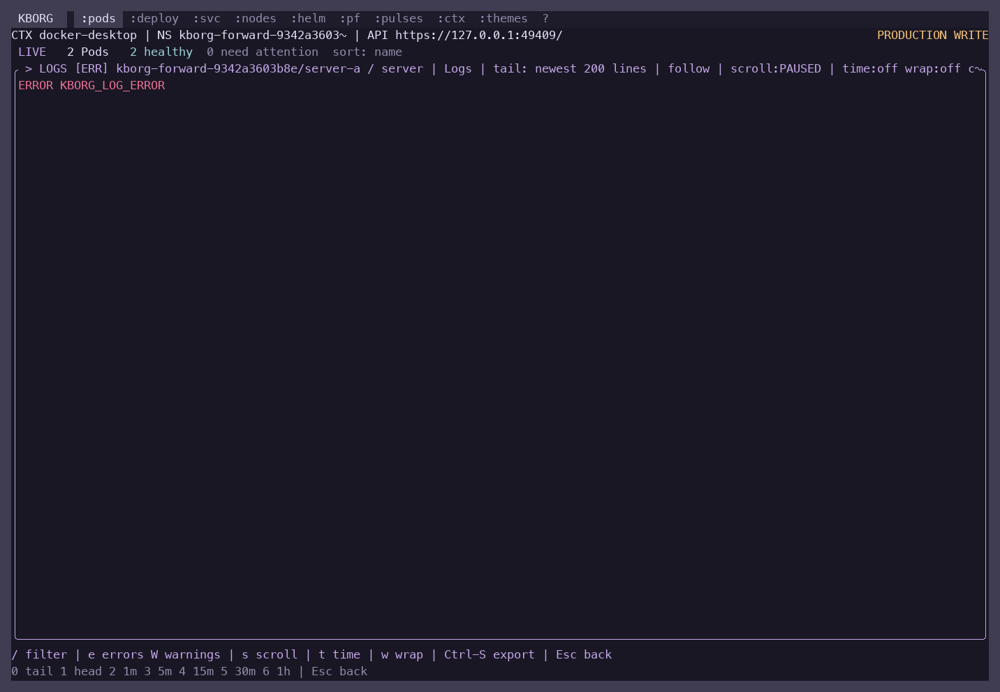

# Mac v1 workflow acceptance

Reviewed 2026-10-23 on macOS ARM64. The YAML editing, node maintenance, export, multiple-forward and top-menu batch is implemented and accepted within the limits below. This is a development milestone, not a signed 1.0 release or full k9s/Helm parity.

## Tested build

Release binary SHA256: `357fdd264de7da5d151fcb0b2e560313d556888fae39754579f30b4aa040fe8e`.

Every final terminal/live report identifies that binary. [Source manifest](evidence/v1-build-source.json) records the exact Rust, test, dependency and embedded CLI-help inputs. [Validation summary](evidence/v1-validation-summary.json) links the checks. Earlier iteration screenshots and older acceptance reports describe their own builds.

## Validation

| Check | Result and scope |
|---|---|
| Release build, formatting, Clippy | Passed with locked offline dependencies; Clippy used all targets and denied warnings |
| Rust tests | 380 passed, 0 failed, 18 ignored in the serial suite: 378 library tests and 2 integration tests; ignored opt-in fixtures are not counted as passes |
| Terminal regression | 63 actual PTY states; terminal restored, no output during the measured two-second idle interval |
| YAML on Docker Desktop and minikube | Six checks per cluster: cancel, invalid-draft retention, fully painted review, confirmed live patch, hidden-field/metadata preservation, TUI restoration and explicit-file CLI workflow |
| Forwarding/log exports on both clusters | Nine checks per cluster: independent routing, collision rejection, selected stop, port reuse, scope/exit cleanup, private attributed exports, cancel and overwrite refusal |
| Node maintenance on Docker Desktop | Dry-run/review/cancel; scheduling preserved. No live cordon/drain of the user's Desktop node |
| Node maintenance on minikube | Reviewed cordon/uncordon, PDB refusal preserving Pod identity, successful policy/v1 eviction, explicit uncordon and fixture recovery |
| Export/UI captures | Five offline resource/log/Helm export checks; ten final theme screens; live YAML, node and forward captures visually reviewed |
| Dependency advisory check | Cached RustSec database: 203 packages, 1,349 advisories, zero reported vulnerabilities/warnings. Database was not refreshed; this is not a current-feed security certification |
| Cleanup | All owned fixtures removed; both disposable minikube nodes/profile deleted. Docker Desktop context and its existing TLS-verified metrics provider preserved |

Commands and reports:

```sh
cargo build --release --locked --offline
cargo fmt --all -- --check
cargo clippy --locked --offline --all-targets -- -D warnings
cargo test --locked --offline -- --test-threads=1
python3 scripts/test-terminal.py --binary target/release/kborg --output docs/evidence/v1-terminal-macos.json
```

Live harnesses are `scripts/test-live-yaml-ui.py`, `scripts/test-live-forwards-ui.py`, `scripts/test-node-maintenance.py` and `scripts/capture-node-ui.py`; their `--help` describes explicit context/kubeconfig/owned-worker selection. The screenshot scripts require Pillow. Tests used Docker Desktop Kubernetes 1.36.1 and an owned two-node Docker-driver minikube cluster running Kubernetes 1.35.9. Node mutations were confined to the disposable worker.

An earlier parallel Rust test run hit the existing snapshot lock (`another snapshot is being saved; retry shortly`). The full final suite passed serially. Parallel process-test isolation remains a test-harness follow-up; the serial result does not establish that the parallel suite is free of flakes.

## Code and security review

Three implementation/review agents and the coordinating review covered YAML patch construction and admission checks, node identity/eviction/PDB handling, forward cleanup, private exports and actual terminal behavior. Findings fixed before the final build included checking the real YAML write response, escaping review paths faithfully, retaining source identity in log exports, showing export failures, correcting error colors and keeping active filter badges visible. Review paragraphs now wrap at word boundaries without losing characters; full-review confirmation still requires every rendered line to be seen.

No unresolved actionable finding remained in those reviewed paths. This is an internal code review with bounded tests, not an independent security assessment. Kubernetes authorization/admission, explicit capability flags, exact target confirmation and one-use reviews remain required. Logs/custom fields may contain secrets; local exports are explicit and private, not guaranteed secret-free.

## Final screenshots

The images below are rendered captures of actual pseudo-terminal output, not mockups. Demo screens are labeled. They do not replace a Terminal/iTerm/SSH/font/accessibility matrix.

Rosé Pine resource table and compact command menu, using demo data:



Live Docker Desktop YAML change review:



Two simultaneous live Docker Desktop forwards:



Docker Desktop node review, canceled without changing scheduling:



Live filtered logs with a visible filter badge:



Full final evidence: [YAML Desktop](evidence/ui-v1-final/yaml-desktop/report.json), [YAML minikube](evidence/ui-v1-final/yaml-minikube/report.json), [forwards Desktop](evidence/ui-v1-final/forwards-desktop/report.json), [forwards minikube](evidence/ui-v1-final/forwards-minikube/report.json), [node Desktop](evidence/v1-node-desktop.json), [node minikube](evidence/v1-node-minikube.json), [node UI](evidence/ui-v1-node-desktop/report.json), [exports](evidence/ui-v1-final/exports/report.json), [theme screens](evidence/ui-v1-final/rose-pine/report.json), [cleanup](evidence/v1-cleanup.json).

## Remaining product work

YAML edits cover existing namespaced non-Secret spec paths; arbitrary apply/creation, metadata/status and cluster-scoped YAML writes are excluded. Drain retains system/DaemonSet/mirror/completed Pods and blocks potentially lossy or unsupported workloads; completion is not permission to power off a node. Forwards are loopback-only, eight sessions/four clients each, capped at five minutes. Log exports cover a retained snapshot; workload stream membership remains fixed.

The [v1 plan](MAC_V1_PLAN.md) prioritizes the next k10s-inspired dashboard grid, numbered focus, stable health/warning sections, evidence-linked OOM/restart summaries and opt-in saved selections. Publisher signing/notarization, longer outage/recovery soaks, real-terminal/accessibility acceptance and independent security review remain release gates. The [remaining-work register](REMAINING_WORK.md) records broader Helm, platform and compatibility limits. Prior Copilot/Sigstore/CRD live acceptance was not rerun as part of this workflow batch.
