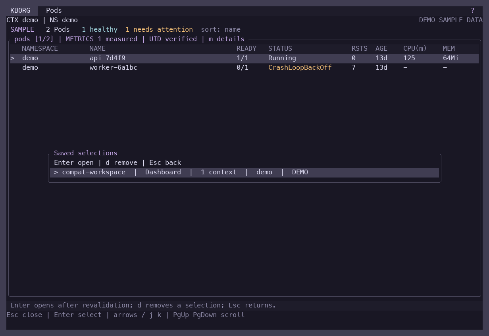
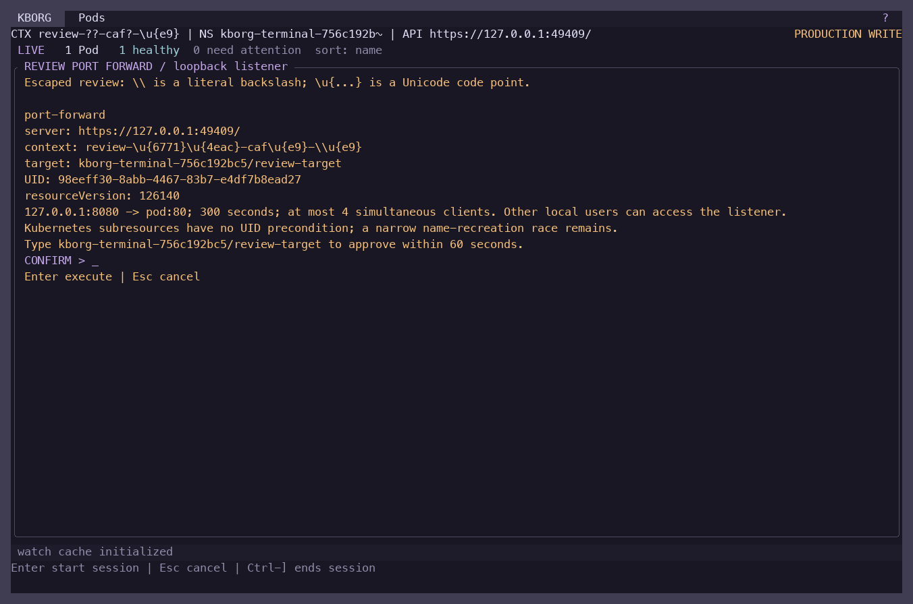
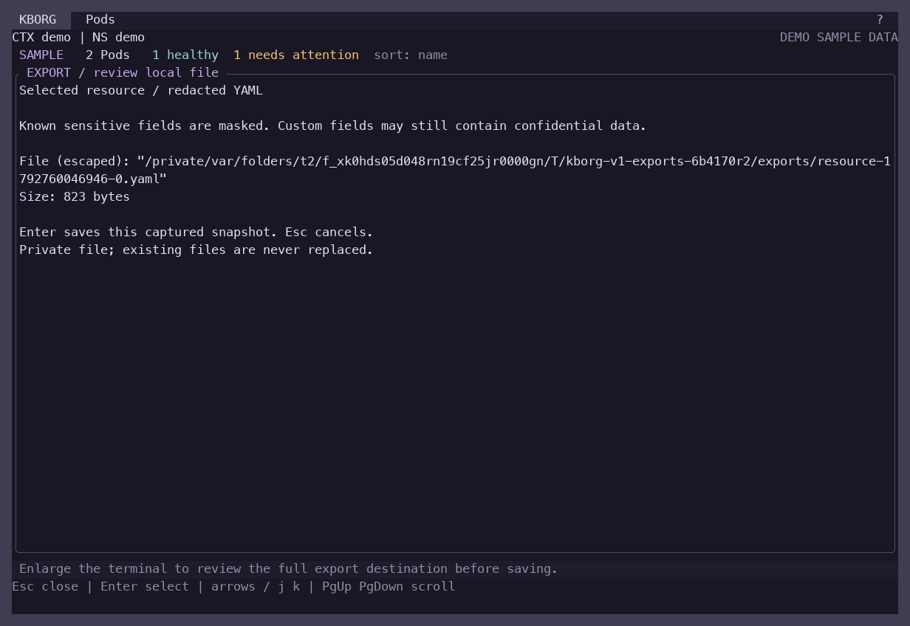

# Mac terminal compatibility

Reviewed 2026-10-23 on macOS 27.0.1, Apple Silicon. This report distinguishes actual process/terminal tests from native application rendering. The final binary digest and individual results are recorded in [the compatibility evidence](evidence/mac-v1-terminal-compatibility.json).

Final release SHA-256: `32a6b514bce9ab3edf247248c91e84abbce363b82980a06a6b440e9450bd4cd5`, built from source commit `2a333066f438ed2ea720d9f4932c273982b3a423`. All 10 PTY profiles passed (71 recorded checks, 50 resize transitions), as did the two `TERM=dumb` checks and five real tmux checks. This includes the new saved-picker action hint, which stays inside the picker rather than disappearing when background status changes.

## Supported operating envelope

KBorg uses standard terminal keyboard input, the alternate screen, cursor addressing, bracketed paste and optional SGR mouse events. It emits complete synchronized frames; terminals that do not implement synchronized updates can ignore that mode and still display the same content. The normal exit path restores raw mode, cursor visibility, line wrapping, mouse capture, bracketed paste and the alternate screen.

The usable minimum is 28 columns by 10 rows. Below that size, the application shows a compact resize notice and remains able to quit. The recommended everyday size is at least 80 by 24; 120 by 34 provides more table detail and dashboard space. Resizing preserves the selected context. Only `?` is exposed in the main header; it opens the keyboard map. Typed commands remain available without a permanent command menu.

| Configuration | Behavior checked |
|---|---|
| `TERM=xterm-256color`, `COLORTERM=truecolor` | RGB theme output, SGR mouse help target, continuous UTF-8 borders |
| `TERM=xterm-256color`, no `COLORTERM` | Indexed 256-color output, keyboard navigation |
| `TERM=xterm`, no `COLORTERM` | Basic 16-color SGR; appearance depends on the host palette |
| `TERM=screen-256color` / `tmux-256color` | Indexed output and navigation in fresh PTYs |
| `LC_ALL=C` | ASCII-only text and `+`, `-`, `|` frame fallback |
| `NO_COLOR=1` | No nondefault foreground/background color escapes |
| `--color=never` | No nondefault foreground/background color escapes |
| `NO_COLOR=1 --color=always` | Explicit command-line choice enables color |
| No `TERM` | Conservative basic colors and ASCII locale behavior |
| `TERM=dumb` | Interactive mode refused before terminal mutation; CLI JSON remains usable |
| tmux 3.8, dedicated private server | Real pane parsing, dashboard navigation, resize, help, Ctrl-C, shell return and mode restoration |

Each interactive PTY profile exercises resources, help, cancelled command entry, dashboard, saved selection, cancelled deletion, sizes 120×34 → 80×24 → 48×16 → 28×10 → 20×8 → 120×34, and clean exit. Tests compare original and final termios and require explicit restoration escape sequences. A saved-picker regression checks that its delete action remains visible even while a background resource watch replaces the status message.

The private tmux test uses a unique socket, `/dev/null` configuration and a disposable demo shell. It does not connect to an existing user server, alter user configuration or claim an SSH connection. The server is stopped after the test.

The [live Unicode-review report](evidence/ui-mac-v1-hardening-final/unicode-review/report.json) exercises a Docker Desktop Pod with a synthetic Unicode kubeconfig context. A short-lived service account can only read Pods in that uniquely owned namespace. The displayed operation review preserves Tokyo characters, accented text and literal backslashes as distinct escaped values; at 48×12, Enter refuses the incomplete visible review. Escape cancels and the forward manager remains empty. No forwarding session or cluster mutation is approved. Namespace cleanup checks its UID and test run label before deletion.

The [export approval regression](evidence/mac-v1-export-approval-regression.json) reproduces the previous release's hidden-review save at 20×100, then proves the corrected release refuses that same Enter key without creating a file. Widening to 120×34 retains the unsaved review, and cancel/save, private permissions, resource/log/Helm exports and terminal restoration all pass. The real event-handler test also covers 27×100, a too-short terminal, successful visible save, and terminal-size query failures before export or Helm dispatch. Export, YAML/node, Helm and Copilot approval handlers now reject an unknown terminal size instead of assuming 80×24.

The [live YAML UI report](evidence/ui-mac-v1-hardening-final/yaml/report.json) adds six checks on an owned zero-replica Docker Desktop Deployment: editor cancellation, invalid-buffer retention, complete review and exact target confirmation, hidden-field preservation, terminal restoration and the explicit-file CLI path. Its namespace was removed after verification.







## Native application and accessibility limits

Apple Terminal 2.15 (488), iTerm 3.7.4 and Ghostty 1.3.1 (15212) are installed. Native app validation was attempted for Terminal and iTerm through the available computer-use tool. Both were rejected with: “Computer Use is not allowed to use the app … for safety reasons.” No alternate UI mechanism was used to bypass that restriction, and no native app compatibility pass or native screenshot is claimed.

The committed screenshots are captures of the running binary's PTY cells. They verify application layout and content; they do not certify a particular emulator, font rasterizer, custom ANSI palette, remote SSH path or screen reader. The capture helper connects the six frame glyphs at terminal-cell edges; that makes the underlying continuous border layout legible but is not evidence of native font rendering.

Before general release, manually complete the following in dedicated Terminal, iTerm and optional Ghostty windows, using the exact release binary:

1. Run `kborg --demo --theme rose-pine --no-splash`. Check continuous borders with the chosen monospace font at standard and enlarged font sizes. Open `?`, close it, open `D`, select contexts and return with Escape.
2. Resize to 80×24, 48×16, 28×10 and below the minimum, then enlarge. Confirm no clipped confirmation becomes actionable and context focus remains stable.
3. Save with dashboard `s`, open `B`, wait through a background update, use `d`, then cancel. Confirm the selection remains and the help line remains visible.
4. Check `NO_COLOR=1`, `--color=never`, `--no-mouse` and `LC_ALL=C`. Confirm keyboard-only operation and selected-row markers are usable without color.
5. Open a reviewed demo operation, inspect every page, cancel and return to the resource list. Verify keyboard navigation and Escape after resizing; no real cluster write is required.
6. Exit normally and with Ctrl-C. Verify the original shell responds, typed characters echo, the cursor is visible, line wrapping works and mouse selection belongs to the terminal again.
7. Repeat through a deliberately configured SSH connection and attached tmux client. Record both server/client terminal identities, font, size, OS and release digest. No remote SSH test was available in this session.

Screen-reader behavior, alternate fonts, bidirectional/wide Unicode text and forced termination remain separate release considerations. Sensitive review text uses explicit ASCII code-point escapes for non-ASCII characters so distinct proposed values cannot collapse to the same visible question marks. This is a review safety measure, not full Unicode UI support. `SIGKILL` cannot run cleanup; after a forced kill, the user's shell may need `stty sane` or `reset`.

## Reproduce

From the repository root, with Python and Pillow available:

```sh
python3 scripts/test-terminal-compatibility.py \
  --binary target/aarch64-apple-darwin/release/kborg \
  --output docs/evidence/mac-v1-terminal-compatibility.json \
  --screenshots docs/evidence/ui-mac-v1-hardening-final/terminal
```

The harness uses only demo data, isolated temporary preferences and bounded subprocesses. It never stores kubeconfig credentials or opens a cluster connection. Docker Desktop and minikube soak evidence is reported separately.
