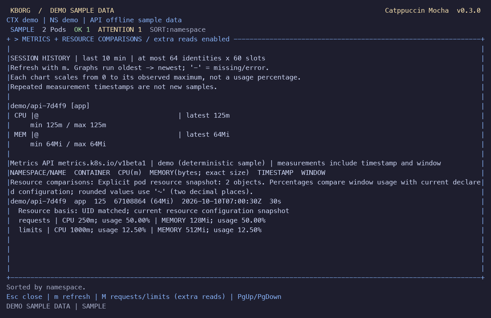

# KBorg priority workflows: local acceptance

Reviewed on 2026-10-10 for the development iteration after `c54dea9`, on branch
`codex/complete-core-workflows`. The user-selected integration scope was the
existing Docker Desktop Kubernetes cluster. This report records implemented
behavior and retained local evidence; [REMAINING_WORK.md](REMAINING_WORK.md)
continues to track external acceptance gates.

## Result and evidence scope

The final native macOS ARM64 build passed **160 library unit tests and two
standalone non-cluster checks: 162 passed, zero failed**, including the independent
metrics quantity contract and broken-pipe CLI output checks. Strict all-target
Clippy, formatting and whitespace checks passed. The two ignored library
subprocess fixtures are exercised by their parent tests; they are not additional
live-cluster tests.

**Six real integration tests passed** against Docker Desktop Kubernetes
**v1.36.1**, across three uniquely owned namespaces. The tests used digest-pinned
BusyBox fixtures and separately scoped reader/operator/fixture identities.
Namespaces were ownership-checked and removed, and the temporary ten-minute
credential directory was removed. No cloud account or nonlocal cluster was used.

| Acceptance | Retained result | Evidence boundary |
|---|---|---|
| macOS ARM64 automated checks | 160 library tests plus two standalone checks: 162 passed, zero failed; strict Clippy/format/release/CLI-help and JSON smoke passed | [Build evidence](evidence/priorities-build-macos.json); successful unit checks are separate from live integration |
| Docker Desktop operations | Two desktop tests plus the native ExecCredential test passed | Typed mutations/RBAC/redaction; long log follow; helper TLS/revocation/reconnect |
| Docker Desktop watch/metrics | Two tests passed | LIST/WATCH lifecycle and authorization loss; optional Metrics API unavailable/forbidden behavior |
| Docker Desktop native operations | One test passed | Exec, attach, forwarding and interactive session cases inside one owned fixture suite |
| Existing default Docker Desktop configuration | Final release read nine pods across all namespaces | [Read-only smoke evidence](evidence/priorities-default-desktop-read.json); unmodified existing kubeconfig, retained count only |
| macOS ARM64 release PTY | Fourteen states captured; terminal restored; exit succeeded | Offline sample data in a native PTY, including a 48×12 resize |
| Linux ARM64 native checks | 160 library tests plus two standalone checks: 162 passed, zero failed; format/Clippy/release and JSON smoke passed | [Linux build evidence](evidence/priorities-linux-arm64.json); native ARM64 binaries inside the documented disposable Docker container, with source rechecked after build |
| Linux ARM64 release PTY | Fourteen states captured; terminal restored; exit succeeded | [Linux PTY evidence](evidence/priorities-terminal-linux-arm64.json); offline samples in Docker, including a 48×12 resize |
| Signed distribution | No publisher-signed or notarized release produced; zero available signing identities | Native build and local testing do not establish distribution provenance |

[Live acceptance JSON](evidence/priorities-local-macos.json) records its UTC
timestamp, Kubernetes version, local endpoint, CA SHA-256, pinned image, suite
results, cleanup and exact hashes for 37 source/test/build inputs. Those hashes
identify the final accepted run. The [macOS build](evidence/priorities-build-macos.json)
and [Linux build](evidence/priorities-linux-arm64.json) reports each retain 39
tested input hashes. All recorded hashes matched the frozen checkout during
final review. Linux additionally rechecked source after its build.

An initial Linux debug test executable exceeded the existing 128 MiB executable
trust bound. `[profile.test] debug = 1` reduced test debug information, and the
final native tests passed without raising that runtime limit.

The accepted image was
`busybox@sha256:bdf57e528e45e4433820e045b29b4597825a1c9e38353532d90a01445013f82e`.
The evidence contains no tokens, private keys, kubeconfig contents or workload
payloads. The previous [SESSION_ACCEPTANCE.md](SESSION_ACCEPTANCE.md) remains a
historical report for the earlier iteration.

The [default-configuration smoke](evidence/priorities-default-desktop-read.json)
also verified the finished release against the user's existing Docker Desktop
configuration, with no kubeconfig edits or cluster writes. It retained only the
successful nine-pod count. The restricted fixture results remain the evidence
for least-privilege and forbidden-operation behavior.

## Delivered priority workflows

| Workflow | Implemented behavior and limits | Validation in this iteration |
|---|---|---|
| Interactive exec/attach | Separate `--write` and exec/attach capability, exact target review, UID/resourceVersion recheck, stdin/TTY resize, local `Ctrl-]` disconnect; 1..3600 seconds, 16 MiB output and 1 MiB input | Real BusyBox stdin and attach, 80×24 resize, output canary filtering, expiry, cancellation and input/output bounds |
| Longer rolling logs | Follow defaults to one hour and accepts 1..86400 seconds; display retains at most 256 KiB/2000 lines; 4096-byte line bound, 64 MiB wire limit, 1 MiB/s and 5000 lines/s flood limits | Real stream exceeded the former 256 KiB session cutoff and resumed after a quiet interval longer than ten seconds; parser/flood/rolling-window regressions |
| Continuous context overview | Up to four explicitly selected independent read-only watches, per-context status/errors, coalesced bounded updates and cancellation on close; snapshot CLI still supports 1..100 contexts | Controlled/demo update, isolation, count and cancellation tests; PTY view capture. Independent real clusters were not exercised together |
| Reviewed authentication helpers | Unix native ExecCredential v1/v1beta1 token or certificate/key; explicit executable, argv/environment/endpoint/CA/TLS/context binding, SHA-256/file identity, 15-second/256 KiB supervision; future expiry within 24 hours and connection stop after 401/403 | Real scoped reader token returned by a fixed native fixture: verified TLS read, forbidden scope, blocked subsequent read, explicit reconnect, and pre-execution endpoint/CA/executable tamper rejection. Windows helpers are unsupported and fail closed |
| Deployment resource budgets | Four individually allowed ordinary-container CPU/memory request/limit fields, readable review, dry-run, sealed patch, UID/resourceVersion and one-use approval; generic patches remain absent | Real owned deployment update in the desktop suite plus validation/policy/GitOps/stale-target regressions |
| Metrics history and optional bases | 64 identities × 60 slots, ten-minute history, exact units and explicit gaps; `M`/`--metrics-resources` separately reads current ordinary-container requests/limits or node allocatable/capacity | Exact percentage/rounding/greater-than-100% tests, missing/zero/invalid/overflow bases, namespace/UID/recreation checks and additional-read 403 retaining usage. Successful live Metrics API collection was not demonstrated in this iteration |
| Native inspection pager | `view --interactive` uses an in-process redacted JSON/YAML pager with search, navigation, horizontal pan, resize and a finite session | Redaction/control/bounds/navigation tests. External interactive editor/pager support remains open |
| Optional registered local views | Unix native views; private schema-1 registry, max 64 entries, exact literal argv and immutable native SHA/file identity; explicit extension/tool capabilities and fresh full-input `RUN TOOL` approval each invocation | Registration/expiry/schema/permissions/concurrency/update tests and native filter smoke. Entries cannot enable KBorg capabilities or substitute object metadata into argv. Windows execution is unsupported |
| Browser refinement | Responsive bordered panels, useful object overview, readiness/restarts/age, command aliases, sorting, live cached filtering with selection restoration, visible disabled actions, context/namespace labels and theme creation from preview | Thirty TUI regressions plus color-mode regression and fourteen actual release PTY states; the broader terminal matrix remains open |
| Optional Copilot preparation | Portable minimized local preview; concrete native Mach-O SDK/OS preflight on macOS only; diagnosis remains disabled on all platforms even after approval | Native SDK signature/hash inspection and fake-file/process/loopback canaries; no model request, account-store selection or credential-content read |

The live helper is a test-only native provider returning the harness's existing
scoped ServiceAccount token from a private response file. Its strict JSON stdout
is captured by KBorg; review, policy and retained evidence contain no credential.
The fixture compiler and response files are temporary test infrastructure, not
an application runtime requirement. This verifies the helper adapter and its
transport boundaries without claiming AWS, Azure or GCP authentication.

Metrics comparisons describe **current declared configuration**, which can
change after a window measurement. When both UIDs are available they must match;
resources created after the measurement are rejected. When the Metrics API omits
UID, the display explicitly marks a name-based snapshot with unverified
generation. Missing or zero denominators produce no percentage; approximate
two-decimal results carry `~`. Init/ephemeral-container usage is not aggregated
into ordinary-container budgets.

## Native release terminal evidence

[PTY evidence](evidence/priorities-terminal-macos.json) identifies the tested
final release binary by SHA-256
`03bb57e54b9db3d243a8a04b490e97432376550a468cdcdbb4ce54b37e38a544`.
The retained report's binary digest and measurements identify this final capture.

The final sample lasted **17.607 seconds**, used **0.037853 child CPU seconds**,
peaked at **9,781,248 bytes / 9.33 MiB RSS**, and
emitted **zero bytes during a two-second quiet interval**. The harness verified
alternate-screen and terminal input-mode restoration. Measurements exclude the
supervising Python process. This is one short native sample, not a sustained soak
or a p95/p99 performance result.

The [Linux ARM64 PTY](evidence/priorities-terminal-linux-arm64.json) used the
native release SHA-256
`2dff0e51af4234d28d527f282e4ed02ea827809eadc4a681f6091edac45fa3f2`.
Its **16.679-second** sample used **0.032085 child CPU seconds**, peaked at
**10,690,560 bytes / 10.20 MiB RSS**, emitted **zero bytes during a two-second
quiet interval**, and restored terminal modes. Both platform samples cover
fourteen states; neither establishes a long-duration performance budget.

Fourteen captures cover pods, object overview, JSON, actions, deployments,
sorting, history, allocations, containers/log detail, context overview, themes,
theme creation and 48×12 layout. The PTY command used offline samples, ASCII
truecolor, `--no-mouse`, inherited `NO_COLOR` and explicit `--color=always`; these
captures do not establish live data, mouse behavior or a physical-terminal matrix.




## Reproduce locally

```sh
cargo test --locked --offline --all-targets
cargo clippy --locked --offline --all-targets -- -D warnings
cargo build --locked --offline --release
python3 scripts/test-local.py --expected-server https://127.0.0.1:YOUR_INSPECTED_PORT --output test-results/priorities-local.json
python3 scripts/test-terminal.py --binary target/release/kborg --output test-results/priorities-terminal.json --screenshots test-results/priority-screens
```

Offline Cargo commands require the locked dependency cache. The local harness
requires the explicitly inspected Docker Desktop TLS endpoint and existing CA;
it rejects a mismatch, creates only owned restricted fixtures and removes them.
The terminal harness requires a native Unix PTY; PNG capture additionally needs
Pillow. [CLI help](CLI_HELP.txt) and [operations](OPERATIONS.md) describe the
separate capability flags and exact approvals for sessions, helpers and tools.

### Linux ARM64 in a disposable Docker container

[test-linux-container.sh](../scripts/test-linux-container.sh) refuses to run
unless both `KBORG_CONTAINER_VALIDATION=1` and `/.dockerenv` are present. The
container copies the read-only source into a scratch build directory, runs
format/tests/Clippy/release and demo/allocation JSON smoke, captures the native
Linux release PTY, and copies source hashes/logs/binary results to the explicit
output directory.

```sh
kborg_linux_output=$(mktemp -d /tmp/kborg-linux-acceptance.XXXXXX)
docker run --rm --platform linux/arm64 \
  --env KBORG_CONTAINER_VALIDATION=1 \
  --mount "type=bind,source=$PWD,target=/source,readonly" \
  --mount "type=bind,source=$kborg_linux_output,target=/output" \
  --tmpfs /build:rw,exec,size=3g \
  rust:1.99.0-slim@sha256:2752b332db73fdbb7dc576f06c82ed1f312005784ef913d7e04a28f5f55dc581 \
  /bin/sh /source/scripts/test-linux-container.sh
```

Default networking downloads the image, Debian `procps`/`python3` and locked
public Cargo dependencies. An optional read-only public Cargo cache at `/cache`
can seed `/cache/registry`; it supplies no credentials. No host kubeconfig,
credential home, SSH directory or Docker socket is mounted. This run builds and
tests native Linux ARM64 code inside Docker; it does not contact Kubernetes or
establish Linux desktop/SSH/tmux/WSL acceptance. Its final retained
[build report](evidence/priorities-linux-arm64.json) and
[PTY report](evidence/priorities-terminal-linux-arm64.json) identify exact source,
image and executable hashes.

## Remaining acceptance gates

Actual AWS/Azure/GCP helper identity flows, chained CLIs requiring PATH or
interpreter wrappers, credential rotation across those providers, and
handle-based executable trust remain untested or unsupported. The native helper
and registered-view supervisors retain the trusted program's OS-user filesystem
and network permissions. Independent platform containment is required before
promoting privileged tools; a content fingerprint is not a publisher signature.
Authentication helper execution and external/registered tool execution are
explicitly unsupported on Windows, rather than merely awaiting acceptance.

[Copilot preflight evidence](evidence/copilot-preflight-macos.json) records a
valid native macOS code signature and successful fresh fake-canary denials, but
`diagnosis_enabled` and `credentials_read` remain false. Publisher-pinned native
SDK provenance, dedicated host-bound credentials, and independent inference/auth
hostname egress have not been validated. The network probe denies all networking;
it does not authorize a Copilot endpoint. Automated advice remains disabled.
The concrete native SDK/sandbox preflight is macOS-only; local minimized preview
is portable, and inference remains disabled on every platform.

External interactive editors/pagers and remote full-screen applications remain
unsupported. A local session disconnect cannot prove that a remote process
terminated. Successful live metrics history needs an installed secured provider;
several simultaneous independent clusters, long floods/soaks and reconnect storms
still require operational acceptance.

This iteration supplies an unsigned local release build. Publisher signing,
notarization, authenticated provenance, protected external audit/reconciliation,
organizational admission/RBAC pilots, Windows/WSL and the broader OS/terminal
matrix remain explicit gates. Historical platform packages and advisory scans
retain their original source/lock identities; they do not certify this iteration.
The direct dependency decisions are recorded in
[ADR 0001](adr/0001-native-first.md).
