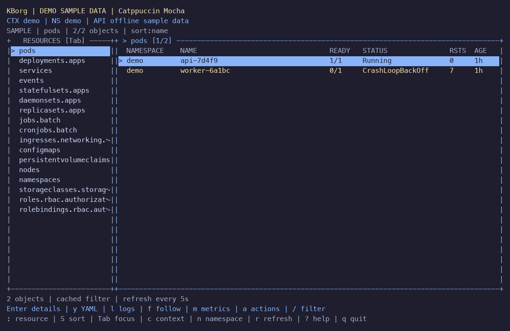

# KBorg native macOS session acceptance

Validated on 2026-10-10, macOS ARM64, Rust 1.99.0, Docker Desktop Kubernetes
1.36.1. Base repository revision: `bb0a53c`. Working branch:
`codex/complete-core-workflows`. Native binary: `target/release/kborg`.

## Result

The core application builds and runs locally with the refined TUI. All **116
non-ignored automated tests** pass, including 20 TUI tests; strict all-target
Clippy, rustfmt and whitespace checks pass. **Four real integration tests** pass
across three uniquely owned fixture namespaces: resource operations, watch
lifecycle/revocation, unavailable/forbidden metrics, and native subresources.
The namespaces and temporary ten-minute token files were removed.

The separately ignored native handoff fixture is a subprocess test helper, and
is exercised by the passing handoff tests. The default test run intentionally
skips the four integration tests; the native local harness runs them explicitly.

## Implemented improvements

| Area | Delivered behavior |
|---|---|
| Resource browser | Adaptive bordered panes, readiness/restarts/age, persistent context/namespace identity, explicit monochrome selection, useful loading/empty/stale states |
| Navigation | `:pods`, `:deploy`, `:svc`, `:nodes`, `:ns NAME`, `:all`, `:ctx`; name/namespace/status/restart/age sorting; page/home/end movement; live filter with UID-preserving cancellation |
| Metrics | CPU/memory history, 64 identities × 60 slots, ten-minute retention, exact latest/min/max, duplicate-timestamp suppression and explicit gaps; five-second modal refresh |
| Themes | `t`, preview with arrows, `N` creates a custom palette from the actual preview; no overwrite; Esc restores the previous theme |
| Terminal compatibility | Cached truecolor/256/ANSI16 detection; actual basic ANSI sequences; `--color=always` overrides inherited NO_COLOR; wrapped small-terminal details |
| Action feedback | Visible OFF reasons, keyboard equivalents, immutable target capture and refusal to approve a review that cannot fit visibly |
| Resource status | Init failure, readiness gates, termination, node scheduling/readiness, daemonsets/jobs/cronjobs; conservative multi-context unhealthy counts |
| Offline demo | Correctly scoped and versioned examples for all 17 built-in kinds; demo ConfigMap values use the same redaction boundary |
| External views | Unix absolute native executable, immutable argv and full redacted transfer review, content revalidation, separate opt-in, 15-second/256 KiB supervision and process-group cleanup |
| CLI reliability | Documented read-output contract v1, unsupported JSON rejection, normal broken-pipe exit across 16 actual finite read paths |



## Retained evidence

[Live acceptance JSON](evidence/local-macos-session.json) records the exact source
hashes used for the real-cluster suites, Kubernetes version, TLS CA fingerprint,
pinned fixture image, suite outcomes and cleanup. A subsequent CLI-only explicit
color override fix is covered by the final automated and PTY checks.

[Native PTY JSON](evidence/terminal-macos-session.json) records the final release
binary SHA-256 `c44f4288853f2f5d5075ad92a71f20d000510c93b63b2b302807464081db24b6`, actual keyboard/resize captures,
terminal restoration and process measurements. Nine captured states cover pods,
deployments, sorting, metrics, container/log views, themes, creation and 48×12
layout. Pure renderer tests additionally exercise widths 28..120 and heights
10..24, details reflow and hidden-review approval refusal.

The final 11.6-second interactive demo sample used **0.031313
CPU seconds**, peaked at **8.66 MiB RSS**, and emitted
**zero bytes during a two-second quiet interval**. This is one native sample,
not a sustained flood/soak or p95/p99 performance certification. The PTY harness
keeps its controlling session alive long enough to verify both alternate-screen
and terminal input-mode restoration; measurements exclude the supervising Python
process. Color capture explicitly inherits NO_COLOR and passes --color=always.

The final binary also passed live `doctor` and discovery smoke checks: 59
browsable kinds, Secrets excluded. A real terminal-reviewed `/bin/cat` tool view
returned the approved demo object and exited successfully.

## Run locally

```sh
./scripts/start-local.sh --demo
./scripts/start-local.sh --context docker-desktop --no-splash
```

Use `--allow-logs` when explicitly opting in to logs. Live browsing starts
read-only; writes and privileged subresources retain their separate flags and
review requirements. Native local tests can be repeated with the exact inspected
Docker Desktop endpoint using `python3 scripts/test-local.py --expected-server
ENDPOINT`; see [operations](OPERATIONS.md).

## Remaining gates

[REMAINING_WORK.md](REMAINING_WORK.md) remains the authoritative register.
Interactive exec/attach stdin/TTY, continuous simultaneous multi-context watches,
cloud auth helper trust, independently constrained privileged external tools,
interactive pagers/editors, Windows tool containment, optional Copilot automation,
protected external audit, signing/notarization, longer soaks and broader terminal
and platform acceptance remain open. The native build is an unsigned local
iteration and does not claim complete feature parity with k9s or production
certification. No dependency was added and Cargo.lock is unchanged.
