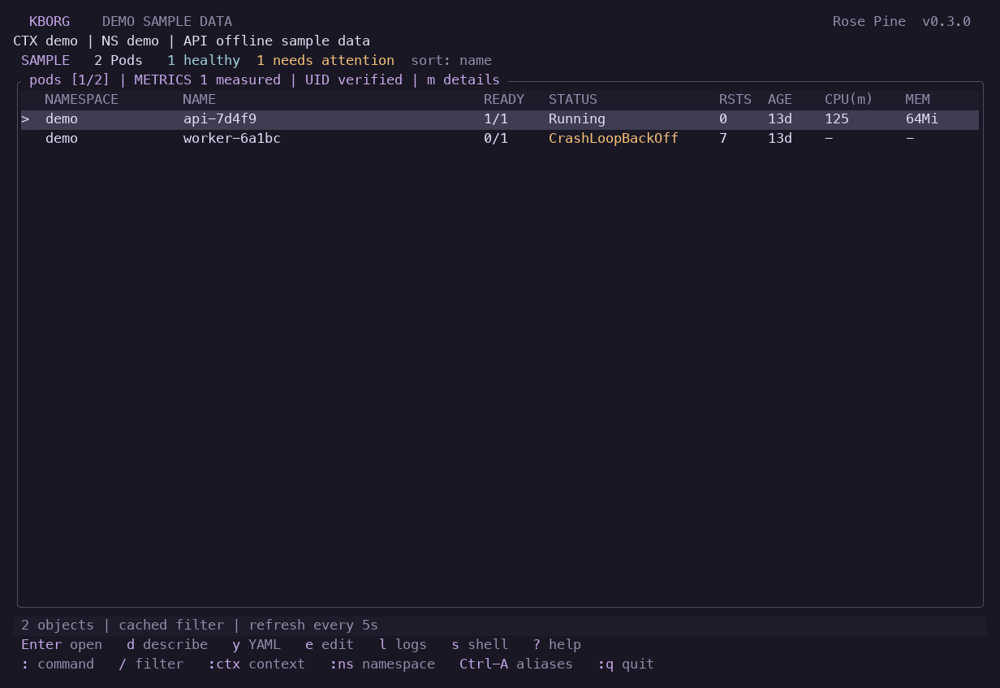
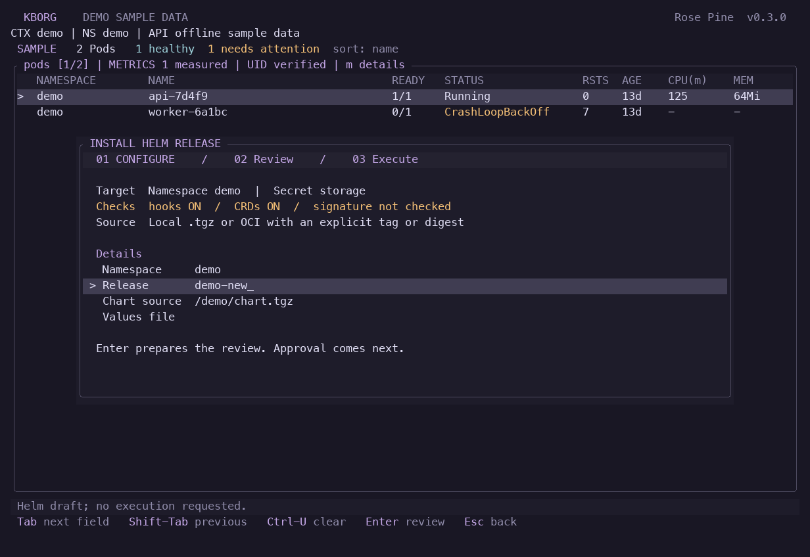

# Sigstore, storage migration and Copilot acceptance

Date: 2026-10-23. Continuation of `5668284` on
`codex/sigstore-migrations-copilot`. This report covers explicit Sigstore chart
verification, CRD storage-version migration, optional contained Copilot advice,
a security review and terminal UI refinement. It is local acceptance, not full
Helm/k9s parity or production certification.

## Delivered behavior

- Sigstore verification seals exact chart archive bytes, an explicit trusted
  native Cosign 3.1.3 pin and offline v0.3 bundle. Both public-key/root and exact
  identity/issuer/root modes require transparency evidence. Verification runs
  before review and execution; wrong or changed trust and content fail closed.
- `helm crds-migrate` and `:helm-crds-migrate` review the schema, all captured
  owned instances, storage versions and any controller request. Native target-API
  rewrites preserve content and use UID/resourceVersion guards. Historical
  storedVersions are cleared only after official controller proof and a fresh
  complete inventory. Docker Desktop stages safely; configured minikube can
  finalize. Cancellation/partial work never implies automatic rollback.
- `:copilot` and `copilot diagnose` offer an exact minimized-status transfer
  review. macOS ARM64 inference uses a pinned signed native client, fresh
  containment checks, a restricted TLS broker and an explicit stored gh account
  or private credential file. Returned advice never authorizes tools or changes.
  Demo/unconfigured sessions retain a local-only preview.
- The full-width, command-driven UI keeps k9s resource navigation and adds clearer
  Configure/Review/Execute stages, visible trust status, separate migration forms,
  explicit staged outcomes and Copilot review/cancellation feedback. Review
  coverage remains tied to actually painted lines and resets with geometry.
- The k10s/Omarchy-inspired appearance adds Flexoki Dark and Rose Pine, bringing
  the built-in count to 20. New installations use Flexoki Dark; saved preferences
  remain. Thin UTF-8 frames have an ASCII fallback; muted headers, status-cell
  color and selective shortcut accents reduce visual noise. All resource data
  remains conservatively rendered.

See [chart trust and migration](HELM_TRUST_AND_MIGRATION.md),
[Copilot setup](COPILOT_INTEGRATION.md),
[security review](TRUST_SECURITY_REVIEW.md) and
[command compatibility](K9S_COMPATIBILITY.md).

## Final validation

All final checked source hashes match this checkout. The application release used
for local cluster, metrics and UI acceptance is SHA-256
`c7899ad5ffbf7e274c568bd4521252b8ccbef5116ed027fde3ae7f1fb7c342d5`.
The Linux ARM64 release is
`cde5ec1027546a0fd0f90a83afd415421db9e75301062601fc27b7612f4dfe17`.

| Check | Final result | Evidence |
|---|---|---|
| macOS ARM64 | 348 automated tests passed, 0 failed; format, strict all-target Clippy and release build passed | [Build](evidence/trust-build-macos.json) |
| Linux ARM64 | 348 automated tests passed, 0 failed; format, strict Clippy and release build passed in a disposable container | [Build](evidence/trust-linux-arm64.json) |
| Terminal paths | 63 native PTY states per platform; terminal restored, no idle repaint output in the measured two-second window | [macOS](evidence/trust-terminal-macos.json), [Linux](evidence/trust-terminal-linux-arm64.json) |
| Sigstore / both clusters | Signed local and OCI chart lifecycles passed; wrong trust/content/signature and post-review drift rejected before writes | [Live verification](evidence/trust-sigstore-local.json), [cryptographic fixtures](evidence/trust-sigstore-fixtures.json) |
| CRD migration / Desktop | One schema switched, two instances rewritten; historical stored versions retained and result correctly staged | [Migration](evidence/trust-migration-local.json) |
| CRD migration / minikube | One schema switched, two instances rewritten; official v1beta1 migration controller proof allowed finalization | [Migration](evidence/trust-migration-local.json) |
| Real migration UI | 14 actual captures across both clusters; complete painted review, exact strong confirmation displayed, cancel preserved schema/instance UID and resourceVersion | [UI proof](evidence/trust-migration-local.json) |
| Helm baseline | Install, upgrade, rollback and uninstall on both clusters and Secret/ConfigMap storage, with refusal and drift cases | [Lifecycle](evidence/trust-lifecycle-regression.json) |
| Docker Desktop regression | Resource/auth-helper, watch and native-operation suites passed; fixture and credential cleanup passed | [Core regression](evidence/trust-regression-local-macos.json) |
| Docker Desktop metrics | Positive Pod and Node samples; retained provider and APIService available, aggregation TLS verification enabled | [Metrics](evidence/trust-desktop-metrics.json) |
| Copilot / github.com account | Real advice returned through the contained broker using the explicitly selected stored `c0dewars` gh account; canaries and cleanup passed | [Synthetic backend test](evidence/trust-copilot-live.json) |
| Dependency audit | 203 locked packages; zero known vulnerabilities, zero warnings, no ignored advisories | [RustSec result](evidence/trust-cargo-audit.json) |

The default offline suites report 17 ignored opt-in tests on macOS and 14 on
Linux; they are not silently counted as passing. Dedicated local-cluster and synthetic-account runners above
provide their own separate evidence. The Copilot live test is a separately
compiled backend test using a fixed synthetic public bundle, not a release
CLI/TUI transfer of live cluster diagnostics. Its 12 compiled-source hashes
match the checkout. No token, payload or returned answer is retained in evidence.

The actual release CLI/UI uses the final macOS binary. Build/source manifests,
checksums, cleanup and scoped acceptance claims are consolidated in
[validation summary](evidence/trust-validation-summary.json). The isolated
minikube profile and the Linux validation container/volume were removed. Desktop
remains the active context with its existing metrics provider available.

## Appearance review

The user-selected Rose Pine palette is saved locally. Flexoki Dark and the
existing Tokyo Night variants remain selectable in `:themes`; all 20 built-in
palettes pass the fixed RGB role-contrast checks. The refinements include quiet
selection surfaces, thin continuous box strokes in UTF-8 captures, status-only
semantic colors, short form guidance and fewer repeated labels. Resource data
retains conservative ASCII rendering and non-UTF-8 locales use ASCII frames.

The final release produced ten captures per palette, including a 48x12 form.
The PNG renderer paints known box strokes through the full cell height so
screenshot font leading does not make continuous terminal borders appear dashed.
No data or application output is changed by capture. Earlier iteration folders
retain their original development-binary hashes and are not final acceptance.





[Rose Pine capture manifest](evidence/ui-trust-rose-pine-final/report.json),
[Flexoki capture manifest](evidence/ui-trust-final/report.json).

## Run this checkout

```sh
./scripts/start-local.sh --context docker-desktop --allow-logs --allow-helm --no-splash
```

Use `:themes` to switch palettes; `kborg theme use rose-pine` persists Rose Pine.
For configured contained advice, add `--copilot-policy /absolute/policy.json`.
The locally reviewed policy is kept under ignored `.local/`; it stores pinned
executable/account metadata, not a token. Write workflows still require their
explicit capabilities and complete operation-specific approval.


## Remaining limits

Sigstore covers chart archives, not OCI manifest/referrer signatures or general
DSSE policy. Exact certificate-identity crypto is exercised using an official
signed checksum document; it is not represented as a public identity-signed
Helm chart installation. Operator trust-root/pin maintenance is still required.

Storage migration covers identical structural schemas, None conversion and
owned namespaced custom objects. It does not transform data or coordinate all
HA API-server writers. Official controller objects may continue after
cancellation and remain for inspection. Clusters without the controller API
retain historical storage versions; this is a staged result, not finalization.

Copilot inference is limited to reviewed macOS ARM64/native version and
GitHub.com. Stored gh credentials can have broader authority than Copilot.
The provider and native runtime remain trusted; the broker restricts TLS hosts,
not encrypted API paths. Other platforms/Enterprise Cloud inference, broad
account/model acceptance and independent security certification remain open.

Repository/version-range chart resolution, arbitrary dynamic charts, conversion
webhooks, cluster-scoped custom instances, Windows Helm lifecycle and the
broader production/platform/terminal gates remain in
[the current register](REMAINING_WORK.md). Previous acceptance reports retain
their original source-specific scope.
