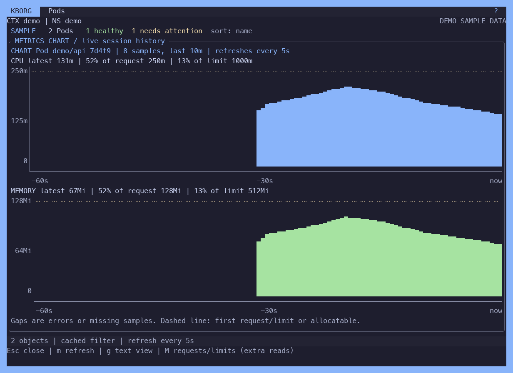

# Theme authoring

Built-in `flexoki-dark` pairs warm charcoal and cream with a teal focus color. Built-in `rose-pine` pairs deep violet and ivory with iris and foam accents. Both use quiet selected-row and status surfaces. Choose one with `kborg theme use flexoki-dark` or `kborg theme use rose-pine`; preview them in the interactive theme picker. Flexoki Dark is the default for new installations; existing saved selections are preserved.

These are unofficial adaptations of [Flexoki by Steph Ango](https://stephango.com/flexoki) and [Rosé Pine](https://rosepinetheme.com/palette/). Pinned palette snapshots and MIT notices are in `assets/upstream/flexoki/` and `assets/upstream/rose-pine/`, with hashes in `assets/upstream/manifest.json`. Flexoki's red-300 and Rosé Pine's subtle foreground replace their fainter source counterparts for readable functional text; the other mapped colors retain their source values.

Run `kborg theme new my-theme --base catppuccin-mocha` to get a template and its path. The file is installed in the user theme directory; editing it changes the next load. Validate before selecting. To install a shared file, use `theme validate FILE`, `theme preview FILE`, then `theme install FILE` and `theme use ID`.

```json
{"schema_version":1,"id":"my-theme","name":"My Theme","base":"catppuccin-mocha","colors":{"accent":"#2DD4BF","focus":"#2DD4BF"}}
```

Allowed roles: `background`, `text`, `muted`, `accent`, `success`, `warning`, `danger`, `focus`, `selection_background`, `selection_text`, `status_background`, `status_text`. Values are `#RRGGBB`. Missing roles inherit from an embedded fixed-palette base only. Change paired colors together if needed. `export` writes all resolved colors; built-in exports get a `-custom` ID.

Files are limited to 64 KiB. Unknown/duplicate fields, reserved IDs, invalid colors, control characters and low-contrast critical pairs are rejected. No includes, scripts, URLs or executable configuration. Invalid directory entries are skipped; explicit validation explains errors. Custom installation never replaces another file. Remove a custom theme with `theme remove ID`; remove/reset never changes cluster settings.

Config roots: Windows `%APPDATA%\KBorg`, macOS `~/Library/Application Support/KBorg`, Linux `$XDG_CONFIG_HOME/kborg` or `~/.config/kborg`. Themes are under `themes/`, preference under `appearance.json`. An absolute `KBORG_CONFIG_DIR` override supports test isolation.

RGB palettes enforce 4.5:1 for foreground text pairs and 3:1 for focus. Built-ins may replace low-contrast semantic colors with black/white; source base colors remain documented in code. Terminal mode uses host colors, whose contrast cannot be guaranteed. The renderer detects `TERM`/`COLORTERM` once per process and uses truecolor, the nearest fixed xterm 256-color entry, or basic ANSI colors. Quantization and customized host ANSI palettes can change contrast; `--color=never` is available when needed. Appearance preferences use synced sibling files and same-directory replacement without deleting the previous file first. Filesystem/OS crash durability and local ACL limitations are documented in STORAGE.md.

First interactive use opens the picker with Flexoki Dark selected. Enter chooses and Esc keeps that default. Missing/invalid selection falls back to Flexoki Dark. Appearance settings also store animation and onboarding state; startup off/on preserves theme selection.


Use theme clone-current ID to copy current resolved colors. Use theme replace FILE to replace a custom theme after validation while retaining an original .json.bak; a second replacement refuses until that backup is deliberately archived.

The UI uses thin rounded frames in UTF-8 locales, with ASCII frames otherwise. Resource data retains conservative single-cell ASCII rendering. A quiet table header, muted shortcut descriptions, compact form guidance and status-only semantic colors keep the selected object prominent. Saved PNG captures join box strokes across cell boundaries so their lines stay continuous. The visual direction follows the compact hierarchy of [k10s](https://github.com/mpiorowski/k10s) and the restrained palettes in [Omarchy themes](https://omarchy.org/themes/); navigation remains command driven without a persistent sidebar.

## ui.yaml

`ui.yaml` in the config root changes layout and style without code: borders, which chrome rows are shown, table style, dashboard cards and per-role colors on top of the active theme. `kborg ui init` writes a commented example (it never replaces an existing file) and `kborg ui validate` checks the installed file. In a running KBorg, `:ui reload` re-reads it; an invalid file keeps the current settings and explains why.

The file is data only: at most 16 KiB, one document, no anchors, aliases, merge keys or duplicate keys. Unknown keys and wrong value types are rejected. A missing, empty or comment-only file means the built-in look. At startup an invalid file shows a notice and falls back to the built-in layout with the saved theme.

| Key | Values (default first) | Effect |
| --- | --- | --- |
| `version` | `1` | Schema version; anything else is rejected. |
| `theme` | unset, or a theme id | Theme for each session. It overrides the picker's saved choice; `--theme` still overrides it. The picker still previews, but the next start uses this id again. |
| `splash` | unset, `true`, `false` | Startup animation. Unset keeps the `kborg startup on\|off` preference; `--no-splash` still turns it off. |
| `borders` | `auto`, `rounded`, `square`, `ascii`, `none` | Panel frames. `auto` uses rounded glyphs in UTF-8 locales and ASCII otherwise. `none` draws blank frames and keeps the layout. |
| `panel_title` | `marker`, `plain`, `bracketed` | ` > TITLE ` (the marker shows focus), ` TITLE `, or `[ TITLE ]`. Used by panels, the table and modal frames. |
| `header.show` | `true`, `false` | Top bar with the KBORG badge, view title and `?`. |
| `header.identity` | `true`, `false` | `CTX \| NS \| API` line. `false` folds it into the top bar. It can only be hidden while `header.show` is true: context, namespace and mode always stay visible. |
| `header.summary` | `true`, `false` | Freshness, counts, health and sort bar. |
| `header.compact` | `false`, `true` | Folds the identity line into the top bar and drops the spare row above the hints, so the table gets two more rows. |
| `hints.show` | `true`, `false` | The resource table's bottom key-hint row. The table grows into it when hidden; `?` still opens the full keymap. |
| `hints.key_role`, `hints.text_role` | `accent`, `muted` | Palette roles for the shortcut keys and their labels. |
| `table.density` | `normal`, `relaxed` | `relaxed` leaves a blank line between rows. |
| `table.selection_marker` | `">"` | One printable ASCII character, or `""` for none. |
| `table.mark_marker` | `"*"` | Marker for Space-marked rows; one character or `""`. |
| `table.zebra` | `false`, `true` | Alternate rows use the raised surface color. |
| `table.column_separator` | `" "` | Exactly one printable ASCII character, for example `"\|"`. |
| `table.age` | `short`, `long` | `14d` or `14d3h` (also `5h12m`, `3m4s`). `long` widens AGE by two cells when NAME has room. |
| `table.sort_ascending`, `table.sort_descending` | `"^"`, `"v"` | Sort markers on the sorted header; 1 or 2 printable ASCII characters. |
| `timestamps` | `utc`, `local` | Log timestamps shown with `t` in the log view. `local` uses `TZ` or `/etc/localtime` (UTC when neither can be read, and on Windows). Exports keep the API's UTC text. |
| `colors.ROLE` | `"#RRGGBB"` | Overrides a palette role on top of the active theme. Roles: `background`, `text`, `muted`, `accent`, `success`, `warning`, `danger`, `focus`, `selection_background`, `selection_text`, `status_background`, `status_text`. The result must pass the same contrast checks as custom themes. The theme picker previews every theme with the overrides; one they would make unreadable is shown without them. The `terminal` theme ignores them. |
| `dashboard.columns` | `0`, `1`..`3` | Card columns. `0` picks 1 to 3 from the terminal width. |
| `dashboard.min_card_width` | `0`..`200` | With `columns: 0`, the number of columns whose cards are at least this wide (1 to 3). `0` keeps the built-in breakpoints. |
| `dashboard.min_card_height` | `9`, `5`..`40` | Below this height per card the grid shows one focused card. |
| `dashboard.trend` | `true`, `false` | Sparkline trend line on expanded cards. |
| `dashboard.node_details` | `true`, `false` | Busiest-Node detail lines under NODES. |
| `charts.style` | `auto`, `braille`, `blocks`, `ascii` | `:metrics` chart mode (`g`) and dashboard charts (`G`). `auto` uses braille dots (2x4 per cell, a line) in UTF-8 locales and ASCII otherwise; `blocks` draws an area chart with eighth blocks; `ascii` uses `#` columns. |
| `charts.show_axes` | `true`, `false` | Value axis with units (millicores, Ki/Mi/Gi, %, counts) and a time axis. |
| `charts.cpu_role`, `charts.memory_role` | `accent`, `success` | Palette roles for CPU and memory series. Axes use `muted` and reference lines `warning`. |

Example:

```yaml
version: 1
theme: nord
borders: square
panel_title: bracketed
header:
  compact: true
hints:
  show: false
table:
  zebra: true
  column_separator: "|"
  age: long
colors:
  accent: "#88C0D0"
dashboard:
  columns: 2
  trend: false
charts:
  style: blocks
  show_axes: true
```

Chart glyphs (braille, eighth blocks, axis lines) are generated by KBorg itself and are the only non-ASCII characters besides the border glyphs that bypass the ASCII display policy; labels and any cluster text keep it.



Header, hint and table settings apply to the resource table view. The dashboard and modal views keep their own fixed layout, but they use the borders, title style and colors. PgUp/PgDown still page by the default table height.
